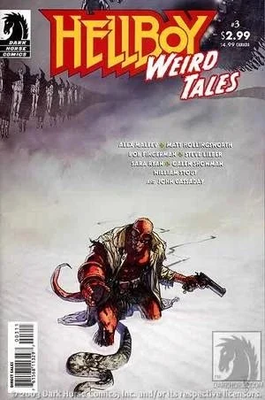
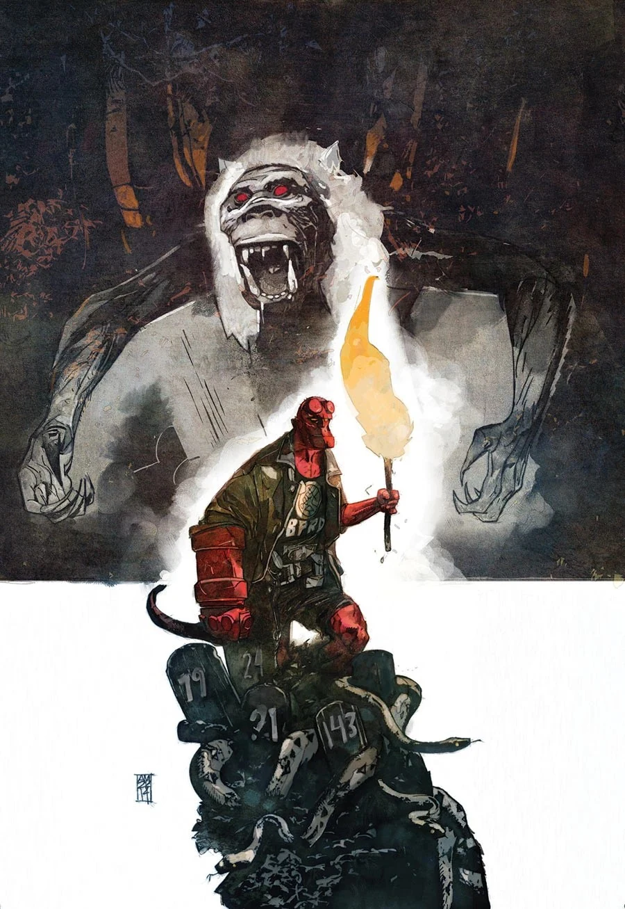
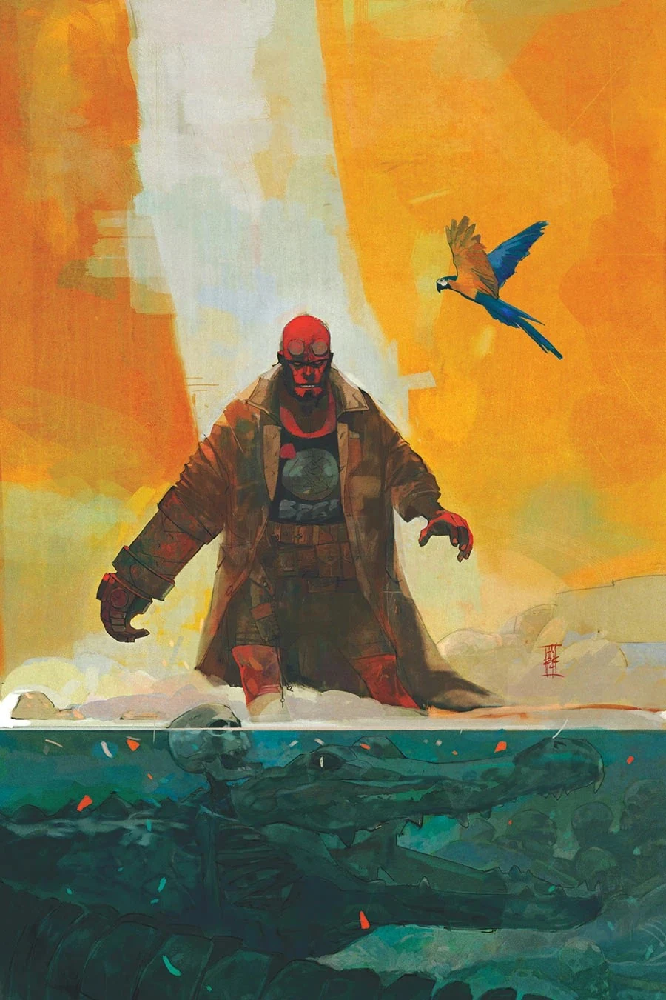
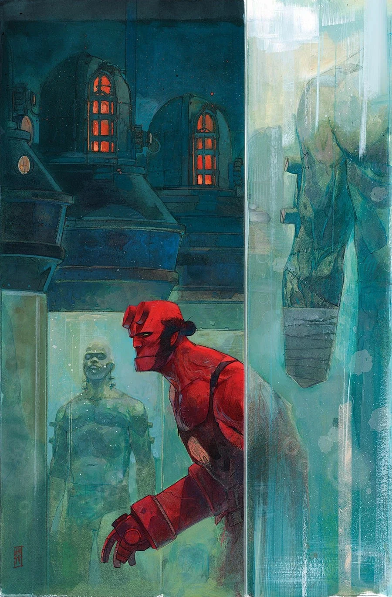
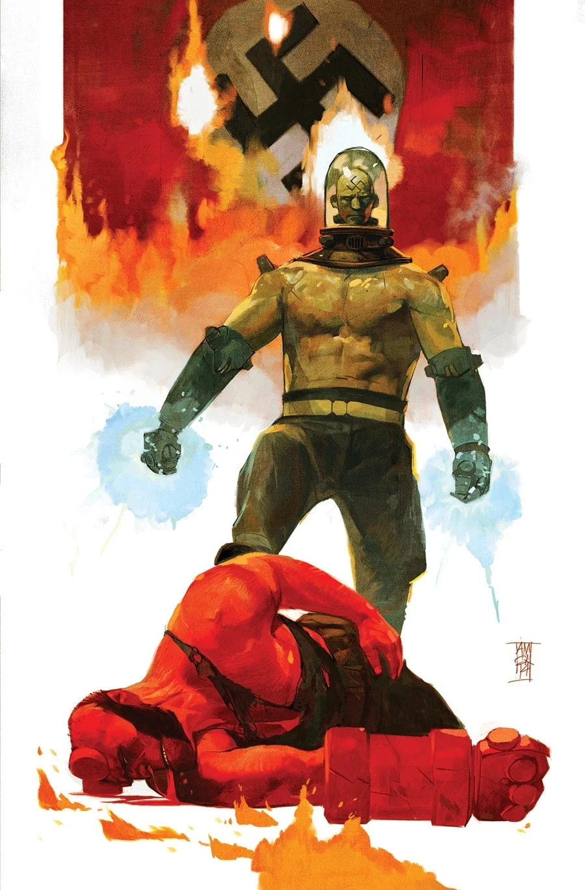

**Alex Maleev** 是一位漫画画师兼编剧。

## 地狱男爵作品年表

### 内页画师

- *[《夭折》（Still Born）](/entry/Still_Born)*（非正史）
- [《1952》](/entry/1952)

### 编剧

- *[《夭折》（Still Born）](/entry/Still_Born)*（非正史）

### 封面画师

## 画廊

|Hellboy Weird Tales #3

|1952 #2

|1952 #3

|1952 #4

|1952 #5
