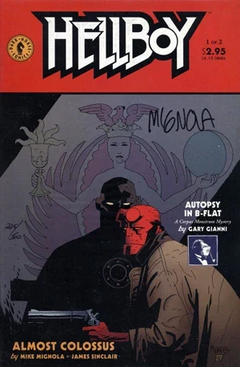
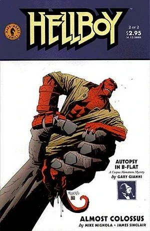

《**近乎巨人**》（Almost Colossus）的故事承接《[唤醒恶魔](/entry/Wake_the_Devil)》八天之后，聚焦于那个[何蒙库鲁兹](/entry/Homunculus)，它由[莉兹](/entry/Liz)赋予生命。

## 出版历史

《近乎巨人》最初作为两期限定迷你系列出版，时间为 1997 年 6 月至 7 月。这两期中刊载了由 Gary Gianni 创作、以 [MonsterMen](/entry/MonsterMen) 为主角的两部分备份故事"Autopsy in B-Flat"。该故事于 1998 年 8 月新增三页后重印于《[地狱男爵 第 3 卷 锁链棺及其他](/entry/Trade_Collections)》。

## 剧情简介

### 第一部

故事开场，[伊丽莎白·谢尔曼](/entry/Elizabeth_Sherman)躺在罗马尼亚的一家医院里。[西德尼·利奇](/entry/Sidney_Leach)向 Olasz 医生解释说，莉兹显然是把自己的能力注入了何蒙库鲁兹体内而失去了能力，并因此正慢慢死去。

与此同时，[地狱男爵](/entry/Hellboy_%28character%29)和[凯特·科里根](/entry/Kate_Corrigan)寻找失踪的何蒙库鲁兹，希望他能以某种方式帮助莉兹。他们发现一座公墓里有 67 具尸体被盗。当地人告诉他们，三天夜里有人把教堂里的十字架取走，扛进了山里。

故事切到山顶，何蒙库鲁兹正在那里祈祷自己的痛苦能够结束。与他会合的是他的"哥哥"——他们的[炼金术士"父亲"](/entry/Edel_Mischrasse)创造的第一个何蒙库鲁兹。年长的何蒙库鲁兹讲述了他们的来历，以及他如何杀死创造者并夺走了他的秘密。他说他一直在进行某项工程，如今已接近完成。

一个当地人说他在附近一座废弃的城堡里看到灯光，还闻到焚烧尸体的气味。地狱男爵和凯特前去调查。他们遇到一面巨大的灼热金属墙，脚下的地板塌陷。年长何蒙库鲁兹的仆从——一些小生物——抓住了凯特并攻击地狱男爵。

### 第二部

第二部开始时莉兹的状况恶化。年长的何蒙库鲁兹揭示了他的计划：用金属和人类的血肉为两个何蒙库鲁兹打造一具巨大的新身体。有了这具新身体，他们就能统治世界。他决定用凯特为巨人施洗命名。年轻的何蒙库鲁兹用从莉兹那里夺走的力量攻击他的哥哥，保护了凯特。就在这时地狱男爵赶到。年长的何蒙库鲁兹进入他的新身体，变成一个高耸的巨像。巨人攻击地狱男爵，毫不留情地痛打他。就在这时，年轻的何蒙库鲁兹请求能够加入巨人的身体，这样他们俩就能一同统治世界。进入巨人身体后，他释放了莉兹的力量，从内部烧毁了巨像。巨人和年长的何蒙库鲁兹被消灭，地狱男爵给剩下的何蒙库鲁兹取名[罗杰](/entry/Roger)，并带他回去把力量还给莉兹。莉兹完全恢复了健康，但罗杰又一次失去了生气。[汤姆·曼宁](/entry/Tom_Manning)决定把罗杰的身体带回 [B.P.R.D.](/entry/B.P.R.D.)。

## 故事年表

《近乎巨人》发生在 1997 年，即《[唤醒恶魔](/entry/Wake_the_Devil)》八天之后。该故事的后续是《[亚伯·赛皮恩大战科学](/entry/Abe_Sapien_versus_Science)》，后者发生在 1997 年至 2000 年之间的某个时候（很可能在 1999 年）。

## 内容

### 角色

#### [B.P.R.D.](/entry/Bureau_for_Paranormal_Research_and_Defense)

- [伊丽莎白·谢尔曼](/entry/Elizabeth_Sherman)
- [托马斯·曼宁](/entry/Thomas_Manning)
- [西德尼·利奇](/entry/Sidney_Leach)
- [巴德·沃勒](/entry/Bud_Waller)（闪回）
- [亚伯拉罕·赛皮恩](/entry/Abraham_Sapien)
- [地狱男爵](/entry/Hellboy_%28character%29)
- [凯瑟琳·科里根](/entry/%E5%87%AF%E7%89%B9%C2%B7%E8%80%83%E7%91%9E%E6%A0%B9))

#### 罗杰的"家人"

- [罗杰](/entry/Roger)（在本故事中得名）
- [罗杰的哥哥](/entry/Roger%27s_brother)
- [埃德尔·米施拉斯](/entry/Edel_Mischrasse)（闪回）
- 小何蒙库鲁兹们

#### 平民

- Olasz 医生
- 马扎尔南多尔村民
- 罗马尼亚修道士（不死者）

### 地点

- 罗马尼亚
  - 沃尔研究所（特尔戈维什泰）
  - 采格城堡（弗尔蒂切尼）
    - [埃德尔·米施拉斯的](/entry/Edel_Mischrasse)工坊
  - 马扎尔南多尔
    - 公墓
    - 卡珀蒂内尼修道院

### 值得注意的物品

- [埃德尔·米施拉斯的](/entry/Edel_Mischrasse)勋章

## 画廊

封面由 [Mike Mignola](/entry/Mike_Mignola) 绘制。

[pt-br:Almost Colossus](/entry/pt-br%3AAlmost_Colossus)
