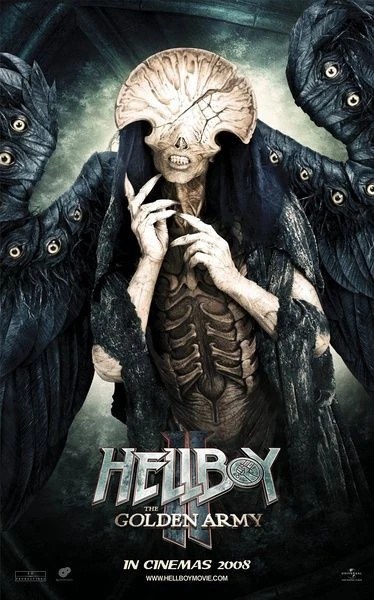

**死亡天使（Angel of Death）**是[地狱男爵](/entry/Hellboy_%28character%29)个人之死的人格化身，自称始终守候在这个半恶魔人生中每一个他可能丧命的十字路口。这位天使最显著的特征是：它的眼睛长在翅膀上，而不是长在骷髅般的脸上。

## 故事

亘古以来，死亡天使便居住在[贝丝莫拉](/entry/Bethmora)废墟中，等待着垂死的地狱男爵。这一天终于到来：当 [BPRD](/entry/BPRD) 搜寻[黄金军团](/entry/the_Golden_Army)时，[丽兹·舍曼](/entry/Liz_Sherman)也正设法取出地狱男爵胸中[弩阿达王子](/entry/Prince_Nuada)长矛的碎片。天使对地狱男爵的苦难无动于衷，只是在丽兹选择让地狱男爵活下去之后才救他一命——尽管它警告丽兹，当地狱男爵履行命中注定的使命时，承受最多痛苦的人将会是她。取出长矛碎片、交给哥布林铁匠后，天使便离去了。

## 体貌

待定

## 画廊

The_angel_of_death.jpg

|
## 趣闻

- 由[道格·琼斯](/entry/Doug_Jones)饰演。
- 由[韦恩·巴洛](/entry/Wayne_Barlowe)设计。
- 这个角色原本设定能够飞行，但戏服太重了。
