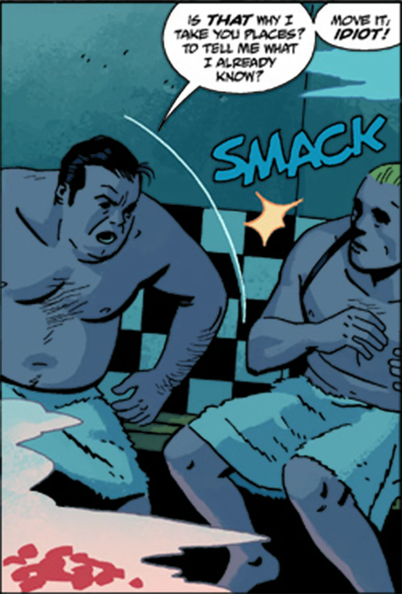

Arnie_wald.jpg

**阿诺德·"阿尼"·瓦尔德（Arnold "Arnie" Wald）**是 20 世纪 30 年代一位颇有势力的黑帮老大。他盘算着弄到一片目前住着廉租公寓住户的地皮——几年后市里要选址修建高速公路，这片土地及其上的住宅必将大幅升值。

## 历史

在打手[艾索格先生](/entry/Isog)的建议下，瓦尔德设下计谋：让手下的匪徒假扮成"印第安人"恐吓公寓区的住户。但计划出了岔子——[辛西雅·泰南](/entry/Cindy_Tynan)和警方很快就认出几名死去的"印第安人"其实是黑帮匪徒。

瓦尔德下令除掉泰南，但他那些头脑简单的打手被[大螯虾强生](/entry/Lobster_Johnson_%28character%29)截住。根据辛西雅提供的情报，大螯虾前往瓦尔德的桑拿疗养别墅，打算将他绳之以法。瓦尔德逃过一劫，但被吓得够呛，于是同意了艾索格的提议：雇佣[黑焰](/entry/The_Black_Flame_%28character%29)。

起初一切顺利：黑焰小试身手，把一个穷困潦倒的流浪汉烧成一具骷髅，随后又用无法扑灭的黑色火焰点着了几栋公寓楼。接下来与大螯虾一伙人的交锋中，瓦尔德弄到了有关大螯虾藏身处的情报。他决定亲自带队突袭，用步枪发射了数枚燃烧弹。负伤之后他仓皇逃走，却正好撞上黑焰之妻借机夺权的把戏。他活了下来，后来在没有麻醉的情况下接受一个无良医生的治疗以控制感染。养伤期间，他一觉醒来发现艾索格站在床边；起初他还满心不快，但艾索格带来的消息让他重新振作起来。

## 性格

阿尼·瓦尔德本质上是个恃强凌弱的恶霸，而且并非勇敢的那种。他说起话来口气很大、装出一副硬派模样，可一旦自身遇到危险，往往第一个溜之大吉。他对神秘学有一些实用层面的了解，但并不信任这一套，大多把此类事情交给艾索格处理。他还极其厌恶香烟味——每当艾索格当着他的面抽烟，他都会勃然大怒。

## 登场

- *[烈焰之掌](/entry/The_Burning_Hand)*
- *[搞定大螯虾！](/entry/%E6%90%9E%E6%8E%82%E9%B3%8C%E8%99%BE))*
- *[中城金属怪物](/entry/Metal_Monsters_of_Midtown)*
- *[海盗的鬼魂](/entry/The_Pirate%27s_Ghost)*
