## 速写本

### 漫展速写本

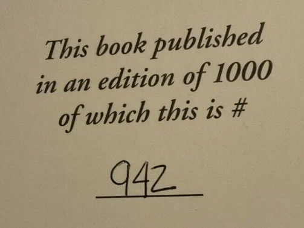

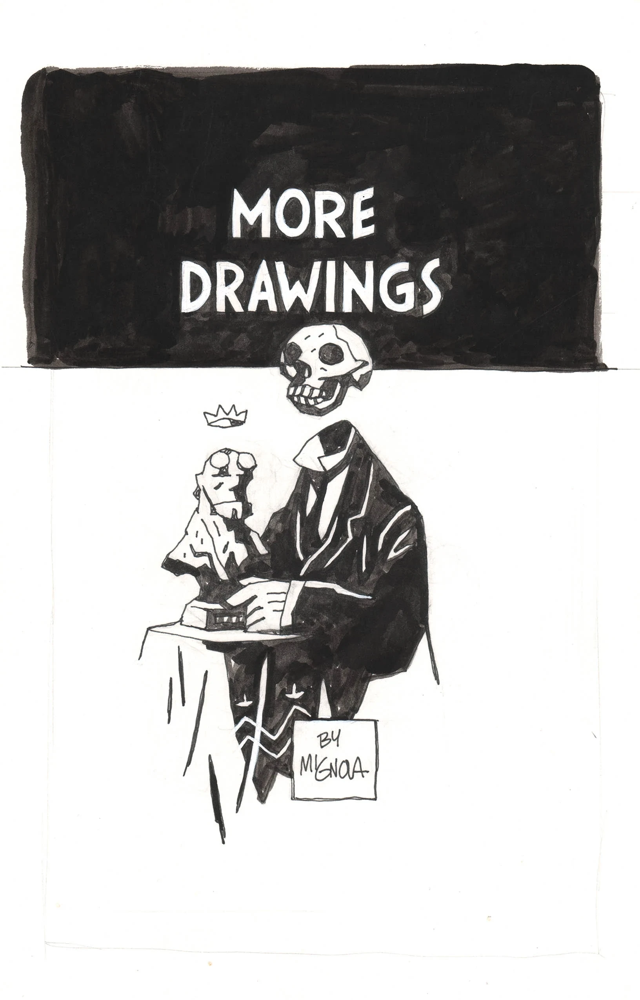

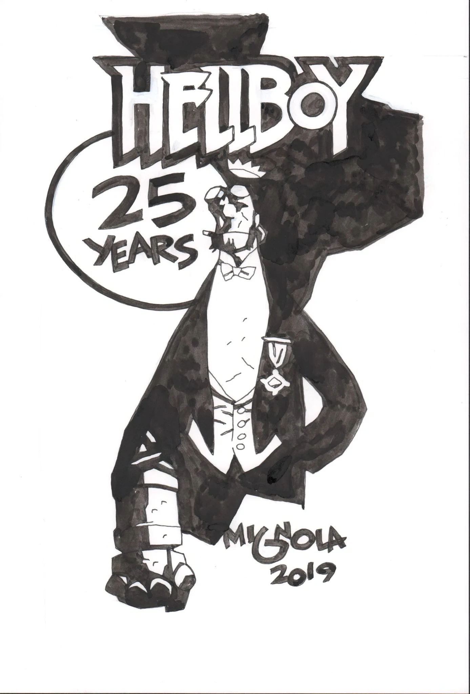

[迈克·米格诺拉](/entry/Mike_Mignola)曾自费出版过多本速写本，内容以地狱男爵宇宙的角色为主，封面也常常由[地狱男爵](/entry/Hellboy_(character))本人出镜。在他参加漫展的年份，米格诺拉经常自费限量出版一本速写本，随后在他的漫展摊位上出售。新速写本往往在大型漫展上首次亮相，并在之后的各届漫展上继续售卖，直至售罄。

书名
出版年份
首次登场漫展
数量
封面

&#10;
《地狱男爵漫展速写本》（Hellboy Convention Sketchbook）
2001
圣迭戈国际动漫展（San Diego Comic-Con）
1000
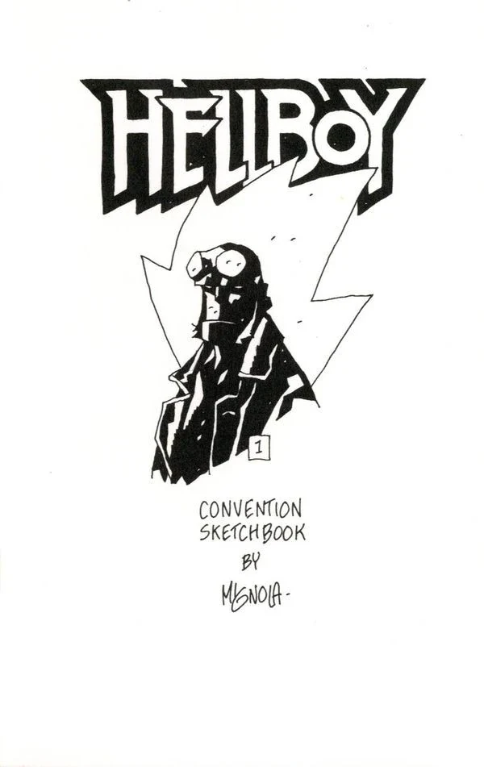

《地狱男爵十周年 1994-2004：一本画集》（Hellboy 10th Anniversary 1994-2004: A Book of Drawings）
2004
圣迭戈国际动漫展
2000
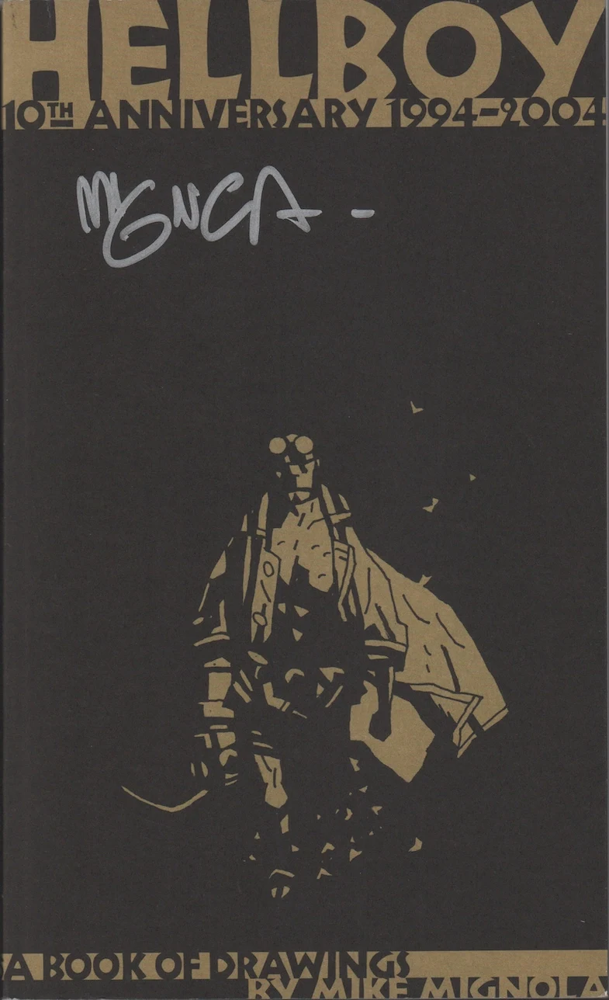
签名版

《一些素描》（Some Drawings）
2006
圣迭戈国际动漫展
750
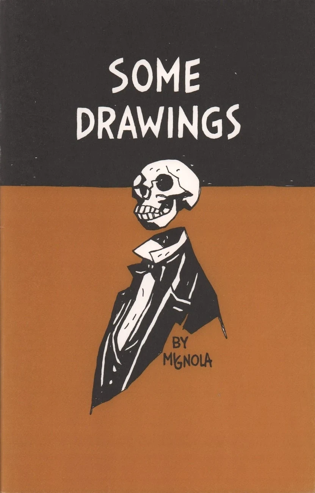

《来自档案库：封面、插图画作及其他零碎作品》（From the Vault: Covers, Pin-Ups & Other Odd Bits）
2007
圣迭戈国际动漫展
1500
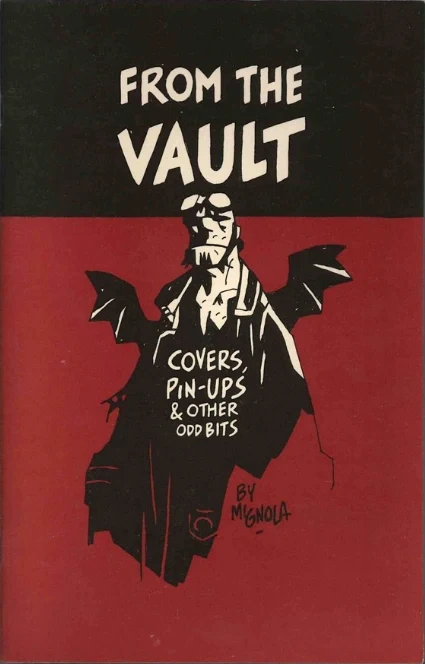

《更多素描》（More Drawings）
2008
圣迭戈国际动漫展
2000
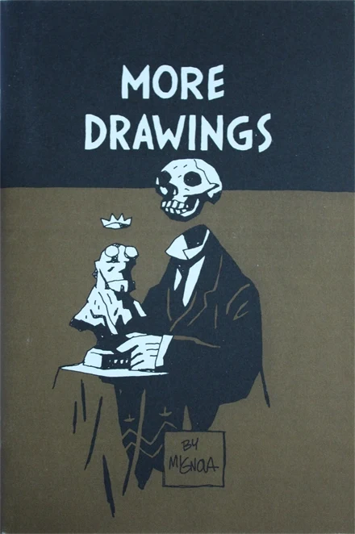

《来自档案库 2》（From the Vault 2）
2009
圣迭戈国际动漫展
1500
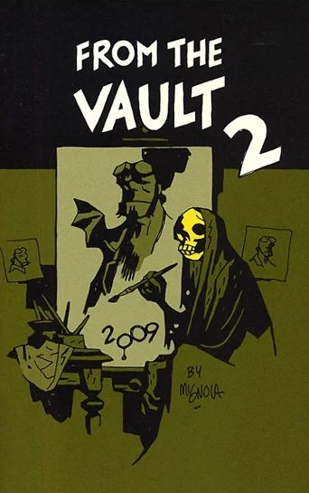

《来自档案库 3》（From the Vault 3）
2010
圣迭戈国际动漫展
1500
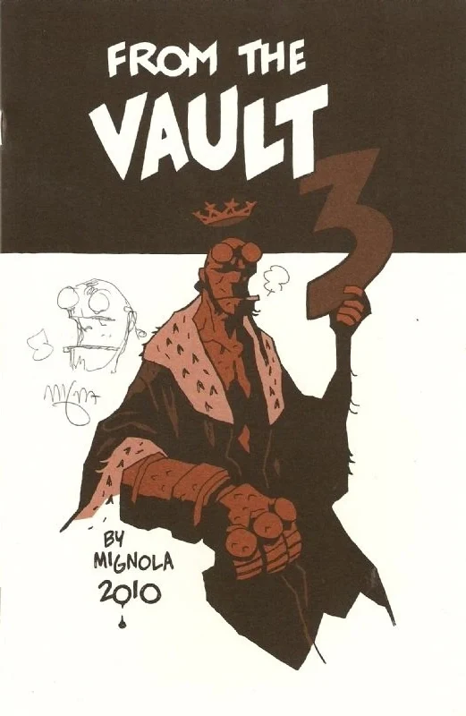

《来自档案库 4》（From the Vault 4）
2011

1200
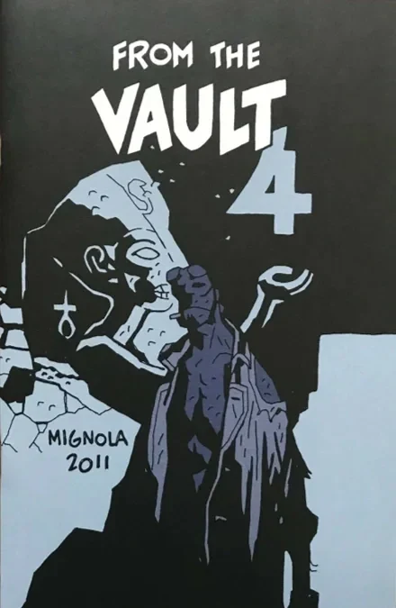

《来自档案库 5》（From the Vault 5）
2012

1000
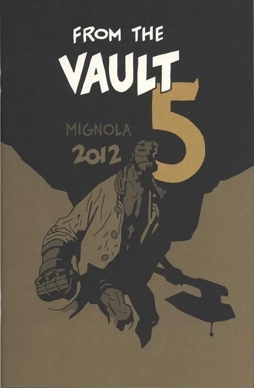

《怪兽之年》（A Year of Monsters）
2013
翡翠城动漫展（Emerald City Comic Con）
1000
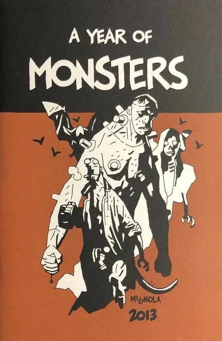

《来自档案库 6》（From the Vault Six）
2015
翡翠城动漫展
1000
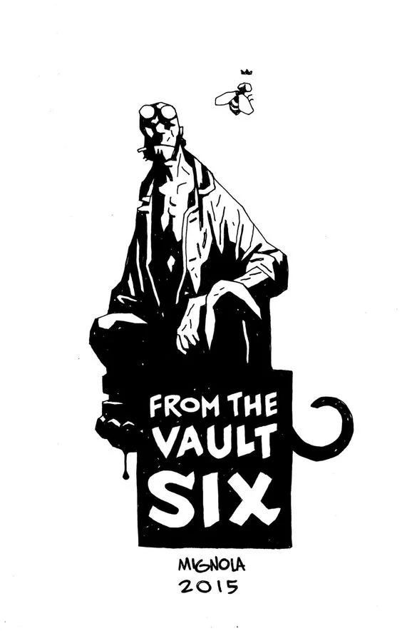

《地狱男爵 25 年》（Hellboy 25 Years）
2019
纽约漫画艺术博览会（NYC Comic Art Expo）
1000
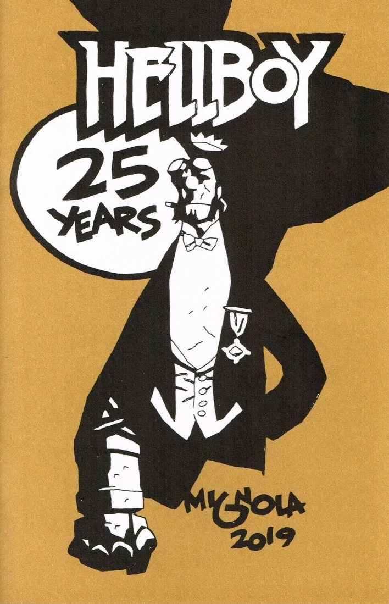

### *《隔离速写本》*

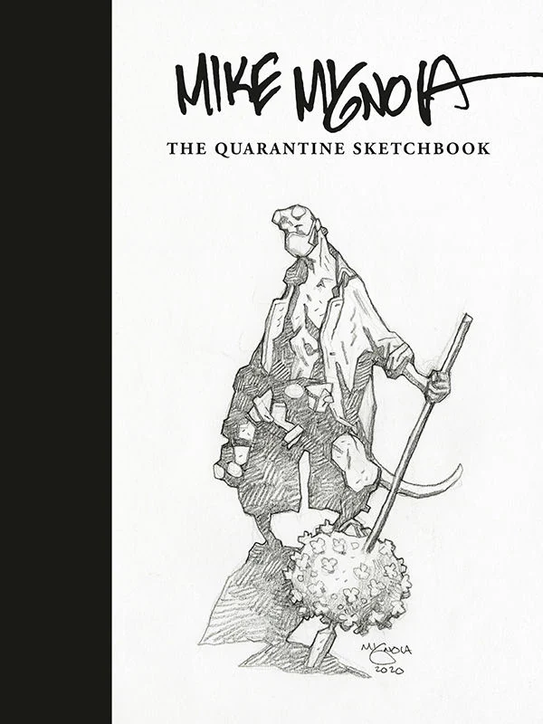

在新冠疫情期间，[迈克·米格诺拉](/entry/Mike_Mignola)创作了大量速写，他会把这些作品分享到社交媒体上，随后通过在线拍卖出售，为世界健康厨房（World Health Kitchen）慈善机构筹款。许多速写的主角不是[地狱男爵](/entry/Hellboy_(character))本人，就是他笔下宇宙中的其他角色。黑马漫画后来将其中许多速写结集为《隔离速写本》（The Quarantine Sketchbook），一本大型精装画册。与书中收录的速写一样，《隔离速写本》销售所得的全部利润都捐给了世界厨房（The World Kitchen）。

## 注释版艺术画集

这些书收录素描以及大多“未完成”的漫画内页和封面，并配有关于故事绘制过程的评注。

书名
出版日期
收录内容
封面

&#10;
《地狱男爵的艺术》（The Art of Hellboy）
2003 年 3 月 26 日（精装）
-
&#10;
2004 年 3 月 31 日（平装）

<li>斯科特·阿利撰写引言，并为全书作注</li>
<li>已完成与未完成的内页和封面</li>
<li>角色素描</li>
<li>此前未曾发表的画作</li>
<li>《嗨，我叫地狱男爵》（Hi, My Name's Hellboy）</li>
<li>《瓦尔科拉克（原版）》（The Vârcolac (Original Version)）</li>

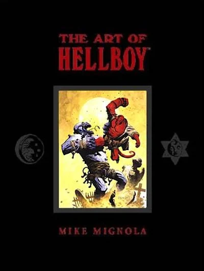.jpg)
MIKE MIGNOLA
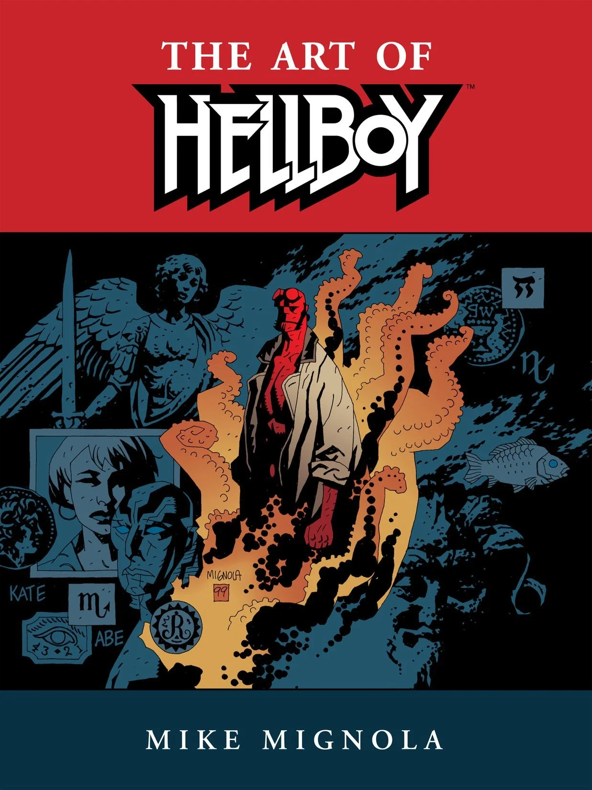
MIKE MIGNOLA

迈克·米格诺拉的
《地狱男爵艺术家版：
地狱男爵在地狱及其他故事》
（精装）
-

迈克·米格诺拉的
《地狱男爵匠人版：
地狱男爵在地狱及其他故事》
（平装）

2014 年 7 月 9 日（精装）
-
&#10;
2022 年 5 月 10 日（平装）

<li>《地狱男爵在地狱》第 #1–4 期（未嵌字版）</li>
<li>《地狱男爵在地狱：三根金鞭》（未嵌字版）</li>
<li>迈克·米格诺拉的《地狱男爵》</li>
<li>迈克·米格诺拉的《地狱男爵：世界上最伟大的超自然调查员》</li>
<li>《信仰》（Faith），节选自约翰·伯恩《Next Men》第 #21 期</li>
<li>《尸体》（The Corpse）</li>
<li>《食尸鬼，或关于死亡与蠕虫之诗的沉思》（The Ghoul, or, Reflections on Death and the Poetry of Worms）</li>
<li>《巨魔女巫》（The Troll-Witch）</li>

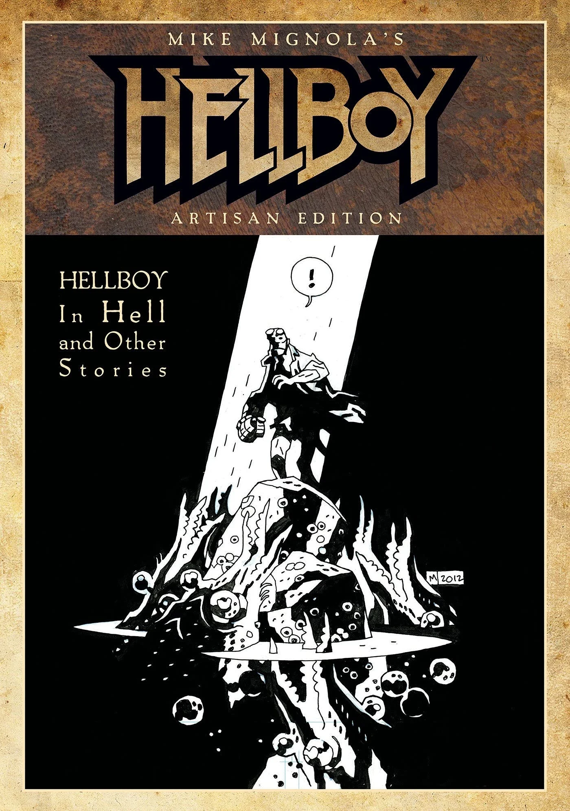
MIKE MIGNOLA
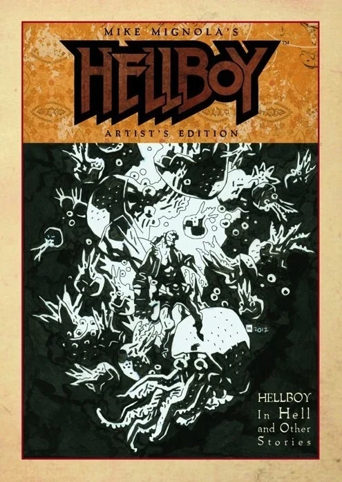
MIKE MIGNOLA

《地狱男爵：驶入寂静之海》
工作室版（Studio Edition）
2018 年 3 月

<li>《地狱男爵：驶入寂静之海》（Hellboy: Into the Silent Sea）</li>
<li>大量缩略草图、铅笔初稿与评注</li>
<li>关于怪兽人（The MonsterMen）的补充内容</li>

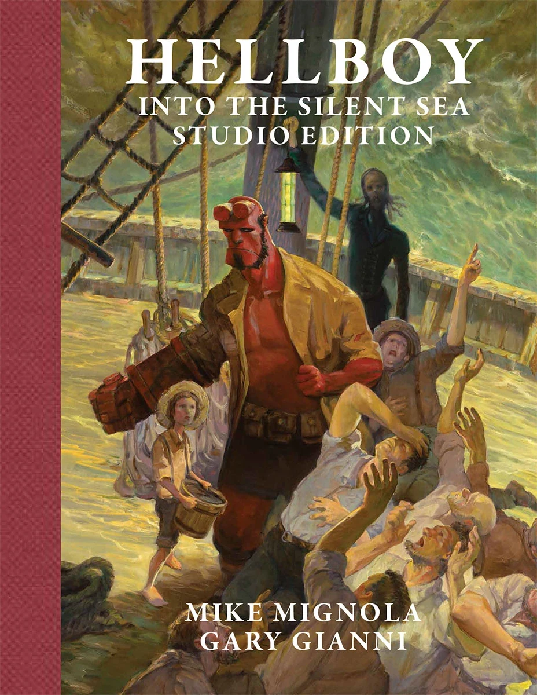
GARY GIANNI

迈克·米格诺拉的
《地狱男爵在地狱》
艺术家版——第二卷
（精装）
计划于
2026 年 3 月 25 日（精装）

<li>《地狱男爵在地狱：死亡纸牌》（The Death Card）</li>
<li>《地狱男爵在地狱：普鲁托的猎犬》（The Hounds of Pluto）</li>
<li>《地狱男爵在地狱：西班牙新娘》（The Spanish Bride）</li>
<li>《地狱男爵在地狱：丧钟为谁而鸣》（For Whom the Bell Tolls）</li>
<li>待定（TBA）</li>

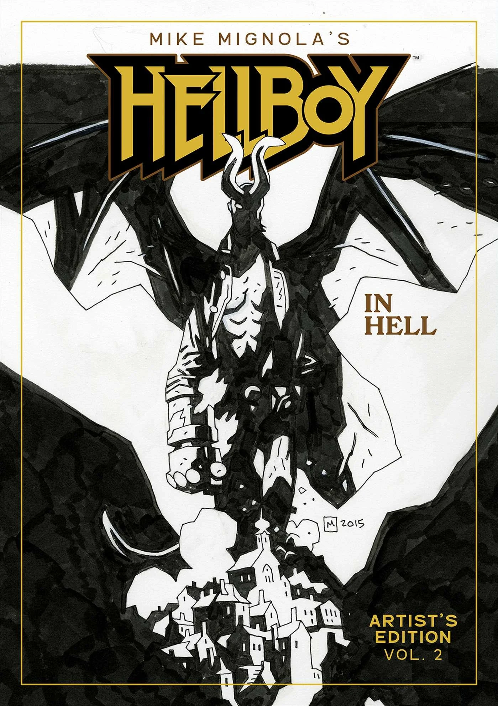
MIKE MIGNOLA

## 关键美术 / 封面合集

这些书精选[地狱男爵宇宙](/entry/The_Hellboy_Universe_Comics)各书（主要是地狱男爵漫画）的关键美术作品和封面。

书名
出版日期
封面

&#10;
《地狱男爵：最初 20 年》（Hellboy: The First 20 Years）
2014 年 3 月 19 日
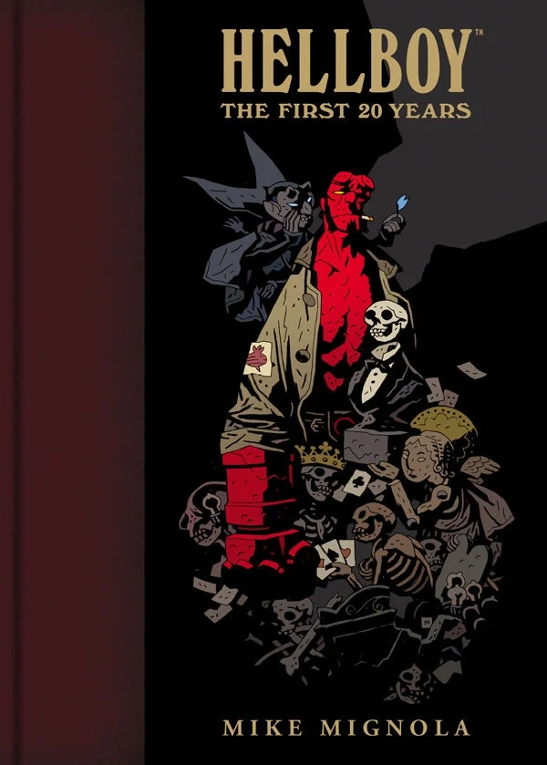
MIKE MIGNOLA

《地狱男爵 100 计划》（The Hellboy 100 Project）
2015 年 9 月 23 日
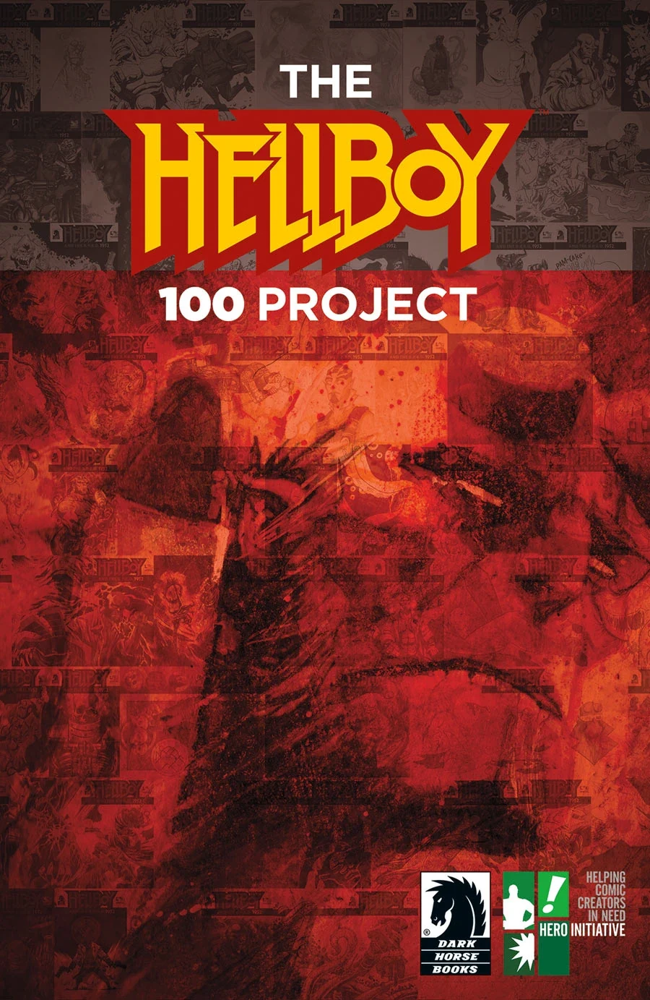
VARIOUS

《地狱男爵：25 年封面集》（Hellboy: 25 Years of Covers）
2019 年 7 月 3 日
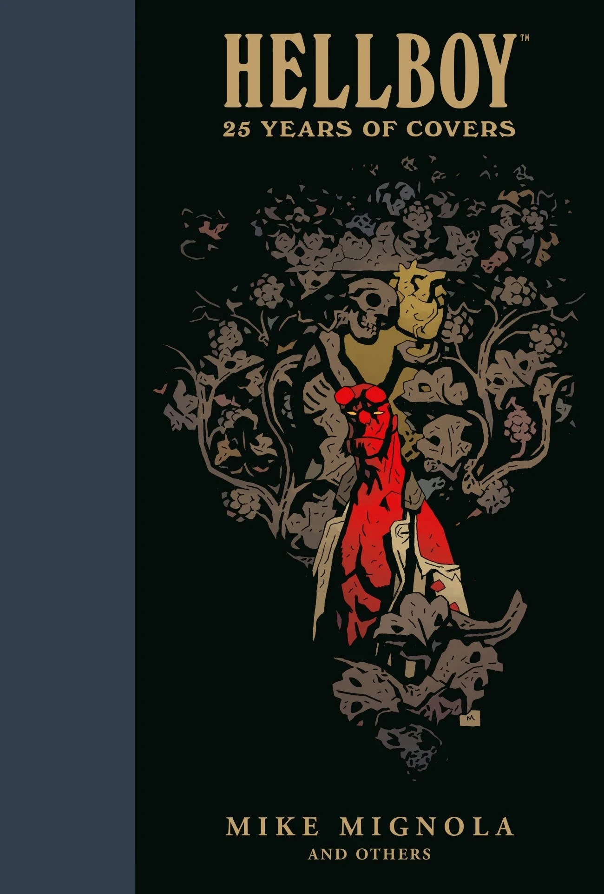
MIKE MIGNOLA

《地狱、墨水与水彩：迈克·米格诺拉的艺术》（Hell, Ink, and Water: The Art of Mike Mignola）
2024 年 10 月 15 日
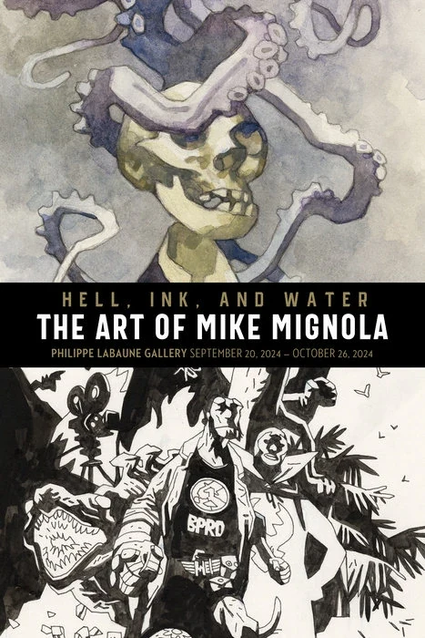
MIKE MIGNOLA

## 艺术家合集

这些合集收录同一位艺术家创作的所有[地狱男爵宇宙](/entry/The_Hellboy_Universe_Comics)作品，以超大开本精装形式出版（类似[图书馆典藏版](/entry/Hellboy_Library_Editions)）。

书名
出版日期
收录内容
封面

&#10;
《地狱男爵艺术家合集：理查德·科尔本》（Hellboy Artists Collection: Richard Corben）
2024 年 5 月 7 日

<li>《生而为人》（Being Human）</li>
<li>《地狱男爵在墨西哥》（Hellboy in Mexico）</li>
<li>《活死人之屋》（House of the Living Dead）</li>
<li>《地狱新娘》（The Bride of Hell）</li>
<li>《马科马》（Makoma）</li>
<li>《邪恶双片连映》（Double Feature of Evil）</li>
<li>《镜子》（The Mirror）</li>
<li>《歪男人》（The Crooked Man）</li>

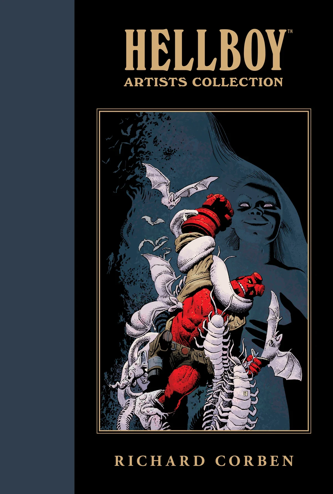
RICHARD CORBEN
