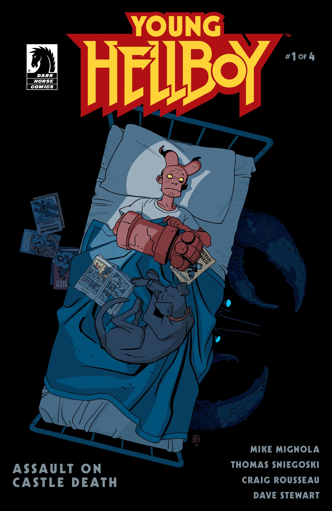
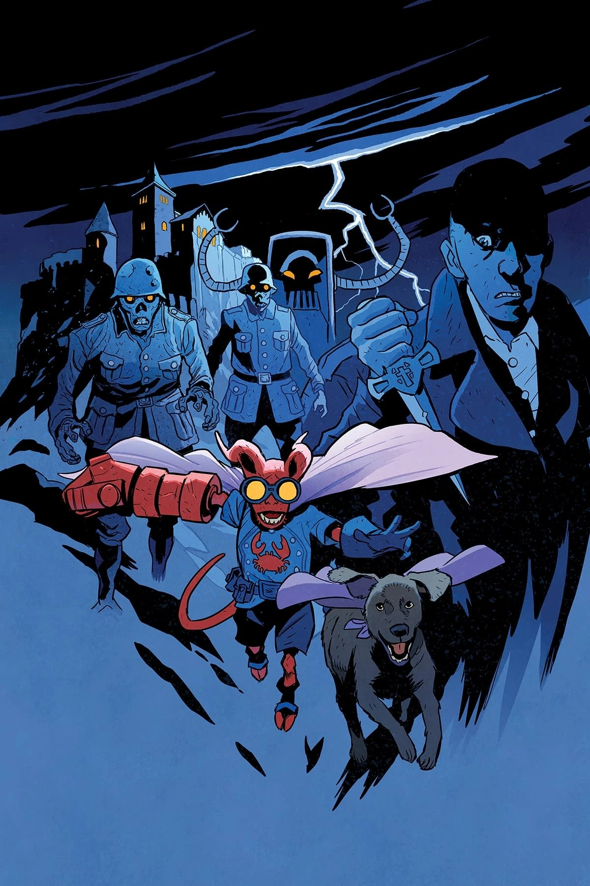
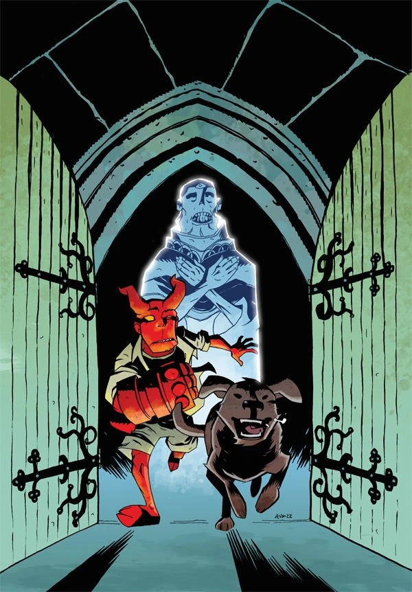
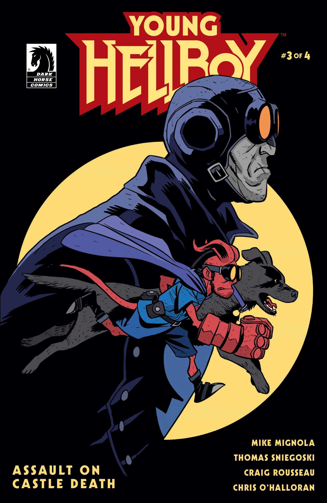
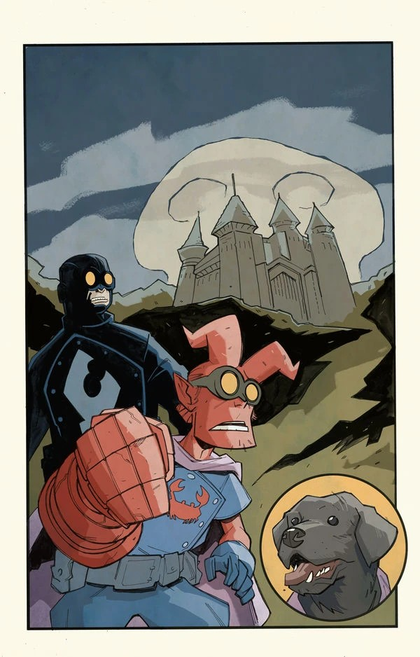
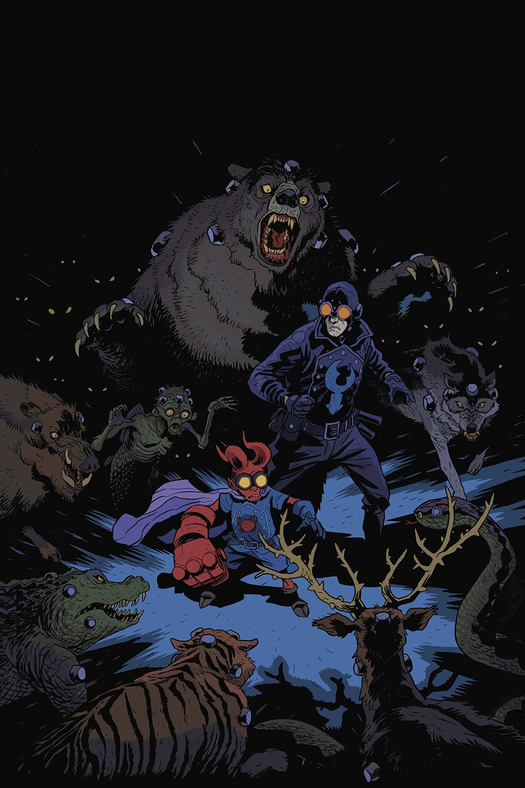
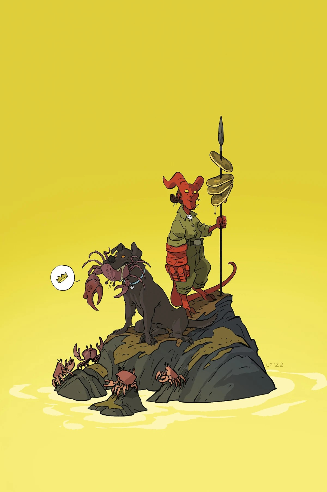

***《袭击死亡城堡》***是一部四期限定迷你系列，由 [Mike Mignola](/entry/Mike_Mignola) 与 Tom Sniegoski 编剧，[Craig Rousseau](/entry/Craig_Rousseau) 作画。它是 *[《少年地狱男爵》](/entry/Young_Hellboy)* 系列中的第二个故事。

## 剧情简介

### 第一部分

[地狱男爵](/entry/Hellboy_(character))与教授从一座秘密岛屿的冒险归来后，随超自然调查防御署一起从新墨西哥州搬到了康涅狄格州。这次搬迁让地狱男爵很不好受：他只是想家，还是岛上那些混乱的记忆攫住了这个超自然的毛头小子？与此同时，地狱男爵生还的消息也传到了一个不知名敌人的耳中，此人曾失手没能杀掉他，但这一次决心不再失败……

### 第二部分

正当地狱男爵在一种怪病的折磨中苦苦挣扎时，潜伏在超自然调查防御署内部的一名兄弟会特工把一名刺客带到了触手可及的距离之内！可即便发着高烧，年少的地狱男爵睡衣袖子里也还藏着一张王牌……或者说，那是一张令人眼熟的名片？

### 第三部分

发着高烧的地狱男爵——又名“猩红螃蟹”——在他的狗麦克和一张出人意料却令人眼熟的面孔陪伴下，闯入了阴森可怖的死亡城堡。但城堡里存放着古怪而危险的秘术物品，它们和地狱男爵的幻觉可凑不到一块儿去——尤其是当神秘兄弟会的刺客出手之时！

### 第四部分

地狱男爵（又名猩红螃蟹）、他的狗麦克，以及一位简直从低俗传奇里走出来的朋友，依旧困在高烧所致的幻觉中，发现自己置身于死亡城堡那间诡异的实验室里。趁地狱男爵迷失在幻想之中，兄弟会的刺客终于逼近了！

## 画廊

标准版封面由 [Matt Smith](/entry/Matt_Smith) 绘制。

第 \#1 期

第 \#1 期变体封面  
作者：[通奇·佐尼奇](/entry/Tonci_Zonjic)

第 \#2 期

第 \#2 期变体封面  
作者：[Michael Avon Oeming](/entry/Michael_Avon_Oeming)

第 \#3 期

第 \#3 期变体封面  
作者：[Craig Rousseau](/entry/Craig_Rousseau)

第 \#4 期

第 \#4 期变体封面  
作者：Lissa Treiman

|Issue #1 variant cover by Tonci Zonjic

|第 #2 期

|Issue #2 variant cover by Michael Avon Oeming

|第 #3 期

|Issue #3 variant cover by Craig Rousseau

|第 #4 期

|Issue #4 variant cover by Lissa Treiman
