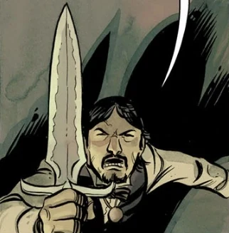

 **巫术匕首（Athame）**传统上是一种巫术仪式中使用的黑柄小刀。

## 背景

一件外形为刀、在神秘学中具有重要意义的武器。

## 历史

### *[《昂兰之谜》（The Mysteries of Unland）](/entry/The_Mysteries_of_Unland)*

[爱德华·格雷爵士](/entry/Edward_Grey)拥有一把巫术匕首，是他随身超自然器具的一部分。当时他正在哈勒姆调查一桩谋杀案。在 Glass Eel 旅馆的房间里，格雷遭到三条巨鳗袭击。他以为它们是某种恶魔或灵体，便挥舞巫术匕首、诵念祷文试图驱退它们。巨鳗却只是嘲笑他，说他的武器和祷文对它们毫无用处。眼见巫术匕首的神秘属性派不上用场，他便转而利用它作为刀的物理属性，把巨鳗逼退。

## 能力与用途

它在召唤与驱逐仪式中有多种用途，被视为力量的象征，在冥界中令人敬畏。
