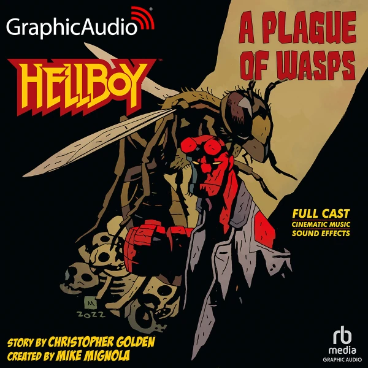
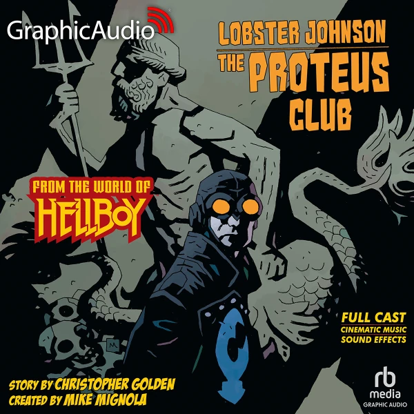
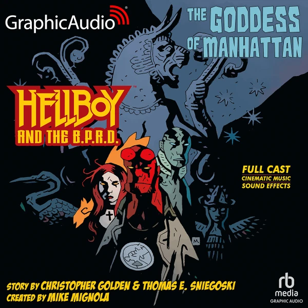

*本条目是一个小作品(stub)。你可以帮助扩充地狱男爵维基。*

广播剧是完全以声音讲述的故事，配有音乐、音效，以及为剧中各个角色献声的全套配音阵容。2023 年 6 月，官方宣布 Graphic Audio 公司将制作三部广播剧，收录由 [Christopher Golden](/entry/Christopher_Golden) 与 [Thomas E. Sniegoski](/entry/Thomas_E._Sniegoski) 创作的原创故事；三部作品均由 Scott McCormick 改编并执导，他还在剧中为[地狱男爵](/entry/Hellboy_(character))配音。其他主要演员包括：Jasmine Hyde 饰演[阿纳斯塔西娅·布兰斯菲尔德](/entry/Anastasia_Bransfield)(Anastasia Bransfield)，Marni Penning 饰演[辛西雅·泰南](/entry/Cynthia_Tynan)，James Konicek 饰演[龙虾](/entry/The_Lobster)，Torian Brackett 饰演[哈里·麦克泰尔](/entry/Harold_McTell)(Harry McTell)，Zeke Alton 饰演朱莉安·索恩(Juliane Thorne)，Eric Messner 饰演[亚伯·塞皮恩](/entry/Abraham_Sapien)，Amanda Forstrom 饰演[丽兹·舍曼](/entry/Elizabeth_Sherman)等。

## 广播剧列表

剧名
出版日期
作者
封面

&#10;
《地狱男爵：黄蜂之灾》
2023 年 7 月 11 日
Christopher Golden

MIKE MIGNOLA

《大螯虾强生：普罗透斯俱乐部》
2023 年 10 月 24 日
Christopher Golden

MIKE MIGNOLA

《地狱男爵与超自然调查防御署：曼哈顿女神》
2024 年 9 月 10 日
Christopher Golden 和 Thomas E. Sniegoski

MIKE MIGNOLA

## 正史性与时间线

三部作品都被视为正史（属于地狱男爵宇宙的一部分），且彼此相互关联，因为它们都涉及虚构的纳粹秘密组织普罗透斯俱乐部。

第一部发行的是[《地狱男爵：黄蜂之灾》](/entry/A_Plague_of_Wasps)，讲述地狱男爵与他当时的女友阿纳斯塔西娅·布兰斯菲尔德在巴西应对一场不寻常的黄蜂虫害。这个故事发生在 1980 年，紧接[《通往一切的钥匙》](/entry/The_Key_to_It_All)——出自[《恋爱中的地狱男爵》(Hellboy in Love)](/entry/Hellboy_in_Love)（同样由 Christopher Golden 执笔）——之后。

第二部[《大螯虾强生：普罗透斯俱乐部》](/entry/The_Proteus_Club)讲述龙虾和他的团队协助辛西雅·泰南与她的新朋友索菲·兰(Sophie Lang)，调查纽约多起人口失踪案的幕后黑手。与所有其他[大螯虾强生](/entry/Lobster_Johnson_(series))故事一样，这一部发生在 20 世纪 30 年代，具体是 1933 年 4 月，时间点与[《奈芙鲁的祈祷》](/entry/The_Prayer_of_Neferu)大致相同。

三部中的最后一部[《地狱男爵与超自然调查防御署：曼哈顿女神》](/entry/The_Goddess_of_Manhattan)是《大螯虾强生》广播剧的直接续作，故事同样发生在纽约，并有部分老角色回归。这一部发生在 1993 年，即龙虾及其团队阻止普罗透斯俱乐部的 60 年后，正值[特雷佛·布鲁姆](/entry/Trevor_Bruttenholm)随卡文迪什探险队失踪于北极期间，时间与[《亡者之鼓》](/entry/Drums_of_the_Dead)、[《马科马》](/entry/Makoma_(story))等故事相近。尽管名字相似，该广播剧与漫画系列[《地狱男爵与超自然调查防御署》](/entry/Hellboy_and_the_B.P.R.D.)基本没有关联。

1.  [↑](#cite_ref-1) 虽然宣传资料只写了"90 年代初"，但具体年份已由 Christopher Golden 通过社交媒体私信确认。
