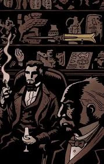

**奥古斯特·斯温（August Swain）** 是十九世纪末[太阳神拉的赫利奥波利斯兄弟会](/entry/Heliopic_Brotherhood_of_Ra)的重要成员，似乎负责该兄弟会在伦敦的行动。他曾多次与[爱德华·格雷](/entry/Edward_Grey)爵士会面，包括 1879 年对[极北之地](/entry/Hyperboreans)鬼魂事件的调查。在这起事件中，很可能是斯温下令处死了人称“船长”的一位绅士以及灵媒[玛丽·沃尔夫](/entry/Mary_Wolf)，二人均为格雷爵士的盟友。

1882 年，斯温在爱德华爵士调查弗里德霍夫（Friedhof）先生一案时主动提出协助。爱德华爵士起初拒绝了这一提议，但当他发现弗里德霍夫其实是一位名叫朱雷斯库（Giurescu）的强大吸血鬼后，为了击败朱雷斯库和他的吸血鬼大军，他不情愿地与斯温及兄弟会结成了同盟。

## 趣闻

- 斯温的形象设计参考了恐怖偶像克里斯托弗·李（Christopher Lee），尤其是他在《魔鬼出击》（The Devil Rides Out）中的造型。
