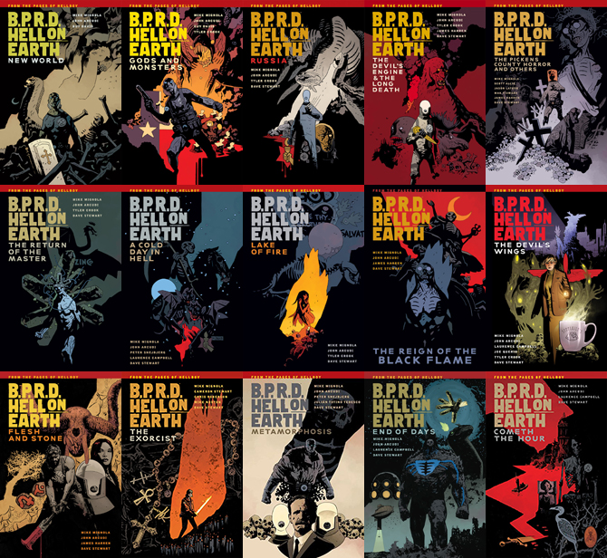
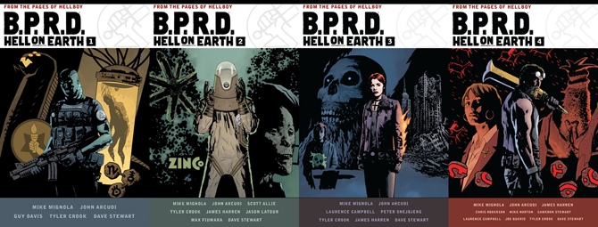

***人间地狱（Hell on Earth）*** 是连载中的《[B.P.R.D.](/entry/B.P.R.D._%28series%29)》故事的第二个周期。

[《蛙疫》周期](/entry/Plague_of_Frogs_%28story_cycle%29)以《[恐惧之王](/entry/King_of_Fear_%28story%29)》告终。此后所有与主线剧情相关的 B.P.R.D. 迷你系列除迷你系列/故事弧本身的标题外，还带有"人间地狱"（Hell on Earth）的标题。《人间地狱》以 B.P.R.D. 第 #147 期完结。

## 已出版的故事

- 《[新世界（New World）](/entry/New_World_%28B.P.R.D._story_arc%29)》#1–5（2010 年 8 月–12 月）
- 《[众神（Gods）](/entry/Gods)》#1–3（2011 年 1 月–3 月）
- 《[西雅图（Seattle）](/entry/Seattle)》（2011 年 3 月）
- 《[怪物（Monsters）](/entry/Monsters)》#1–2（2011 年 7 月–8 月）
- 《[俄罗斯（Russia）](/entry/Russia)》#1–5（2011 年 9 月–2012 年 1 月）
- 《[无名坟墓（An Unmarked Grave）](/entry/An_Unmarked_Grave)》（2012 年 2 月）
- 《[漫长的死亡（The Long Death）](/entry/The_Long_Death)》#1–3（2012 年 2 月–4 月）
- 《[皮肯斯县恐怖事件（The Pickens County Horror）](/entry/The_Pickens_County_Horror)》#1–2（2012 年 3 月–4 月）
- 《[恶魔的引擎（The Devil's Engine）](/entry/The_Devil%27s_Engine)》#1–3（2012 年 5 月–7 月）
- 《[J.H.奥唐奈的转变（The Transformation of J.H. O'Donnell）](/entry/The_Transformation_of_J.H._O%27Donnell)》（2012 年 5 月）
- 《[驱魔（Exorcism）](/entry/Exorcism)》#1–2（2012 年 6 月–7 月）
- 《[主人归来（The Return of the Master）](/entry/The_Return_of_the_Master)》#1–5（2012 年 8 月–12 月）
- 《[时间深渊（The Abyss of Time）](/entry/The_Abyss_of_Time)》#1–2（2013 年 1 月–2 月）
- 《[地狱中的寒日（A Cold Day in Hell）](/entry/A_Cold_Day_in_Hell)》#1–2（2013 年 3 月–4 月）
- 《[废土（Wasteland）](/entry/Wasteland)》#1–3（2013 年 5 月–7 月）
- 《[火湖（Lake of Fire）](/entry/Lake_of_Fire)》#1–5（2013 年 8 月–12 月）
- 《[黑焰统治（The Reign of the Black Flame）](/entry/The_Reign_of_the_Black_Flame)》#1–5（2014 年 1 月–5 月）
- 《[恶魔之翼（The Devil's Wings）](/entry/The_Devil%27s_Wings)》#1–2（2014 年 6 月–7 月）
- 《[破碎的方程式（The Broken Equation）](/entry/The_Broken_Equation)》#1–2（2014 年 8 月–9 月）
- 《[碾压（Grind）](/entry/Grind)》（2014 年 10 月）
- 《[血肉与石头（Flesh and Stone）](/entry/Flesh_and_Stone)》#1–5（2014 年 11 月–2015 年 3 月）
- 《[无处、虚无、永不（Nowhere, Nothing, Never）](/entry/Nowhere%2C_Nothing%2C_Never)》#1–3（2015 年 4 月–6 月）
- 《[现代普罗米修斯（Modern Prometheus）](/entry/Modern_Prometheus)》#1–2（2015 年 7 月–8 月）
- 《[末日（End of Days）](/entry/End_of_Days)》#1–5（2015 年 9 月–2016 年 1 月）
- 《[驱魔人（The Exorcist）](/entry/The_Exorcist)》#1–3（2016 年 4 月–6 月）
- 《[时辰将至（Cometh the Hour）](/entry/Cometh_the_Hour)》#1–5（2016 年 7 月–11 月）

## 画师

[盖伊·戴维斯](/entry/Guy_Davis)一直担任《[B.P.R.D.](/entry/B.P.R.D._%28series%29)》的长期主笔画师（始于迷你系列《[蛙疫](/entry/Plague_of_Frogs_%28story%29)》），然而在迷你系列《[众神](/entry/Gods)》完结时，他宣布将离开去从事其他项目。

与此同时，[泰勒·克鲁克](/entry/Tyler_Crook)被宣布为新任长期主笔画师，不过其职责方式与戴维斯此前的并不完全相同。戴维斯担任主笔画师期间，他独自负责连载故事，而克鲁克则一直与其他半固定画师分担这些工作。此后，[詹姆斯·哈伦](/entry/James_Harren)和[劳伦斯·坎贝尔](/entry/Laurence_Campbell)加入，与克鲁克一起成为《B.P.R.D.: Hell on Earth》团队的长期主笔画师。

从《[恶魔之翼](/entry/The_Devil%27s_Wings)》开始，劳伦斯·坎贝尔被定为《B.P.R.D.: Hell on Earth》的长期主笔画师，并将一直担任到完结。泰勒·克鲁克和詹姆斯·哈伦则分别转去创作各自的原创系列《Harrow County》和《Rumble》。

参与过该系列的其他画师包括[杰森·拉图尔（Jason Latour）](/entry/Jason_Latour)（《[皮肯斯县恐怖事件](/entry/The_Pickens_County_Horror)》）、[马克斯·菲乌马拉（Max Fiumara）](/entry/Max_Fiumara)（《[J.H.奥唐奈的转变](/entry/The_Transformation_of_J.H._O%27Donnell)》）、[彼得·斯奈比约恩（Peter Snejbjerg）](/entry/Peter_Snejbjerg)（《[地狱中的寒日](/entry/A_Cold_Day_in_Hell)》和《[无处、虚无、永不](/entry/Nowhere%2C_Nothing%2C_Never)》）、[乔·奎里奥（Joe Querio）](/entry/Joe_Querio)（《[破碎的方程式](/entry/The_Broken_Equation)》）以及[胡利安·托蒂诺·特德斯科（Julián Totino Tedesco）](/entry/Juli%C3%A1n_Totino_Tedesco)（《[现代普罗米修斯](/entry/Modern_Prometheus)》）。

[卡梅伦·斯图尔特（Cameron Stewart）](/entry/Cameron_Stewart)是[阿什利·斯特罗德（Ashley Strode）](/entry/Ashley_Strode)相关故事——2012 年的《[驱魔](/entry/Exorcism)》和 2016 年的《[驱魔人](/entry/The_Exorcist)》——的编剧。

## 支线故事与向连载系列的转变

2012 年，《B.P.R.D.: Hell on Earth》尝试在一个月内发行多本刊物，其中总有一期聚焦主线剧情，偶尔增加的一期则聚焦支线故事。这些故事并非由约翰·阿库迪撰写，并有多位画师参与创作。[斯科特·艾利](/entry/Scott_Allie)曾表示，这些故事不是独立故事，它们将以重大方式影响《人间地狱》的整体剧情，但它们的作用不会那么立竿见影。

从 2012 年万圣节起，《B.P.R.D.: Hell on Earth》转变为连载系列，[《主人归来》#3](/entry/The_Return_of_the_Master)成为第 #100 期。这一变化意味着该系列将按固定的月度计划发行，不再像 2012 年上半年那样在同一个月推出支线故事。

## 合订本

《人间地狱》被收录在其独立的平装合订本产品线中，以区别于前一个周期和回忆故事。《人间地狱》共计 15 本平装合订本。

十五本《B.P.R.D.: Hell on Earth》平装合订本。

《人间地狱》周期从 2017 年 12 月开始推出[合集版](/entry/Omnibus_Editions)。这些合集版收录了扩充的素描本内容。

《B.P.R.D.: Hell on Earth》合集版的五卷。
