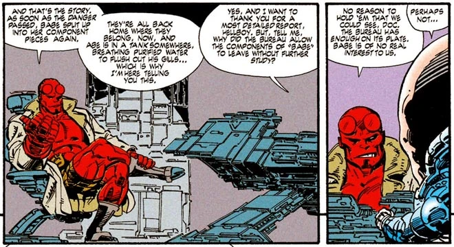

> 
>
> 这是 Byrne 最巅峰的状态：奇妙、有趣、火力全开！《地狱男爵》中的亚伯·塞皮恩特别客串，最后一页保证让各地粉丝既意外、又欣喜、还摸不着头脑！
>
> 
>
> —[Dark Horse Comics](/entry/Dark_Horse_Comics)，期刊宣传语

  
***《Babe 2》*** 是一部两期漫画限定连载，由 [John Byrne](/entry/John_Byrne)编剧并作画。它是《Babe》限定连载的续集，而后者又是 Byrne 所著《Danger Unlimited》系列的衍生作品。《Babe 2》由 [Dark Horse Comics](/entry/Dark_Horse_Comics)于 1995 年在旗下"Legend"出版品牌下出版；该系列还与同属 Legend 品牌的《Monkeyman and O'Brien》以及 *[《地狱男爵》](/entry/Hellboy_(series))* 联动，后者中的[亚伯·塞皮恩](/entry/Abraham_Sapien)在其中大量登场。

## 角色

- [亚伯·塞皮恩](/entry/Abraham_Sapien)
- [地狱男爵](/entry/Hellboy_(character))

## 剧情简介

鼩鼱怪（Shrewmanoid）率领一支巨型机械鳄鱼军团袭击纽约。亚伯·塞皮恩协助 Babe 击退它们；他的身份直到第二期才揭晓，但两期中都有出场。

故事结尾，地狱男爵向 Danger Unlimited 小队讲述事情的经过，身体不适的亚伯则在一旁休养。

## 趣闻

- 这个故事是 Dark Horse Comics 旗下 [Legend](/entry/Dark_Horse_Comics) 创作者之间的若干联动作品之一。John Byrne、Art Adams 和[迈克·米格诺拉](/entry/Mike_Mignola)最初曾计划让各自的漫画发生在同一个共享宇宙中。尽管这些计划很快被放弃，他们早期的几期漫画中仍出现了彼此重叠的角色和情节。
  - 鼩鼱怪出自 Adams 的《Monkeyman and O'Brien》，在本故事中回归；那部作品的两位主角在一格闪回画面中登场。
  - 亚伯·塞皮恩和地狱男爵则出自米格诺拉的 *[《地狱男爵》](/entry/Hellboy_(series))* 系列，在本故事中登场。
- 亚伯自我介绍时称自己隶属于超自然*调查*与防御局（B.P.I.D.），而非[超自然*研究*与防御署](/entry/Bureau_for_Paranormal_Research_and_Defense)（B.P.R.D.）。
  - 尽管亚伯遇到的人都不认识他，他们却听说过地狱男爵——对此他不无调侃地说："几乎人人都听说过"。

## 外部链接

- 《Babe 2》，Dark Horse Database 词条
- 《Babe 2》第 1 期，Dark Horse Comics
- 《Babe 2》第 2 期，Dark Horse Comics
