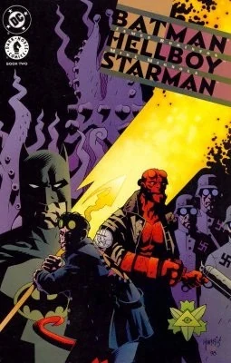

***《蝙蝠侠／地狱男爵／星侠》（Batman/Hellboy/Starman）***是由 James Robinson 编剧、Mike Mignola 作画、DC 漫画出版的一部非正史两期限定迷你系列。故事呈现了地狱男爵（黑马漫画旗下角色）与蝙蝠侠、星侠（后二者均为 DC 漫画旗下角色）之间的跨界联动。

## 角色

### 主要角色

- 蝙蝠侠（布鲁斯·韦恩）
- [地狱男爵](/entry/Hellboy_(character))
- 星侠（泰德·奈特）

### 配角

- 詹姆斯·戈登

### 反派

- 小丑
- [十月骑士团](/entry/Knights_of_October)（Knights of October）
  - 新纳粹分子与士兵
  - 奥托·丹茨（Otto Dantz）

### 其他角色

- 星侠（杰克·奈特）

## 地点

- 地球-7642
  - 地球
    - 哥谭市
      - 哥谭市警察总部

## 剧情简介

### 第一部分

黄金时代星侠泰德·奈特在就替代能源举行讲座时，被新纳粹光头党绑架，蝙蝠侠与 [地狱男爵](/entry/Hellboy_(character)) 联手前去营救。二人最终追查到绑匪——一个自称“十月骑士团”的组织——藏身于一座废弃机场。两人展开营救行动。在随之而来的战斗中，十月骑士团首领丹茨挟持着仍为囚徒的奈特，乘一架小型飞机逃脱。地狱男爵发誓要追上去，但蝙蝠侠因小丑逃脱而被召去处理，于是泰德之子、新任星侠杰克·奈特接替他加入地狱男爵的行列。

### 第二部分

蝙蝠侠与二人道别，地狱男爵和星侠登上布鲁斯·韦恩的私人飞机前往亚马逊雨林；他们刚在目标上空跳伞，便遭到炮火袭击。突破防线后，他们得知丹茨正利用奈特的科学知识，令恶魔苏戈尔·约格罗斯（Suggor Yogeroth）复生。地狱男爵念出一道古老的利莫里亚咒语以驱散恶魔，二人得以将其击退，并救出了被俘的奈特。

## 封面画廊

第 \#1 期

第 \#2 期

|第 #2 期
## 外部链接

- DC 数据库（DC Database）中的条目
