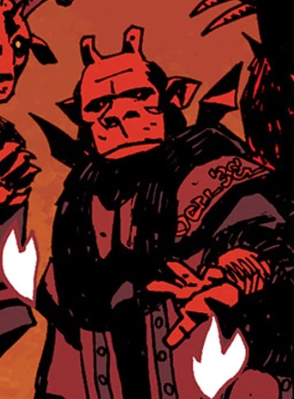

**比雷特**（Beleth）是一名[恶魔](/entry/Demon)，属于一个邪恶三位一体（另外两位是[约姆亚尔](/entry/Yomyael)（Yomyael）和[西迪](/entry/Sytry)（Sytry））。

## 历史

比雷特、[约姆亚尔](/entry/Yomyael)和[西迪](/entry/Sytry)是三位恶魔组成的三位一体，“自从人类开始信仰群星背后的黑暗以来”，他们便在战争中帮助亚细亚人。后来某个时期，他们还与一个名为玛斯特玛（Mastema）的存在交战，后者很可能是一位天使。

彼得大帝召唤了比雷特和另外两位恶魔，希望他们能在大北方战争中帮助自己对抗瑞典人；而他们索取的回报是他未来的儿子们、他的心脏以及他的灵魂。

撒旦堕落后，他被下级恶魔所杀，一同被杀的还有[阿斯塔罗斯](/entry/Astaroth)、奥罗巴斯（Orabas）、萨瑞尔（Suriel）、[沙克斯](/entry/Shax)、乌西尔（Usiel）、劳姆（Raum）、赛姆亚扎（Semyaza）、[摩洛](/entry/Moloch)、彼列、大衮和[别西卜](/entry/Beelzebub)。

## 传说

比雷特是《歌德提亚》（Ars Goetia）中的一位精灵，被描述为“强大而可畏的地狱君王”，统率八十五个恶魔军团。

## 登场

- (/entry/1946)
