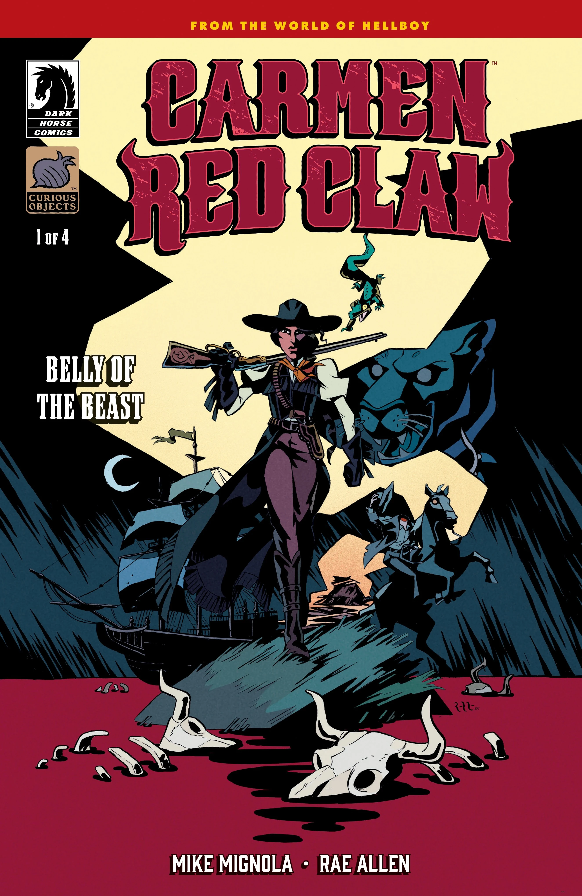
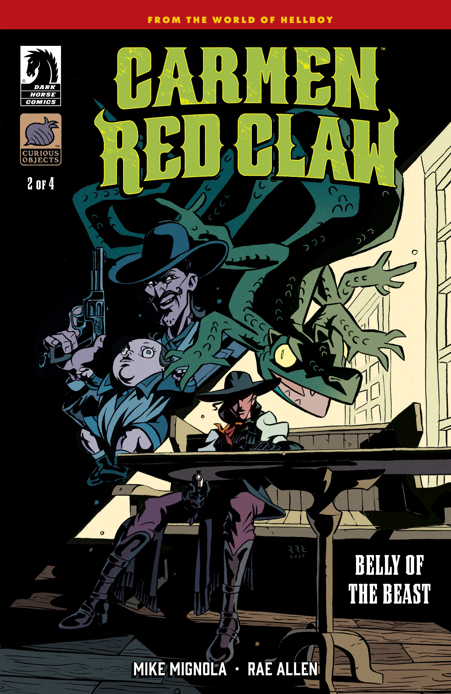
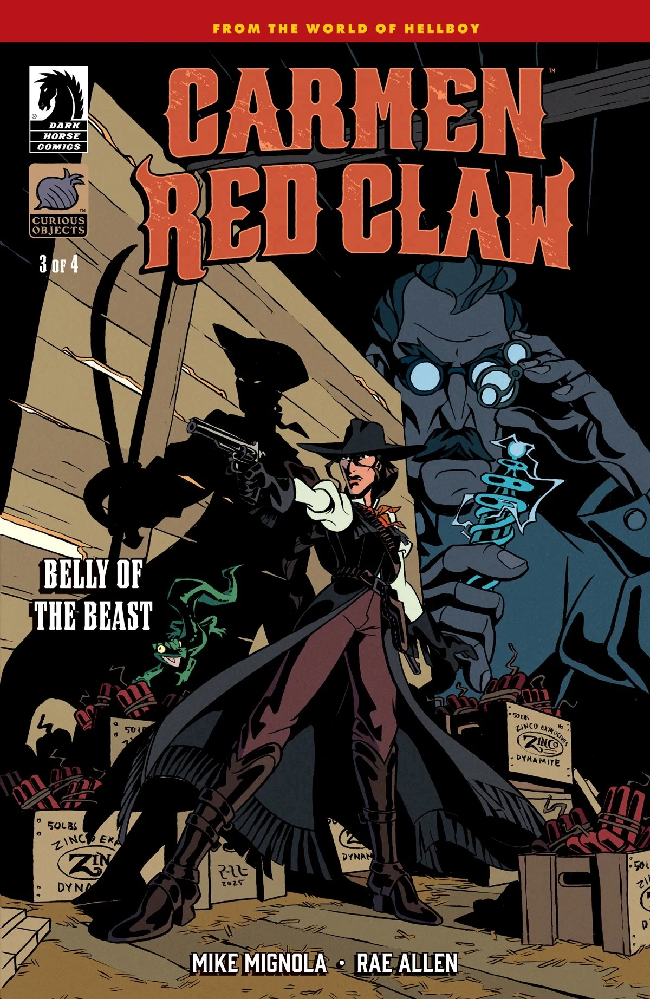
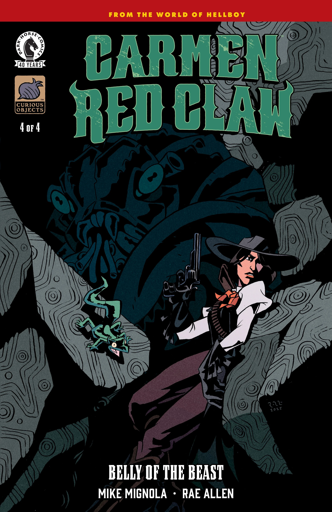
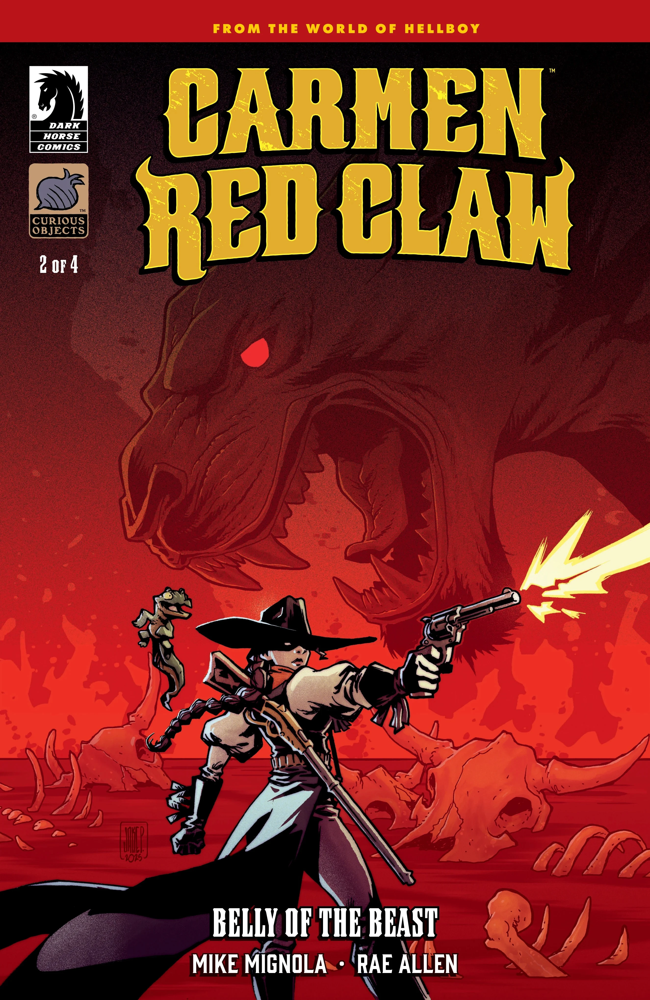
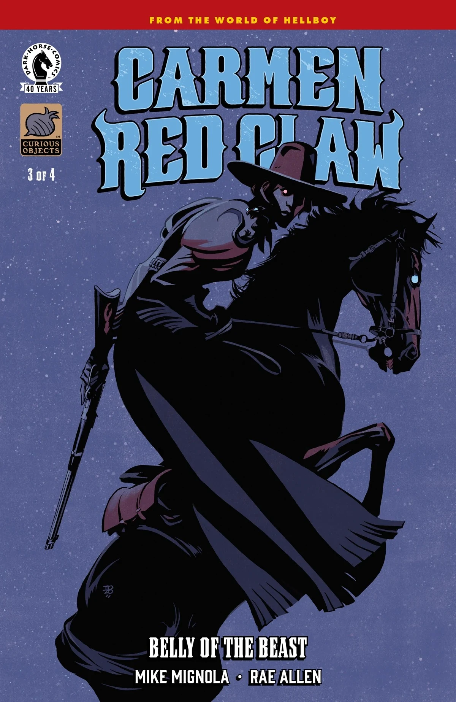
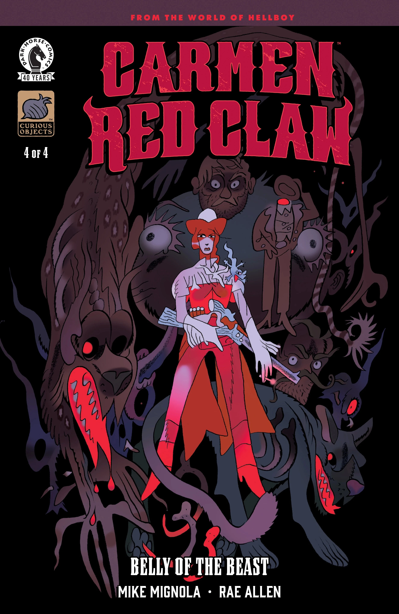

*本条目为小作品。你可以帮助扩充地狱男爵 Wiki。*

***《兽腹之中》（Belly of the Beast）***是《卡门·红爪》（Carmen Red Claw）的第一个故事弧，由迈克·米格诺拉与 Rae Allen 编剧，Allen 作画——这也是她在地狱男爵宇宙中的首次亮相。

## 剧情简介

### 第一部分

超自然雇佣兵、臭名昭著的埃尔·博加万特（El Bogavante）的变形者后裔[卡门·红爪](/entry/Carmen_Red_Claw)在调查一片据传遭到诅咒的牧场土地时，遭遇了一种新型怪物。当地不断有牛被什么东西杀死，但卡门必须查明：该为此负责的究竟是不是野兽，抑或人类才是这里真正的怪物。

### 第二部分

牛仍在不断失踪，牛仔们接二连三没了脑袋；与此同时，卡门对当地牧场土地上所谓诅咒的调查也在步步升级。

### 第三部分

在一列飞驰的火车上与卓柏卡布拉们展开的全面混战中，卡门调动起了祖先的力量。

### 第四部分

在这场爆炸性的大结局中，卡门的对手们召唤一头远古怪物来助自己一臂之力！

## 画廊

全部封面由 Rae Allen 绘制。

*《卡门·红爪：  
兽腹之中》* \#1

*《卡门·红爪：  
兽腹之中》* \#2

*《卡门·红爪：  
兽腹之中》* \#3

*《卡门·红爪：  
兽腹之中》* \#4

|Carmen Red Claw: Belly of the Beast #1

|Carmen Red Claw: Belly of the Beast #2

|Carmen Red Claw: Belly of the Beast #3

|Carmen Red Claw: Belly of the Beast #4

|Carmen Red Claw: Belly of the Beast #2 variant cover by Jake Parker

|Carmen Red Claw: Belly of the Beast #3 variant cover by Tonci Zonjic

|Carmen Red Claw: Belly of the Beast #4 variant cover by Benjamin Schipper
### 变体封面

*《卡门·红爪：  
兽腹之中》* \#1  
迈克·米格诺拉 绘制变体封面  
戴夫·斯图尔特上色

*《卡门·红爪：  
兽腹之中》* \#2  
Jake Parker 绘制变体封面

*《卡门·红爪：  
兽腹之中》* \#3  
通奇·佐尼奇绘制变体封面

*《卡门·红爪：  
兽腹之中》* \#4  
Benjamin Schipper 绘制变体封面
