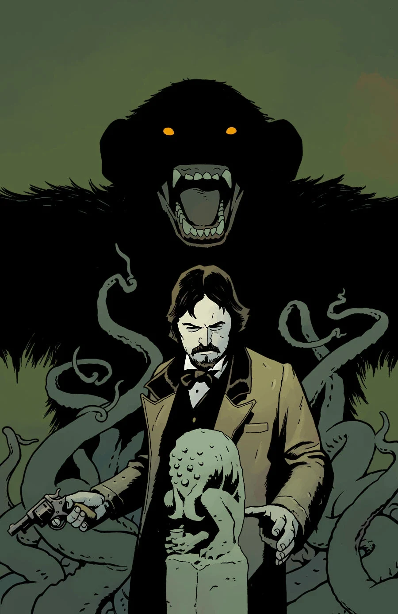

《**当心猿猴**》（Beware the Ape）是刊载于《Dark Horse Presents》第 36 期的一则短篇故事。

## 出版历史

本故事发表于八十页篇幅版本《Dark Horse Presents》的最后一期。

## 剧情简介

在世传奇 Mike Mignola、Stan Sakai 和 Jaime Hernandez 全部为《Dark Horse Presents》的这一终刊号供稿！Mignola 与 Ben Stenbeck 带来一则全新的《猎巫人》故事，而 Hernandez 则推出了魔法师 Merlon！本期还收录了若干新故事——Luciano Saracino 与 Juan Manuel Tumburús 的《Sunstroke》、Kel McDonald 创作的全新《Clark Collins》故事、Patrick Alexander 的两则令人捧腹的新连环漫画，以及 Martin Conaghan 与 Jimmy Broxton 带来的一个结局出人意料的科幻故事！

## 画廊

《Dark Horse Presents》第 36 期
封面作者 Ben Stenbeck
