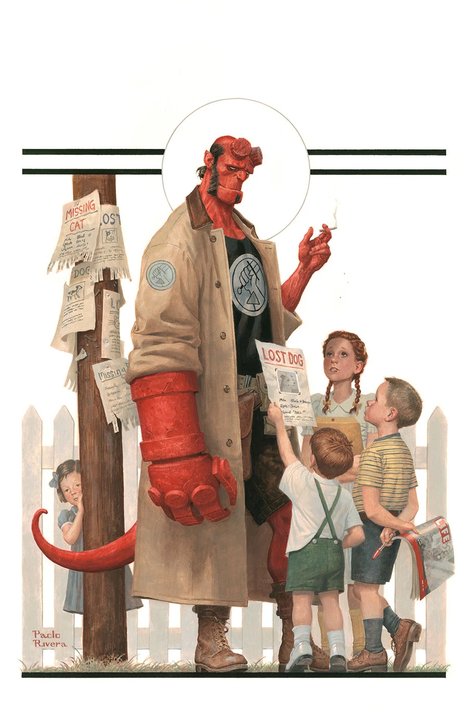
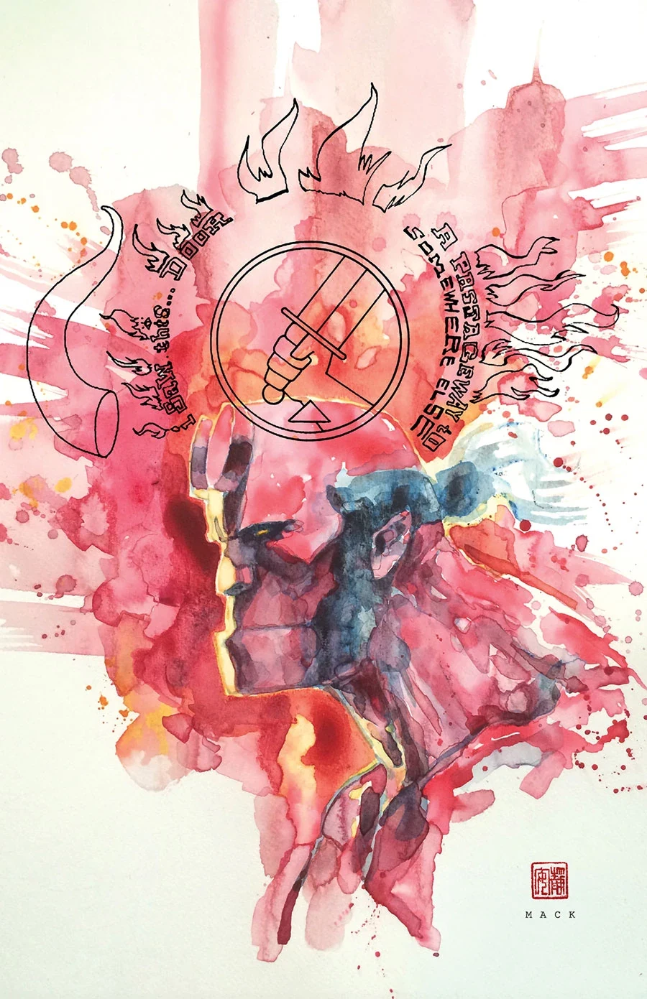
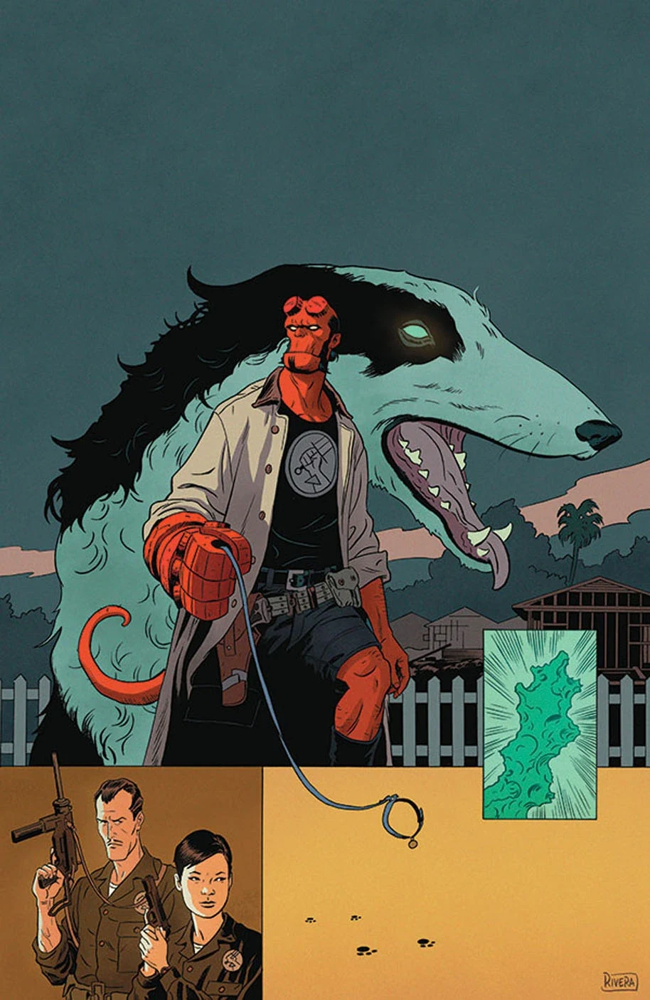
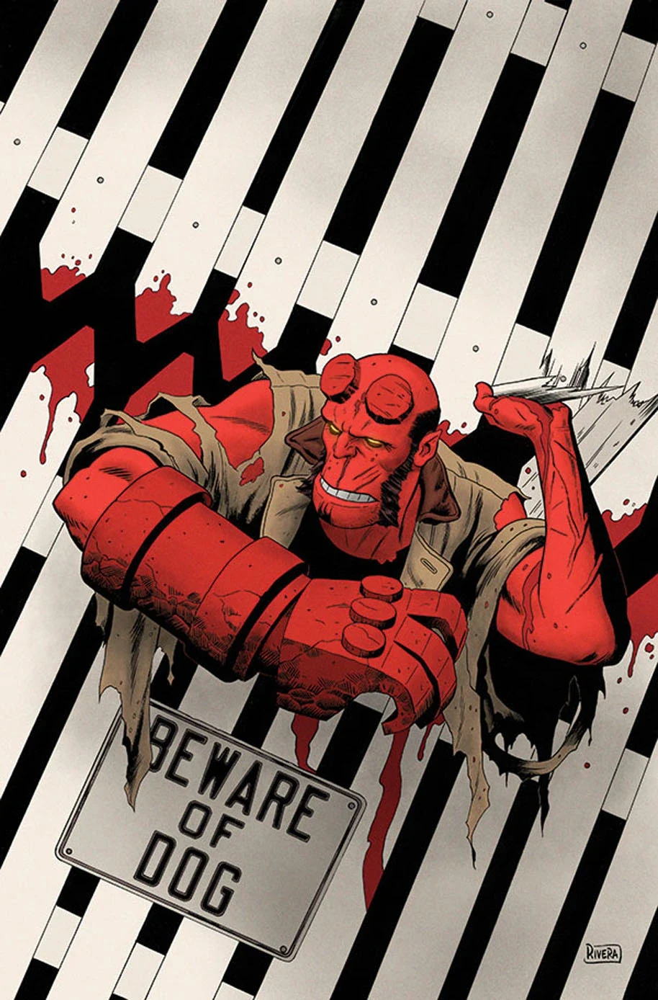

***《Beyond the Fences》**是一个三期故事，由 Mike Mignola 和 Chris Roberson 编剧，Paolo Rivera 与 Joe Rivera 绘制。它是组成《[Hellboy and the B.P.R.D.](/entry/Hellboy_and_the_B.P.R.D.)：1953》的数个故事之一。

## 剧情梗概

### 第一部分

一只神秘生物在一座田园诗般的郊区小镇猎杀孩童；[BPRD](/entry/Bureau_for_Paranormal_Research_and_Defense)展开调查后，发现事情远比预想复杂，而且这场调查开始显得诡异眼熟。

### 第二部分

[地狱男爵](/entry/Hellboy_%28character%29)与一只离奇生物正面对峙，郊区被撕得粉碎；与此同时，BPRD 试图查清是谁、出于什么目的造出了这样一头怪物。

### 第三部分

在一次冷战时期的任务中，人类最好的朋友成了地狱男爵最可怕的噩梦。

## 画廊

除特别注明外，封面均由 [Paolo Rivera](/entry/Paolo_Rivera) 绘制。

|*1953* \#3

|*1953* \#3 变体封面
由 [David Mack](/entry/David_Mack) 绘制

|*1953* \#4

|*1953* \#5
