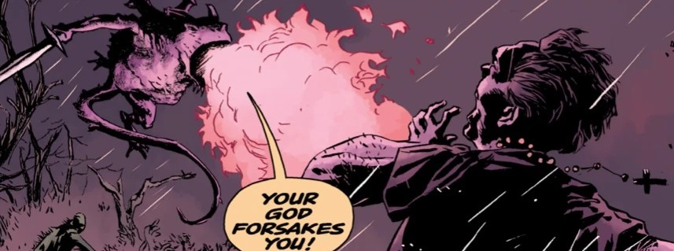
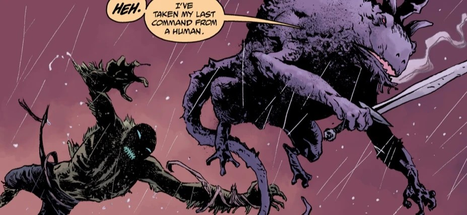
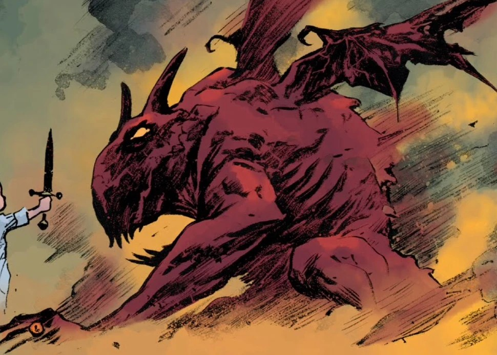

**比弗隆斯（Bifrons，所罗门七十二柱魔神之一）**是一名[恶魔](/entry/Demon)，也是[地狱](/entry/Hell)的伯爵。

## 历史

比弗隆斯被[约姆雅尔（Yomyael）](/entry/Yomyael)（当时附身于[瓦尔瓦拉](/entry/Varvara)）召唤，她企图在人间重建[万魔殿（Pandemonium）](/entry/Pandemonium_(location))。

比弗隆斯对约姆雅尔心存疑虑，她盗取了已故地狱公爵[安度西亚](/entry/Amdusias)的戒指。而比弗隆斯自己的戒指则来自已故的地狱亲王[别西卜（Beelzebub）](/entry/Beelzebub)。约姆雅尔提醒这位伯爵，她正是用[地狱男爵](/entry/Hellboy_(character))杀死[撒旦](/entry/Satan)的那把刀控制着他。

后来，比弗隆斯率领空中部队进攻[超自然调查防御署](/entry/Bureau_for_Paranormal_Research_and_Defense)的军队，后者试图将纽约残存的恶魔一举消灭。这位伯爵与丽兹·舍曼展开了一场令人瞩目的战斗，最终丽兹设法杀死了这名恶魔。

## 外形

比弗隆斯的形象是一只长着角、生有翅膀的巨型红色蟾蜍。

## 传说

在恶魔学中，比弗隆斯同样是地狱伯爵，麾下统领六十支恶魔军团，并且常与罗马神祇雅努斯联系在一起。

## 画廊

约姆雅尔召唤比弗隆斯

|

|

|Yomayel summons Bifrons
## 登场

- [*《亚伯·塞皮恩：至深之暗》*](/entry/A_Darkness_so_Great)
- [*《B.P.R.D.：魔鬼旧相识——万魔殿》*](/entry/Pandemonium_(story_arc))
- [*《B.P.R.D.：魔鬼旧相识——诸神黄昏》*](/entry/Ragna_Rok_(story_arc))（尸体）
