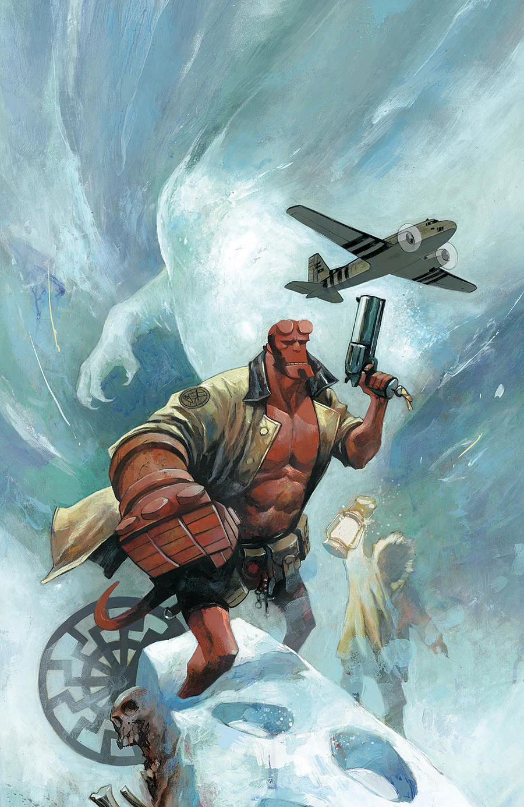

***Black Sun***（黑日）是《[Hellboy and the B.P.R.D.](/entry/Hellboy_and_the_B.P.R.D.)：1954》的一个两期故事弧，编剧为 Mike Mignola 与 Chris Roberson，作画为 Stephen Green。

## 剧情概要

### 第一部分

当一只未知生物袭击了一支北极探险队的科考小组后，地狱男爵与 BPRD 被派往调查。此时的地狱男爵已不再是新人，他以为自己能立刻解开这个谜团，但他们在雪地中的发现却表明，这头野兽背后隐藏着远为庞大的东西。

### 第二部分

地狱男爵与 BPRD 的其余成员失散，发现自己身边竟是一位老对手——对方带来了一件新武器，并打算拿地狱男爵来试手。

## 画廊

封面作者为 [Mike Huddleston](/entry/Mike_Huddleston)。

|*1954: Black Sun* \#1

|*1954: Black Sun* \#2
