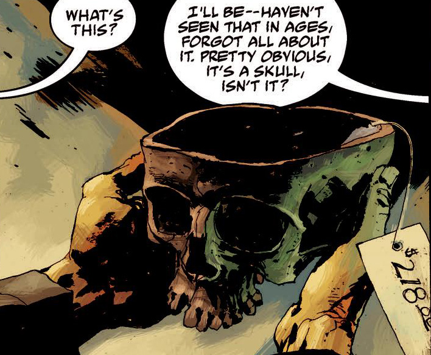

 黑胡子被杀死他的猎人枭首示众、头颅挂上长杆之后，猎人的一位老朋友取回了这颗头颅，将他的头骨制成了这件近乎传说级别的法器。它曾被收入各类收藏，包括一些兄弟会（例如耶鲁和波士顿的兄弟会）以及若干私人收藏。

除了由[黑胡子（Blackbeard）](/entry/Blackbeard)的头骨制成之外，这只圣杯并没有任何[魔法](/entry/Magic)上的功用。但黑胡子能通过它感知到某些事物，还曾借助它向一个有灵能的骗子发出呼唤。
