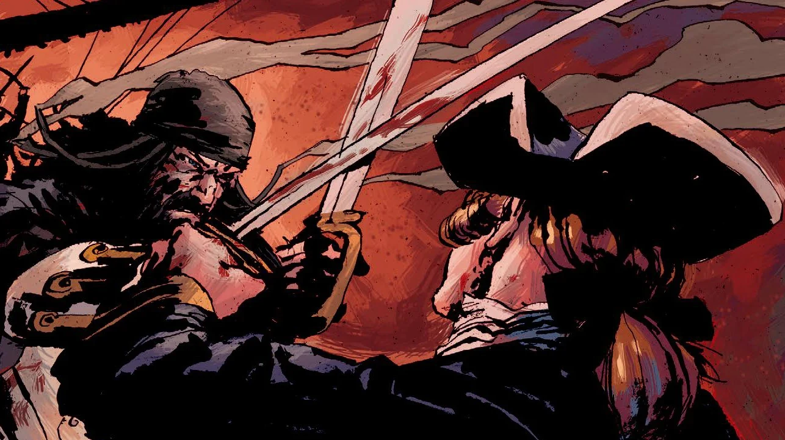

**爱德华·蒂奇（Edward Teach）**，绰号**黑胡子**，是一名英国海盗，最早在安妮女王统治时期出海。他是海盗题材作品中最受欢迎的人物之一，为各类鬼故事、电影（包括《加勒比海盗》系列）、游戏、小说以及许多其他未列出的文艺形式提供了灵感。

尽管关于他的已知事迹有很大一部分是虚构的——其中不少还是他本人编造的——但他确实是一个凡人。

## 黑胡子在地狱男爵中

爱德华·蒂奇是个令人闻风丧胆的海盗，拥有一些超自然力量。他是故事[《乘船下海之人》](/entry/They_That_Go_Down_to_the_Sea_in_Ships)的主要反派。一个有通灵天赋的男人在一家古董店里发现了他的头骨，便谋杀了店主，企图通过协助并号令这个恐怖海盗来牟利。

事情并未按计划发展：这个通灵者的犯罪同伙为了头骨杀死了他，却又被黑胡子的不死之身杀死。地狱男爵与黑胡子研究专家厄尔·里兹（Earl Reeds）联手对抗这个邪恶的还魂丧尸，后者把地狱男爵错当成了"[老恶魔](/entry/Satan)"派来的手下。他几乎势不可挡，直到一群不死水手（他从前的船员与敌人混在一起）赶到，把他拖进了戴维·琼斯的储物柜（海底葬身之所）。

## 能力

黑胡子在世时拥有超乎常人的耐力，他身中无数创伤，最终才倒在一名无名苏格兰高地人的斩首一击之下。即便如此，他那无头的尸体仍游着追赶梅纳德（Maynard）的船——他的头颅就挂在那艘船的船首斜桅上。

成为不死者后，他的耐力不减反增，几乎能扛住地狱男爵朝他使出的一切攻击，包括他的[毁灭之右手](/entry/Right_Hand_of_Doom)。他还能从已被改造成[黑胡子骷髅圣杯](/entry/Blackbeard's_skull_chalice)的头骨残片上重新长出头颅，也能让自己的身体和武器恢复完好，并曾在近距离朝地狱男爵开了一枪。

## 趣闻

- 他的头骨曾被多个团体使用，包括波士顿和耶鲁大学的兄弟会。
- 他至少清楚自己的复活花了不少时间。
- 他曾邀请地狱男爵入伙当海盗。

## 画廊

不死的黑胡子朝地狱男爵开枪

曾属于黑胡子的头骨——圣杯

## 外部链接

维基百科上的黑胡子
