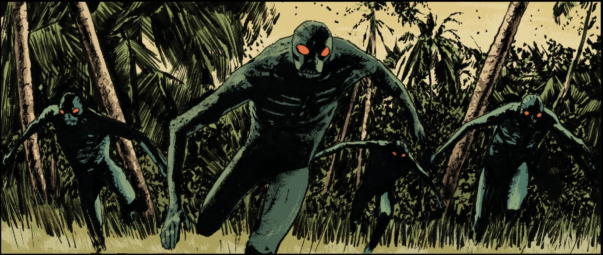

**邦吉人（Bonji）**是新的人类种族，又称 **鱼智人（Ichthyo Sapiens）**，他们自称 **第一先民（First People）**；在人类文明覆灭一千年后，他们成为了地球上的优势物种。

## 背景

一千年前，[亚伯·塞皮恩](/entry/Abraham_Sapien)在与[格里高利·拉斯普廷](/entry/Grigori_Rasputin)的战斗中被杀，他的遗体沉入大海。从他的身体中流出许多卵，孵化出蝌蚪般的小生物。这些生物不断进化，变得越来越接近人形，最终如预言所言，崛起成为新的人类种族。这个形似青蛙的种族从海中现身，向陆地进发，在那里遇到了封存着融入[维利](/entry/Vril)之力的[丽兹·舍曼](/entry/Elizabeth_Sherman)遗体的水晶。

与他们的始祖不同，邦吉人形如类人青蛙，与[蛙人](/entry/Frog_monster)相似——后者由[奥格德鲁·赫姆](/entry/Ogdru_Hem)所创造，只是邦吉人不如蛙怪粗野蛮横。

## 文化

邦吉人是一个和平的社会，生活在地表这个严酷却美丽的世界中。尽管尚处原始阶段，他们通过在地下深处发现的各种器物与城市废墟，知晓在他们之前还存在过一个更早的世界。按照他们的理解，之前的世界是由[“棍子人”](/entry/Human)（stick people）统治的。在[Frankenstein](/entry/Frankenstein_(character)) 和莉尔雅（Lilja）到来之前，他们一直把这些发现以及关于那个早于他们的文明的传说当作神话。

在他们的信仰中，世界原本只有石头与火焰，直到被称为 [Ughdra-Hesh](/entry/Ogdru_Jahad) 的神祇来到世间，播下最初的生命之种，带来雨水和生命之水。邦吉人便是从他们播下的种子中诞生。相传 Ughdra-Hesh 留在邦吉人身边守护他们，直到他们沉睡，化作山脉。

## 资料来源

1.  [↑](#cite_ref-1) [《魔鬼旧相识》](/entry/The_Devil_You_Know_(story_cycle)) 第 15 期
2.  [↑](#cite_ref-2) [《新世界》](/entry/New_World_(Frankenstein_story_arc)) 第 2 期
