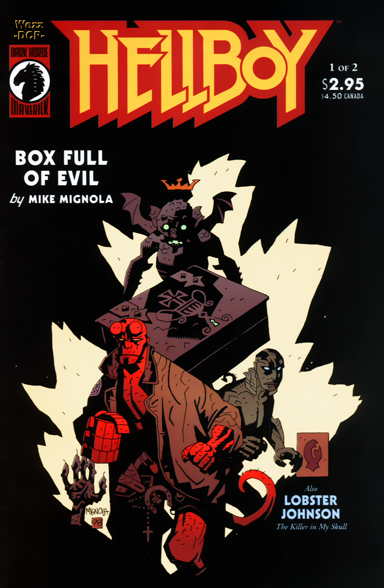
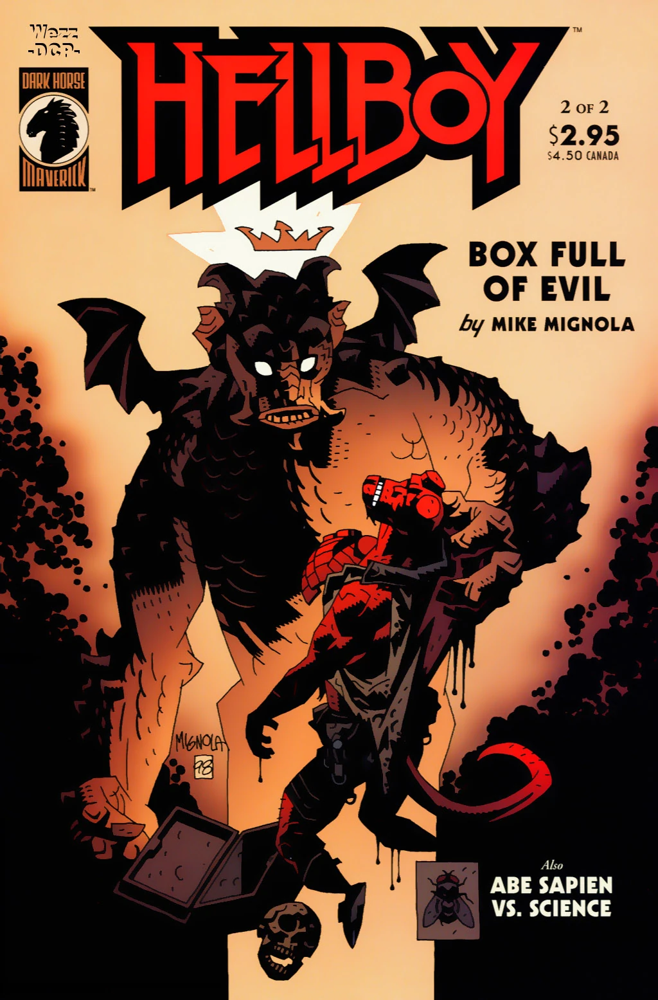

《**装满邪恶的盒子**》（Box Full of Evil）是一部两期限定的迷你系列，由 [Mike Mignola](/entry/Mike_Mignola) 编剧并绘制。这是第一个揭示地狱男爵秘密王冠的故事。

## 出版历史

《装满邪恶的盒子》最初于 1999 年 8 月至 9 月以两期限定的迷你系列形式出版。每期都包含一个备份故事——第 1 期是 *[我颅中的杀手](/entry/The_Killer_in_My_Skull)*（第一个 *[龙虾约翰逊](/entry/Lobster_Johnson_%28series%29)* 故事），第 2 期是 *[亚伯·赛皮恩大战科学](/entry/Abe_Sapien_versus_Science)*。2000 年 4 月故事被结集时增加了一个四页的尾声。这个尾声将故事与 *[毁灭之右手](/entry/The_Right_Hand_of_Doom)* 联系了起来。

## 剧情简介

### 第一部

故事开篇，[地狱男爵](/entry/Hellboy_%28character%29)和 [Abe Sapien](/entry/Abraham_Sapien)正在调查一栋英国宅邸中发生的离奇入室盗窃案。房主讲述说，一个男人进入他的房子，砸开了壁炉上方的墙壁，带着一个金属盒子和一把钳子离开。地狱男爵注意到被砸开的墙上原本挂着一幅圣邓斯坦的肖像，房主告诉他这栋房子曾是一座修道院。房主还看到了一栋阴森宅邸的幻象。

画面切到窃贼 [Igor Bromhead](/entry/Igor_Bromhead)，他正在那栋阴森宅邸中对一对夫妇说话。他解释说邓斯坦用钳子捉住了一个恶魔，并把它封在金属盒子里。这对夫妇——一位伯爵和伯爵夫人——将他们所有的世俗财产都付给 Bromhead 作为报酬。伯爵夫人打开盒子，一个看似苍蝇的东西从盒中飞出，钻进她的嘴里。被恶魔附身后，她把丈夫变成了一只猴子，并试图变形 Bromhead。然而他佩戴着一枚刻有圣邓斯坦像的护身符，护佑着他。他利用恶魔的秘密名字 [Ualac](/entry/Ualac) 束缚并命令它。Bromhead 向恶魔索要财富与力量，恶魔告诉他宅中藏有一笔宝藏，以及一股强大的力量。他解释说"末日的先驱"仍然活着，并且拒绝了自己的命运，但他仍然戴着一顶无形的王冠。这个存在拥有巨大的力量，即使是地狱的摄政者也必须服从他。场景转换，揭示地狱男爵实际上就是那位先驱。

地狱男爵和 Abe 进入宅邸，发现了打开的盒子。猴子开枪击中 Abe 并把他拖走。与此同时 Bromhead 束缚住地狱男爵，并借助 Ualac 的帮助使一顶王冠出现在地狱男爵头顶。Ualac 取走王冠，Bromhead 用邓斯坦的钳子殴打地狱男爵。本期结尾，Abe 被锁链拴在墙上，猴子站在他身旁。

### 第二部

猴子站在 Abe 身旁，用烧红的烙铁烫他。Bromhead 把地狱男爵打得几乎死去，直到 Ualac 叫他住手。他们必须在地狱男爵被杀之前砍断他的手，"以免他的死亡渗入其中，毒害它"。Ualac 解释说这只手拥有释放并号令 [Ogdru Jahad](/entry/Ogdru_Jahad)、以及让地狱军团复生的力量。Ualac 拿起邓斯坦的钳子，钳子变成了一把剑。

地狱男爵发现自己坐在一棵树下，[Dagda](/entry/Dagda)、*[尸体](/entry/The_Corpse)* 中的那个哥布林，以及 [Edward Grey 爵士](/entry/Sir_Edward_Grey)正低头看着他。哥布林告诉他，既然他不再佩戴王冠，他的名字就不再是 Anung Un Rama。回到宅邸中，由于地狱男爵的名字不再是 Anung Un Rama，他已摆脱了 Bromhead 的束缚。他攻击 Ualac，击碎了那把剑。

Bromhead 逃走。Abe 设法从猴子手中挣脱。猴子朝 Abe 扑来，却从墙上的一个破洞掉了下去，落在 Ualac 此前提到的宝藏上。Abe 找到 Bromhead，逼问他地狱男爵在哪里。Bromhead 把自己锁在一个房间里，召唤恶魔 [Astaroth](/entry/Astaroth) 求助。Astaroth 把房间的门变成了一堵石墙，保护 Bromhead。在争斗中 Bromhead 的护身符碎了。失去保护后，Astaroth 把 Bromhead 的下半身变成了蜥蜴。

仍在与 Ualac 搏斗的地狱男爵掰断自己的双角，用角刺中 Ualac。恶魔离开躯体，变回了最初那个苍蝇般的生物。地狱男爵纵身去抓 Ualac，摔到了屋外。Astaroth 出现在地狱男爵面前，把 Ualac 带回地狱。Astaroth 托出王冠。地狱男爵说他永远不会带来末日。Astaroth 回应说他会在地狱中替他保管王冠，等候地狱男爵。

地狱男爵回到宅中帮助 Abe。最后一格画面显示，变成猴子的伯爵死在宝藏堆中，头上戴着一顶王冠。

### 尾声

[Kate Corrigan](/entry/%E5%87%AF%E7%89%B9%C2%B7%E8%80%83%E7%91%9E%E6%A0%B9))在一片田野中与地狱男爵见面。她告诉他 Abe 不会有事。地狱男爵谈起自己如何总是回避追问自己究竟是谁。然而，有时事情发生，他被迫面对自己的身份，但至少这一次他还会再次回避它。地狱男爵松开那张来自 *[毁灭之右手](/entry/The_Right_Hand_of_Doom)* 的纸片，纸片在半空中被一只巨大的黑鸟叼走。

## 故事年表

这个故事的确切日期从未说明。它必定发生在 *[毁灭之右手](/entry/The_Right_Hand_of_Doom)* 之后、*[Being Human](/entry/Being_Human)* 之前。

## 内容

### 角色

#### [B.P.R.D.](/entry/Bureau_for_Paranormal_Research_and_Defense)

- [Abraham Sapien](/entry/Abraham_Sapien)
- [地狱男爵](/entry/Hellboy_%28character%29)
- [Trevor Bruttenholm](/entry/Trevor_Bruttenholm)（被提及）
- [Katherine Corrigan](/entry/%E5%87%AF%E7%89%B9%C2%B7%E8%80%83%E7%91%9E%E6%A0%B9))

#### 其他

- [Igor Bromhead](/entry/Igor_Bromhead)
- [恶魔](/entry/Demon)
  - [Ualac](/entry/Ualac)
  - [Astaroth](/entry/Astaroth)
- Heath 先生
- Guarino 伯爵
- Guarino 伯爵夫人
- [Ogdru Jahad](/entry/Ogdru_Jahad)
- [Daoine Sidhe](/entry/Daoine_Sidhe)
  - [Dagda](/entry/Dagda)
  - 抽烟斗的哥布林
- [Edward Grey](/entry/Edward_Grey)[1]
- [Ogopogo](/entry/Ogopogo)（被提及）

### 地点

- 英格兰
  - Heath 宅邸（德拉甘山）
  - 埃夫伯里石环（威尔特郡）
- 苏格兰
  - Guarino 宅邸（洛克马本）
- [世界之树](/entry/Yggdrasil)
- [地狱](/entry/Hell)
  - [万魔殿](/entry/Pandemonium_%28location%29)（被提及）
- 加拿大
  - 奥肯纳根湖（不列颠哥伦比亚省）（闪回）

### 值得注意的器物

- 荣耀之手
- 装有 [Ualac](/entry/Ualac) 的盒子
- 圣邓斯坦的钳子
- 圣邓斯坦的画像/护身符
- [Malcolm Frost](/entry/Malcolm_Frost) 关于[毁灭之右手](/entry/Right_Hand_of_Doom)的笔记

## 画廊

封面由 [Mike Mignola](/entry/Mike_Mignola) 绘制。

 \#1

 \#2

 封面

[1] 身份尚未揭示
