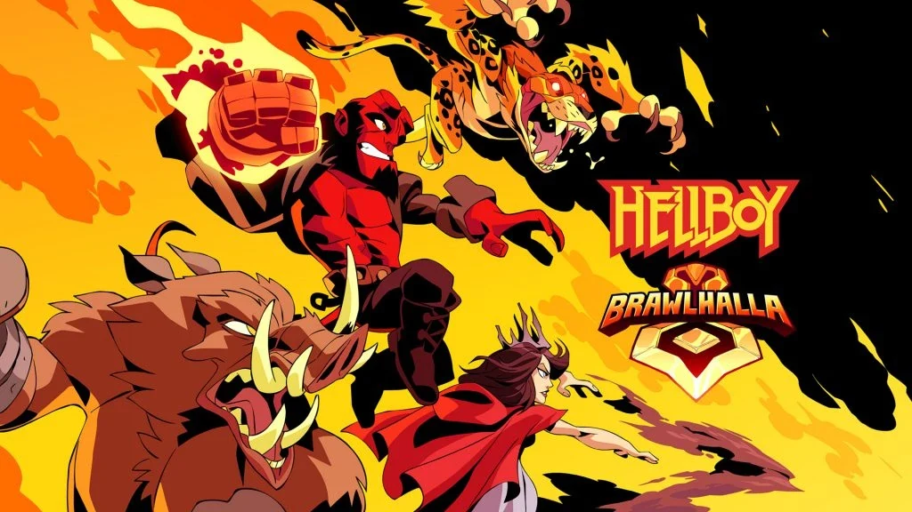
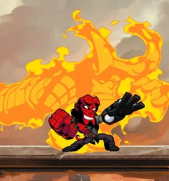
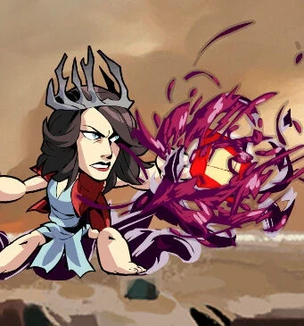
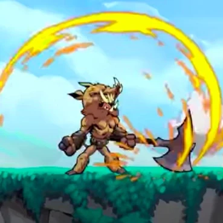
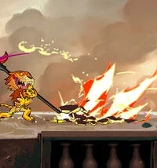
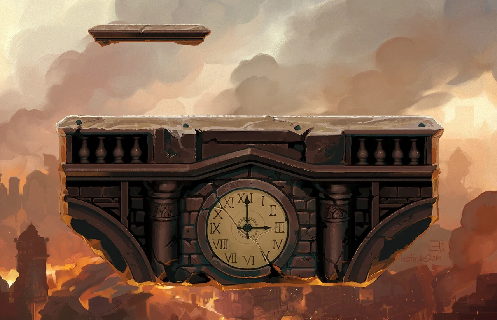
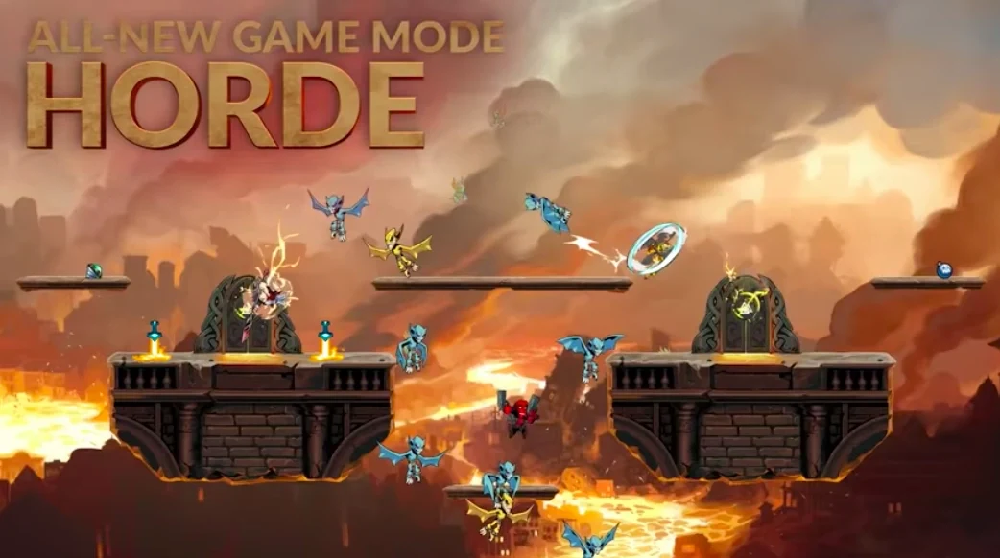

***《英灵乱战》（Brawlhalla）*** 是一款由 Blue Mammoth Games 开发、育碧（Ubisoft）发行的 2D 平台格斗游戏。

2019 年 4 月 10 日，为宣传[2019 年电影](/entry/Hellboy_(2019_film))而举办的一场联动活动为游戏加入了若干 *[《地狱男爵》](/entry/Hellboy_(series))* 主题内容。地狱男爵、妮缪、格鲁阿加和达米奥是四款史诗级联动皮肤：地狱男爵、妮缪和达米奥售价 300 猛犸币（约合 10 美元），格鲁阿加售价 240 猛犸币（约合 8 美元）。

## 地狱男爵

[地狱男爵](/entry/Hellboy_(character))是角色 Cross 的史诗级联动皮肤。地狱男爵使用的武器为枪铳（撒马利亚人，Samaratins）与拳套（末日之手，Apocalypse Hands）。地狱男爵的属性值和招牌（特殊）攻击与 Cross 完全相同，但招牌攻击的动画经过了重新制作。

## 妮缪

[妮缪](/entry/Nimue)是角色 Dusk 的史诗级联动皮肤。妮缪使用的武器为长矛（猩红长枪，Crimson Pike）与法球（血之碎片，Blood Shard）。妮缪的属性值和招牌攻击与 Dusk 完全相同，但招牌攻击的动画经过了重新制作。

## 格鲁阿加

[格鲁阿加](/entry/Gruagach)是角色 Teros 的联动皮肤。格鲁阿加使用的武器为战斧（叛逆者，The Renegade）与战锤（重击者，Heavy Hitter）。格鲁阿加的属性值和招牌攻击与 Teros 相同，使用的招牌攻击动画也与 Teros 一致。

## 达米奥

[本杰明·达米奥](/entry/Benjamin_Daimio)是角色 Mordex 的史诗级联动皮肤。Mordex 使用的武器为拳套（美洲豹之爪，Jaguar Claws）与镰刀（致命之刃，Lethal Edge）。达米奥的属性值和招牌攻击与 Mordex 完全相同，但招牌攻击的动画经过了重新制作。

## 新地图

地狱男爵联动活动带来了一张名为“天启”（Apocalypse）的全新 1v1 地图。地图地形平坦，设有一块软平台。

## 领奖台与头像

地狱男爵联动活动带来了一个名为“末日巨兽”（Beast of Apocalypse）的全新领奖台，台上矗立着恶魔形态、手持佩剑的地狱男爵雕像。装备该领奖台后选择角色，领奖台顶部会浮现一顶火焰王冠。该领奖台售价 240 猛犸币。

活动还带来了一个名为“火焰王冠”（Crown of Flame）的全新动态头像。头像以红色为背景，主体是一顶明黄色的火焰王冠、一双眼睛和一头由角构成的“头发”。该头像售价 60 猛犸币。

“末日巨兽”领奖台

“火焰王冠”头像

## 游戏模式

地狱男爵联动活动带来了一个名为“军团”（Horde）的全新游戏模式：一支最多 8 名玩家组成的队伍要守卫英灵殿（Valhalla）的大门，抵挡一群恶魔——甚至还有格鲁阿加——的进攻。目标是在时间耗尽、或恶魔破门之前守住大门。

## 外部链接

- “地狱男爵加入英灵乱战”（Hellboy Joins Brawlhalla）更新补丁说明
