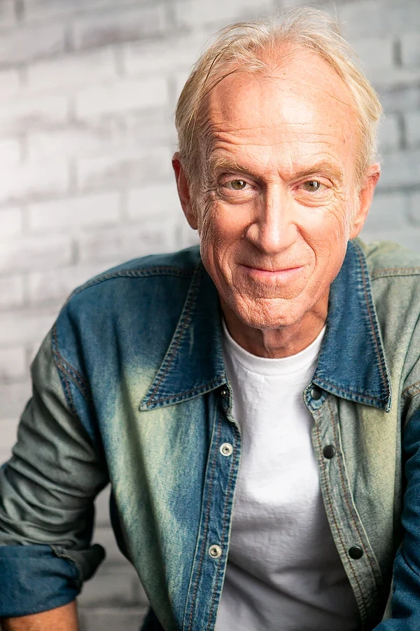

Bruce Barker 出生于美国本土，在阿拉斯加州的乡村长大。2001 年，在广播电台从事了很长时间的 DJ 与商业广告制作生涯之后，Bruce 将全部精力转向配音工作，并在洛杉矶创办了音视频制作公司 RightAfterThis.com。

Bruce 每年为数百支广告配音，其中许多在全美范围内播出。他还出演过大量电子游戏，并为许多纪录片和有声书担任旁白。Bruce 经常登台出演本地戏剧，是 Westminster Mint 的全国性出镜代言人，并在由 Johnny Soto 执导的故事片《Hollywood Road Trip》中饰演 Thomas Berkus。

他还编写并执导过数部短片，相关信息列于此处的 IMDb 作品年表板块中。

他在 Netherrealm 工作室的《不义联盟 2》（Injustice 2）中为地狱男爵配音。
