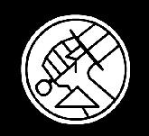
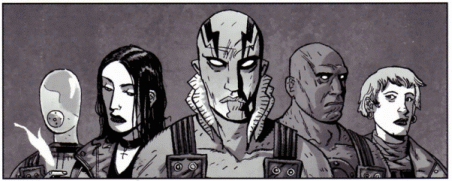

 **超自然调查防御署（Bureau for Paranormal Research and Defense）**（**B.P.R.D.**）是一个肩负保护美国乃至全世界、抵御秘术、超自然与超自然现象之责的组织。它长期雇用数名拥有"超常天赋"的人员，其中包括[地狱男爵](/entry/Hellboy_%28character%29)。

B.P.R.D. 最早登场于*[《地狱男爵》](/entry/Hellboy_%28series%29)*漫画，在第一个故事线*[《毁灭之芽》](/entry/Seed_of_Destruction)*中作为地狱男爵及其同事们效力的组织被引入。2001 年出版的*[《征服之虫》](/entry/Conqueror_Worm_%28story%29)*故事线结尾，地狱男爵退出了防御署；此后不久，独立的*[《B.P.R.D.》](/entry/B.P.R.D._%28series%29)*系列以故事线*[《空心地球》](/entry/Hollow_Earth)*开始出版。《地狱男爵》与《B.P.R.D.》两套漫画此后并行连载，两边发生的事件互相呼应。相关系列*[《地狱男爵与 B.P.R.D.》](/entry/Hellboy_and_the_B.P.R.D.)*则讲述地狱男爵在 20 世纪 50 年代初任外勤探员的岁月。

## 历史

B.P.R.D. 由[特雷弗·布鲁滕霍尔姆](/entry/Trevor_Bruttenholm)教授于 1944 年末创立，目的是对抗在对纳粹德国的行动中发现的种种秘术威胁。成立之初，它与美国陆军航空队关系密切，总部设在新墨西哥州的一座军用空军基地。到 1947 年，防御署迁往康涅狄格州费尔菲尔德一座专门建造的设施。时至今日，它仍与美国武装部队的多个分支保持着紧密联系。它是一个私营组织，经费来自多个主要国家政府（主要是美国和英国，不过也提到过加拿大、日本、法国、意大利等其他国家）。

布鲁滕霍尔姆教授一直担任主管，直到 20 世纪 50 年代末辞职、重返外勤工作。现任主管是[托马斯·曼宁博士](/entry/Tom_Manning)。自 20 世纪 70 年代起，又有多名超自然探员加入队伍，如[丽兹·舍曼](/entry/Liz_Sherman)、[亚伯拉罕·塞皮恩](/entry/Abraham_Sapien)、[约翰·克劳斯](/entry/Johann_Kraus)和[本·达米奥](/entry/Ben_Daimio)。这是维持防御署高知名度所必需的，尤其是考虑到他们的王牌探员[地狱男爵](/entry/Hellboy_%28character%29)已于 2001 年离去。

B.P.R.D. 是一个知名且受人尊敬的组织，与大多数国家的政府及美国政府机构关系良好，唯有中国和中央情报局例外。

### [《蛙疫》](/entry/Plague_of_Frogs_%28story_cycle%29)

防御署最初是美国抵御[蛙族生物](/entry/Frog_monster)大举入侵的唯一防线。"蛙怪"最初在东海岸活动，随后沿美加边境两侧向西蔓延。为削减开支，防御署把总部从使用已久的康涅狄格驻地迁往科罗拉多州一座废弃的研究设施。这座设施最后一次启用，是用来安置二战后叛逃到美国的纳粹科学家。因此，设施中存有大量 B.P.R.D. 尚未查阅的秘密档案。

蛙怪入侵在*[《黑焰》](/entry/The_Black_Flame_%28story%29)*的事件中达到高潮。一个名叫[黑焰](/entry/Landis_Pope)的纳粹狂徒钻营成了蛙怪的首领，二者联手把[卡塔-赫姆](/entry/Katha-Hem)（[奥格德鲁·赫姆](/entry/Ogdru_Hem)之一，[奥古·桀哈](/entry/Ogdru_Jahad)的 369 个子嗣之一）从地底唤醒。这头巨兽在美国腹地肆虐，直到丽兹·舍曼借助一件[古代器物](/entry/Spiked_Cylinder)把自己的控火之力放大了上千倍。她将卡塔-赫姆活活烧死之后，蛙怪把黑焰拖进一道巨坑，入侵就此终结。

### [《人间地狱》](/entry/BPRD%3A%E4%BA%BA%E9%97%B4%E5%9C%B0%E7%8B%B1))

随着[奥格德鲁·赫姆](/entry/Ogdru_Hem)在世界各地大肆活动，B.P.R.D. 近来已成为一个获得联合国支持的国际组织。防御署近来也无法再依赖他们的超常天赋探员。前队长本·达米奥在导致数名探员死亡后逃离了防御署。丽兹·舍曼探员在阿加森摧毁蛙族军队和黑焰之后目前下落不明。亚伯·塞皮恩探员因重伤昏迷四个月，苏醒之后目前正在逃亡。昏迷期间发生的变化令他面目全非，也让同事们对他本人以及他在世界末日中扮演的角色更加疑心。由于缺少超常天赋探员，在世界分崩离析之际，更多传统型探员不得不挺身而出。

## 探员

几位著名的 BPRD 探员。从左到右：[约翰·克劳斯](/entry/Johann_Kraus)、[丽兹·舍曼](/entry/Liz_Sherman)、[亚伯·塞皮恩](/entry/Abe_Sapien)、[罗杰](/entry/Roger)、[凯特·考瑞根](/entry/Kate_Corrigan)。

### 超常天赋探员

- [地狱男爵](/entry/Hellboy_%28character%29)——世界上最伟大的超自然调查员，天启之兽
- [亚伯·塞皮恩](/entry/Abe_Sapien)——鱼形类人生物，原名 Langdon Caul
- [丽兹·舍曼](/entry/Liz_Sherman)——控火者
- [约翰·克劳斯](/entry/Johann_Kraus)——灵质肉身灵媒（已故）
- [菲尼克斯·埃斯佩霍](/entry/Fenix_Espejo)——灵能者
- [伊扎尔·霍夫曼](/entry/Izar_Hoffman)博士——灵能者
- [西德尼·利奇](/entry/Sidney_Leach)——以心灵感应探测并操控金属（可能已退休）
- [本·达米奥](/entry/Ben_Daimio)上尉——队长，豹人（已故）
- [罗杰](/entry/Roger)——[人造人](/entry/Homunculus)（已故）
- [潘雅](/entry/Panya_%28character%29)——长生不老的木乃伊、灵能者（已故）
- [阿什利·斯托德](/entry/Ashley_Strode)——驱魔师（已故）
- [泰德·霍华德](/entry/Ted_Howards)——手持与[一位史前人类](/entry/Gall_Dennar)相连的极北之剑（已故）

### 普通人类探员

#### 当代 B.P.R.D.

- [托马斯·曼宁博士](/entry/Thomas_Manning)——主管（已故）
- [凯特·考瑞根博士](/entry/%E5%87%AF%E7%89%B9%C2%B7%E8%80%83%E7%91%9E%E6%A0%B9))——超常天赋探员的前联络官，后任外勤主管（已故）
- [J·H·奥唐纳教授](/entry/J%C2%B7H%C2%B7%E5%A5%A5%E5%94%90%E7%BA%B3%E6%95%99%E6%8E%88))——秘术专家（已故）
- [宝琳·拉斯金](/entry/Pauline_Raskin)——前外勤探员，负责培训新探员
- [安德鲁·德文](/entry/Andrew_Devon)——外勤探员，后任外勤主管（已故）
- [卡拉·贾罗科](/entry/Carla_Giarocco)——外勤探员（已故）
- [尼科尔斯](/entry/Nichols)——外勤探员
- [Rebecca Gervesh](/entry/Rebecca_Gervesh)——外勤探员
- [项探员](/entry/Tian)——外勤探员（已故）
- [拉塞尔·伊诺斯](/entry/Enos)——外勤探员（已故）
- [约瑟夫·沃恩](/entry/Joseph_Vaughn)——外勤探员（已故）
- [Nastassja "Stazz" Hansen](/entry/Nastassja_Hansen)——外勤探员（已故）
- [Salvatore Tasso](/entry/Salvatore_Tasso)——外勤探员（已故）
- [特雷弗·布鲁滕霍尔姆教授](/entry/Trevor_Bruttenholm)——前主管（已故）

#### 20 世纪 40 年代的 B.P.R.D.

- 特雷弗·布鲁滕霍尔姆教授，主管
- [蒂姆·克拉克](/entry/Tim_Clark)
- [雅各布·斯特格纳](/entry/Jacob_Stegner)，外勤探员（*[《1947》](/entry/1947)*、*[《1948》](/entry/1948)*）
- [西蒙·安德斯](/entry/Simon_Anders)，外勤探员（*[《1947》](/entry/1947)*、*[《1948》](/entry/1948)*、*[《吸血鬼》](/entry/Vampire_%28story%29)*）
- [Archibald Muraro](/entry/Archibald_Muraro)，外勤探员
- [Margaret Laine](/entry/Margaret_Laine)，秘书
- [Norton Ricker](/entry/Norton_Ricker)将军，美国军方
- 麦克（Mac），那只狗
- [霍华德·伊顿](/entry/Howard_Eaton)博士——（已故）——（登场于[《1946》](/entry/1946)、[《奥列克主教的魔鬼》](/entry/Bishop_Olek%27s_Devil)）
- [弗兰克·拉塞尔](/entry/Frank_Russell)，外勤探员（已故）——（登场于[《1947》](/entry/1947)）
- [加布里埃尔·鲁伊斯](/entry/Gabriel_Ruiz)，外勤探员（已故）——（登场于[《1947》](/entry/1947)）

#### 20 世纪 50 年代的 B.P.R.D.

- [Margaret Laine](/entry/Margaret_Laine)，行动助理主管
- [伍德罗·法瑞尔](/entry/Woodrow_Farrier)，外勤探员
- [苏珊·项](/entry/Susan_Xiang)，灵能外勤探员
- [Myron Linneberg](/entry/Myron_Linneberg)，情报顾问（前 CIA）
- [雅各布·斯特格纳](/entry/Jacob_Stegner)，外勤探员（截至[《1956》](/entry/1956)已故）
- Gustafsson 探员，外勤探员——（登场于[《1956》](/entry/1956)）
- Hendricks 探员，外勤探员——（登场于[《1956》](/entry/1956)）
- Hinojosa 探员，外勤探员——（登场于[《1956》](/entry/1956)）
- Murphy 探员，外勤探员——（登场于[《1956》](/entry/1956)）
- [维克多·凯斯特勒](/entry/Victor_Koestler)，外勤探员——（1964 年仍在役）
- [罗伯特·阿姆泽尔](/entry/Robert_Amsel)，外勤探员（叛徒）（截至[《1952》](/entry/1952)已故）

#### 配角及/或背景人物

- Matthew Roddel 博士，科学家
- Michael Cobb 博士，科学家
- Arnold Platt 博士，科学家（已故）
- Doris，医生
- Peter，负责看管奥安尼斯超人类躯体的技术员
- Jim，技术员
- Lloyd，机械师——《唤醒恶魔》
- Izzy Kemper，邪教专家、语言学家
- [加勒特·奥马塔](/entry/Garrett_Omatta)，灵媒
- Josh Ecton，灵能者
- Lashley 探员，外勤探员——《黑焰》
- [Navarro 探员](/entry/Agent_Navarro)，外勤探员——《黑焰》
- [卡特利特](/entry/Agent_Catlett)，外勤探员——《向蛙族宣战》
- Swanson 探员，外勤探员
- Helton 探员，外勤探员
- Kinsley 探员，外勤探员——《土星回归》
- Brandaux 探员，外勤探员（已故）——《废土》
- Cris Peters，外勤探员（已故）——《皮肯斯县恐怖事件》
- Lehane 探员，外勤探员（已故）——《时间深渊》
- [巴德·沃勒](/entry/Bud_Waller)，外勤探员/机械师（已故）——《唤醒恶魔》
- [斯科特·克拉克](/entry/Clark)，外勤探员（已故）——《唤醒恶魔》
- [布拉德利中尉](/entry/Lieutenant_Bradley)，外勤探员（已故）——《向蛙族宣战》第 2 期
- [德默斯](/entry/Agent_Demers)，外勤探员（已故）——《向蛙族宣战》第 2 期
- Varadi 探员，外勤探员（已故）——《向蛙族宣战》第 2 期
- Kohler 探员，外勤探员（已故）——《向蛙族宣战》第 2 期
- Whitcomb 探员，外勤探员（已故）——《向蛙族宣战》第 2 期
- Bernie D'Andrea，外勤探员（已故）——《向蛙族宣战》第 2 期
- Bama 探员，外勤探员（已故）——《向蛙族宣战》第 2 期
- Ferguson 探员，外勤探员（已故）
- Musgrove 探员，外勤探员（已故）——《杀戮之地》
- Holcombe 探员，外勤探员（已故）——《杀戮之地》
- Pratt 探员，外勤探员（已故）——《溺水》
- Hampton 探员，外勤探员（已故）——《溺水》
- Van Fleet 探员，外勤探员（已故）——《溺水》
- Wilson，飞行员（被变成[蛙人](/entry/Ogdru_Jahad)，推定已故）——《蛙疫》

## 其他媒体

电影改编作品中 B.P.R.D. 都占据重要地位，通常把地狱男爵刻画为该组织的一员（他在*[《黄金军团》](/entry/Hellboy_II%3A_The_Golden_Army)*结尾退出，但影片大部分时间里仍以探员身份行动）。除了塑造漫画中的角色外，改编作品还常常原创一些身为防御署成员的角色。

### 探员

#### 动画版

登场于*[《地狱男爵动画版：风暴之剑》](/entry/Hellboy_Animated%3A_Sword_of_Storms)*：

- [汉密尔顿](/entry/Agent_Hamilton)，外勤探员（已故）

#### 2004–2008 年电影系列

登场于*[《地狱男爵》](/entry/Hellboy_%282004_film%29)*：

- [约翰·迈尔斯](/entry/John_Myers)，2004 年地狱男爵的联络官，2008 年之前某时被调往南极
- [克莱](/entry/Clay)，外勤探员、地狱男爵的前联络官（已故）
- Lime 探员，外勤探员（已故）
- Moss 探员，外勤探员（已故）
- Quarry 探员，外勤探员（已故）
- Stone 探员，外勤探员（已故）

登场于*[《地狱男爵2：黄金军团》](/entry/Hellboy_II%3A_The_Golden_Army)*：

- Flint 探员，外勤探员（已故）
- Steel 探员，外勤探员（已故）
- Marble 探员，外勤探员（已故）

#### 2019 年电影

登场于*[《地狱男爵：血皇后崛起》](/entry/Hellboy_(2019_film))*：

- Michael Clark，外勤探员（已故）
- Virginia Payne，外勤探员（已故）
- Esteban Ruiz，外勤探员（已故）
- Madison 探员，外勤探员
- Strode 探员，外勤探员
- Taylor 探员，外勤探员

#### 《扭曲人》电影

登场于*[《地狱男爵：扭曲人》](/entry/Hellboy%3A_The_Crooked_Man_%28film%29)*：

- [Bobbie Jo Song](/entry/Bobbie_Jo_Song)，外勤探员
