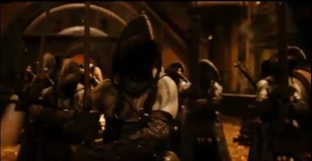

巴洛尔国王的屠夫卫队正准备迎战弩阿达王子

**屠夫卫队（Butcher Guards）**是[巴洛尔国王](/entry/King_Balor)的亲卫队，却在几分钟内被他的儿子[弩阿达](/entry/Nuada)王子悉数解决。他们在电影[《地狱男爵 2：黄金军团》](/entry/Hellboy_2%3A_The_Golden_Army)中短暂登场，弩阿达王子在片中轻而易举地将他们全部杀死。他们的盔甲轻薄，但携带的武器十分强悍，包括一把形似大型屠刀的剑（"屠夫卫队"由此得名），背上还佩有一把较小的剑。目前不清楚他们是由巴洛尔亲自挑选的护卫，还是配备屠夫卫队本就是一项传统。

## 外貌

屠夫卫队身高完全一致，都有着古铜色的皮肤。由于头戴巨大的喙形头盔，无人知晓他们的容貌。他们的头盔后部还装有假发饰，使他们看起来都仿佛留着深色长发。他们属于什么种族同样不明，但据推测是精灵。

## 传记

### 巴洛尔国王遇刺

当弩阿达现身要杀死父亲时，屠夫卫队总是慢了一步，无法阻止他。他在入口处被一名官员拦下时，在任何屠夫卫队来得及阻拦之前就险些将那人斩首，最终只是因为妹妹的到来才停手。在实际交战中，他轻松解决了这些护卫——不知是因为他们的战斗力低劣，还是因为弩阿达的武艺太过高强。据推测他们之所以轻易被杀，是因为弩阿达太过强悍；否则他们也不会被选中守护魔法界地位最高的统治者。尽管被轻易砍倒，他们始终忠于巴洛尔国王，战斗到了最后一人。
