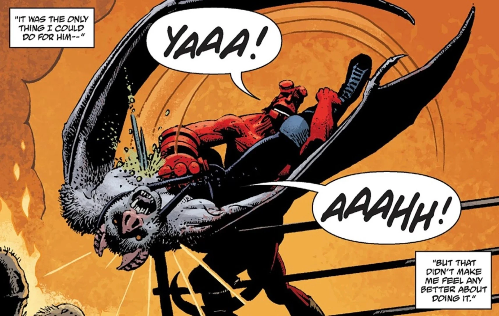

**卡马佐茨（Camazotz）**是玛雅的蝙蝠神。

## 历史

后来，[埃斯特万](/entry/Esteban)冒用了这位神祇的身份，他被变成了一名吸血鬼 luchador（墨西哥摔角手）。[地狱男爵](/entry/Hellboy)接受挑战，与这位昔日的朋友交战，最终用一根木桩杀死了他。

亚伯·塞皮恩曾与一头怪物战斗，那怪物可能就是这位古老的神祇。

## 画廊

埃斯特万，冒用卡马佐茨身份的摔角手

埃斯特万／卡马佐茨被地狱男爵杀死

|Esteban/Camazotz is killed by Hellboy
## 登场作品

- [《地狱男爵在墨西哥》](/entry/Hellboy_in_Mexico_(story))（埃斯特万冒用其身份）
- [《亡者之地》](/entry/The_Land_of_the_Dead)（可能是真正的卡马佐茨）
- [《地狱男爵》（2019年电影）](/entry/Hellboy_(2019_film))
