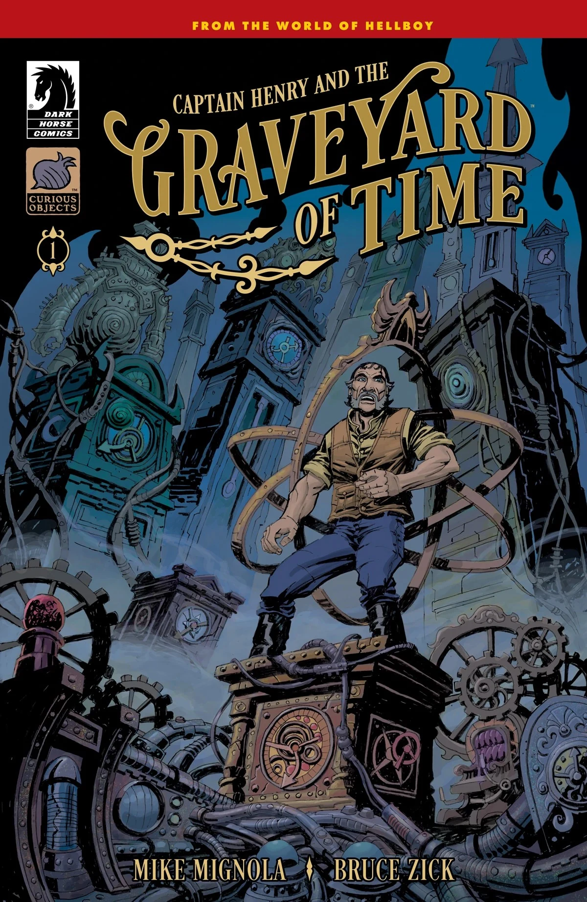
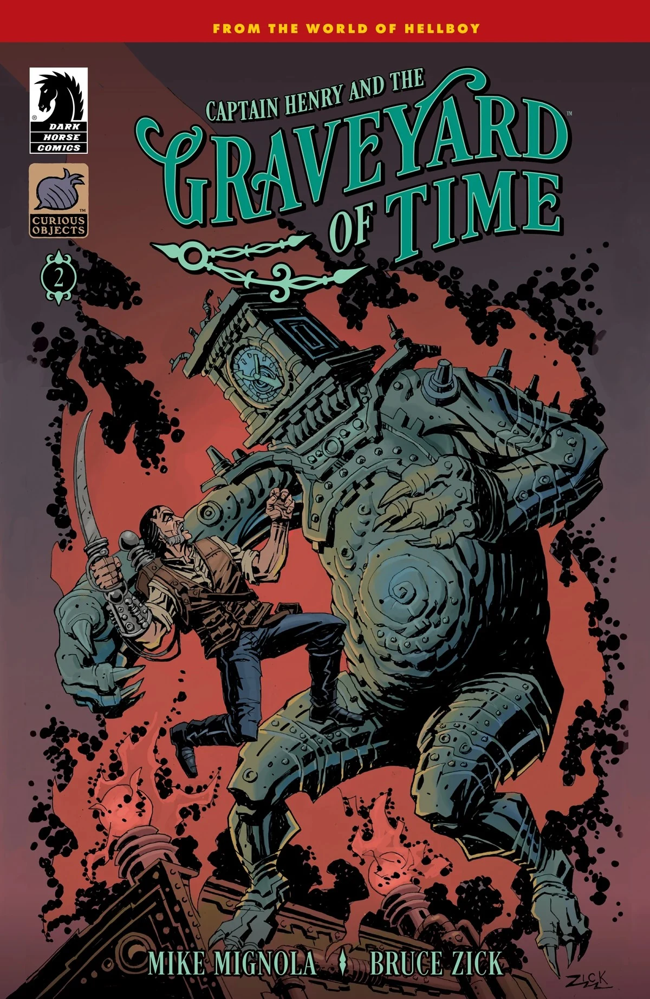
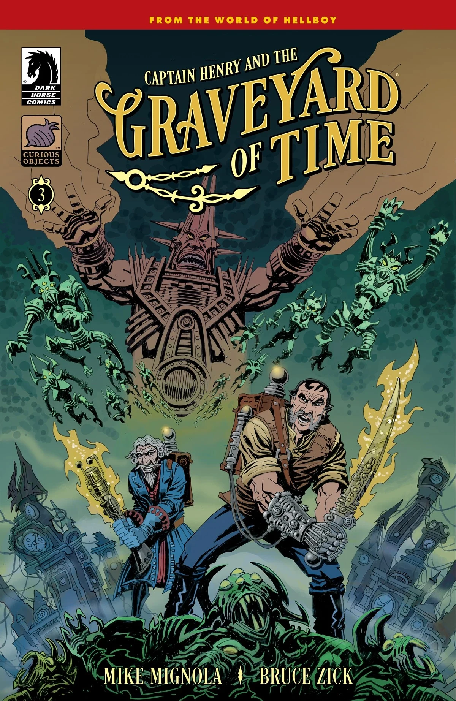
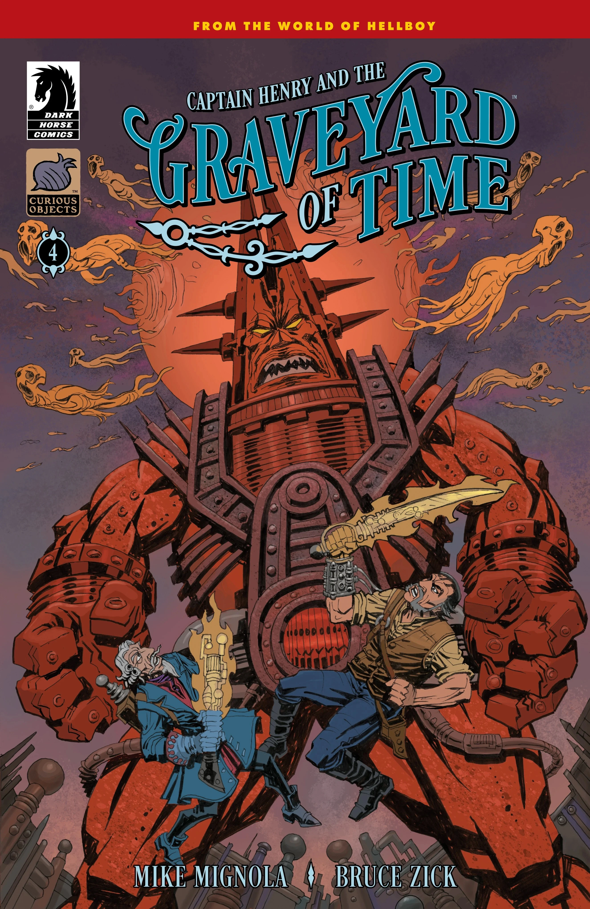
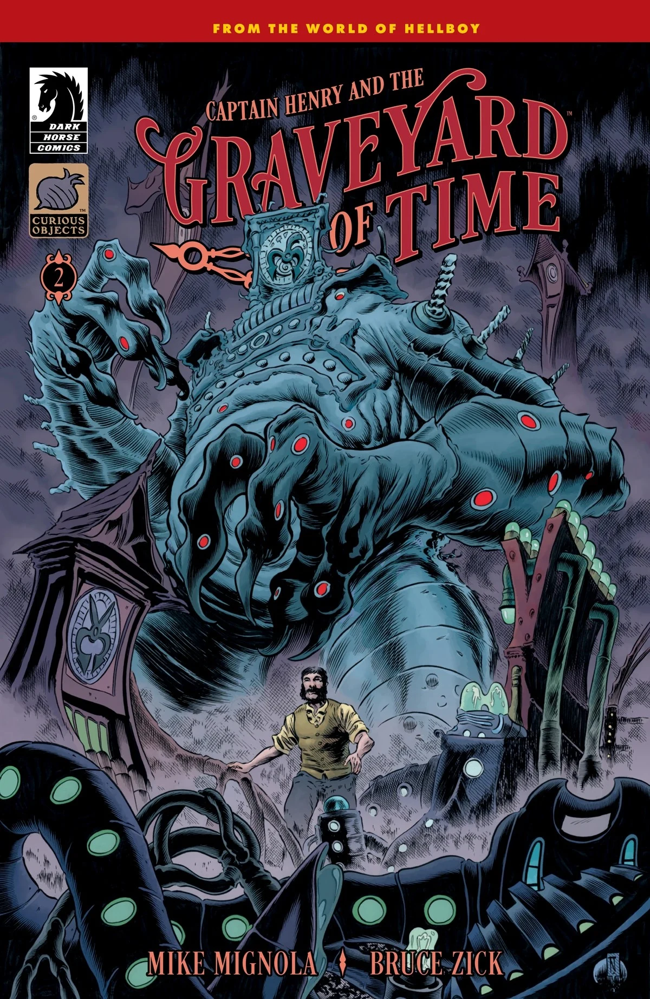
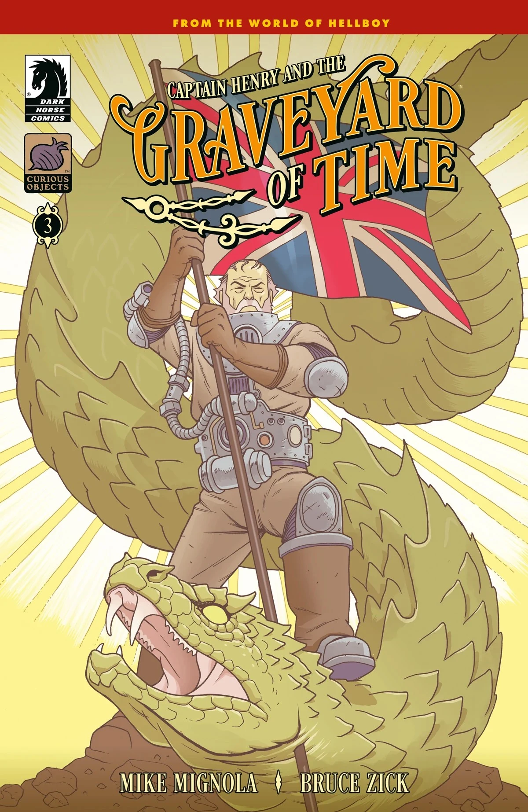
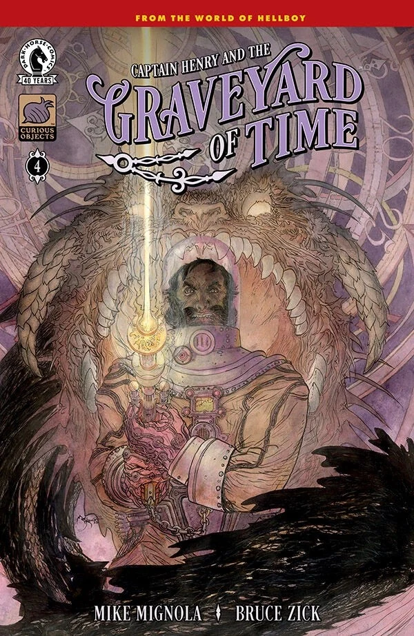

***《亨利船长与时间坟场》（Captain Henry and the Graveyard of Time）*** 是一部四期迷你连载，编剧 [Mike Mignola](/entry/Mike_Mignola) 与 Bruce Zick，同样由 Zick 作画，这也是他首次在地狱男爵宇宙中亮相。故事围绕[爱德华·格雷爵士](/entry/Edward_Grey)与惠蒂尔（Whittier）一家展开。

## 剧情简介

### 第一部分

一位无畏的时间旅行者远航至一个全新的维度，但他在那里发现的怪物，或许还不如时间本身危险。

### 第二部分

这位迷途的船长在这颗神秘星球上遇到了另一位旅行者，才发现自己并非孤身一人。然而，尽管其他人也曾被困于此——却从无人能够离开。

### 第三部分

时间之王下令消灭船长及其同样流落此地的旅伴们，于是一大群怪物向他们发起攻击。

### 第四部分

亨利船长与时间之王及其爪牙交战，这是他击败邪恶君王、回到自己原来的地方——与原来的时代——的最后希望。

## 画廊

全部封面由 Bruce Zick 绘制。

*《亨利船长与时间坟场》* \#1

*《亨利船长与时间坟场》* \#2

*《亨利船长与时间坟场》* \#3

*《亨利船长与时间坟场》* \#4

|Captain Henry and the Graveyard of Time #1

|Captain Henry and the Graveyard of Time #2

|Captain Henry and the Graveyard of Time #3

|Captain Henry and the Graveyard of Time #4

|Captain Henry and the Graveyard of Time #2 variant cover by Troy Nixey

|Captain Henry and the Graveyard of Time #3 variant cover by Ben Stenbeck

|Captain Henry and the Graveyard of Time #4 variant cover by Michael Kaluta
### 变体封面

*《亨利船长与时间坟场》* \#1  
变体封面作者 Mike Mignola  
Dave Stewart 上色

*《亨利船长与时间坟场》* \#2  
变体封面作者 Troy Nixey

*《亨利船长与时间坟场》* \#3  
变体封面作者 Ben Stenbeck

*《亨利船长与时间坟场》* \#4  
变体封面作者 Michael Kaluta
