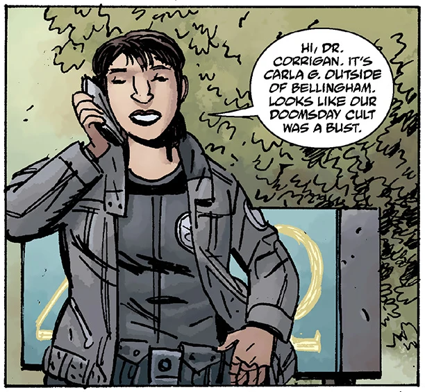
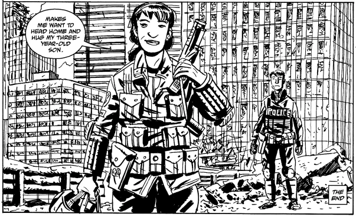
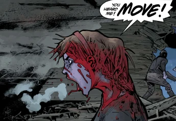
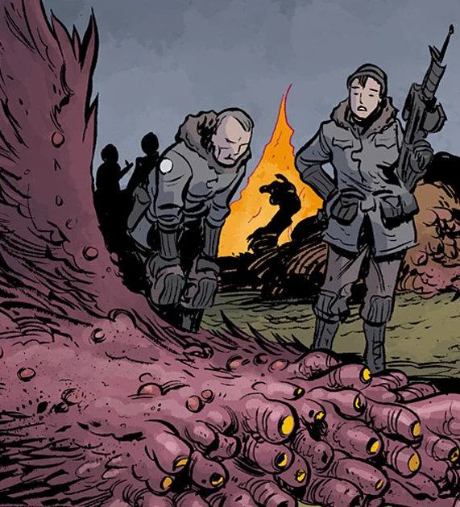

**卡拉·贾罗科（Carla Giarocco）**是[B.P.R.D.](/entry/B.P.R.D.)的一名外勤探员，在[凯特·考瑞根](/entry/Kate_Corrigan)麾下与强化天赋探员们共事。她加入 B.P.R.D. 的时间不长，但已迅速成长为一名得力干将，成为人类对抗奥古·桀哈及其众多仆从的战争中一名关键的步兵。

## 角色传记

### *恐惧之王*

在[伊丽莎白·舍曼](/entry/Elizabeth_Sherman)关于未来与 B.P.R.D. 覆灭的天启幻象中，丽兹在该局武装部队的废墟间看到了卡拉的尸体——这或许是对卡拉持续为该局效力的预言性一瞥，也可能预示着她的厄运。

### *新世界*

** 卡拉首次登场时，正与[亚伯·塞皮恩](/entry/Abe_Sapien)一同在贝灵厄姆调查有关一个末日邪教的报告，结果发现那不过是当地大学生搞的恶作剧。抵达之后，亚伯便丢下其他探员，独自追查与温迪戈和[本·达米奥](/entry/Ben_Daimio)有关的线索，没有通知任何人。

### *西雅图*

 *[恐惧之王](/entry/King_of_Fear_%28story%29)*事件之后局势不断升级，后来西雅图市遭到一头巨型怪物袭击，卡拉代表 B.P.R.D.，与当地警方和军队合作，在怪物夷平整座城市之前将其消灭。

胜利之后，一名当地警官问她，她觉得人类能否在这场斗争中获胜。贾罗科回答说她不知道，但她三岁的儿子是支撑她继续战斗的东西之一。

### *漫长的死亡*

** 西雅图事件后不久，卡拉再次出外勤，与[约翰·克劳斯](/entry/Johann_Kraus)及另外十几名探员一同前往不列颠哥伦比亚省调查一系列失踪案；那正是今年早些时候亚伯找到并击败一个奥古·桀姆的地区。由于亚伯[在行动中负伤](/entry/The_Devil%27s_Engine)，约翰当选行动指挥。然而他的真实目的是向附身后的达米奥复仇——达米奥正藏在该地区，亚伯曾秘密与他会面。抵达之后，约翰和此前的亚伯一样丢下队伍独自去猎仇。当夜，已被美洲豹恶魔控制的达米奥袭击并屠戮了这支队伍。卡拉在极近距离用一枚手榴弹成功逼退了那怪物，但自己也身受重伤。

### *主人归来*

 养伤期间，她写了一份措辞严厉的报告批评约翰的行为——充分康复后，凯特·考瑞根为嘉奖她的英勇表现，将她晋升为外勤指挥官。此外，她还被推荐给俄罗斯 S.S.S 的[约瑟夫·尼恰伊科](/entry/Iosif_Nichayko)，协助执行一项格外敏感的任务。

她率队被派往苏格兰，在那里见到了 B.P.R.D. 资深探员[萨尔·塔索](/entry/Salvatore_Tasso)，并带队在苏格兰高地展开搜捕；他们的目标是一个名叫[拉扎尔](/entry/Lazar)的俄罗斯科学家，此人逃脱了[约瑟夫的怒火](/entry/Russia)。不久事态失控：拉扎尔显露自己是[一股更强大力量](/entry/Rasputin)重生的通道，向卡拉、萨尔和她的队伍释放出各种超自然力量，双方展开殊死搏斗。卡拉和另外十名探员在与拉扎尔的战斗中幸存，并在一个奥古·桀姆现身之际，得益于俄罗斯[特殊科学局](/entry/Special_Sciences_Service)局长[约瑟夫·尼恰伊科](/entry/Iosif_Nichayko)的努力、救援及时赶到而获救。

### *地狱里寒冷的一天*

卡拉陪同 S.S.S. 局长尼恰伊科及其部下去执行任务，保卫一座孤立的无线电塔免遭恶魔袭击。

### *火湖*

在俄罗斯逗留之后，卡拉回到科罗拉多基地，与探员同伴们重聚。卡拉出席了一次 B.P.R.D. 高级会议，得知即将执行进入纽约市的任务——自从[黑焰](/entry/The_Black_Flame_%28character%29)引发的第二波奥古·桀姆活动以来，纽约便一直无法联络。后来她了解到[霍华德探员](/entry/Agent_Howards)的本事，要求他与[格维什探员](/entry/Agent_Gervesh)、[尼科尔斯探员](/entry/Agent_Nichols)和[伊诺斯探员](/entry/Russell_Enos)一同编入她的小队。卡拉和她的队伍将在尼恰伊科局长率领的 S.S.S. 配合下，经新泽西进入纽约市。

### *黑焰统治*

## 能力

卡拉是一名没有超自然能力的普通人类探员——但她已证明自己在激战之中足智多谋、身手干练。
