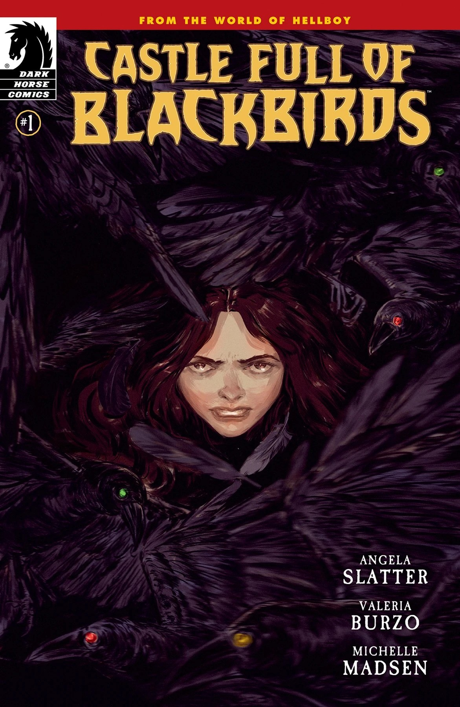
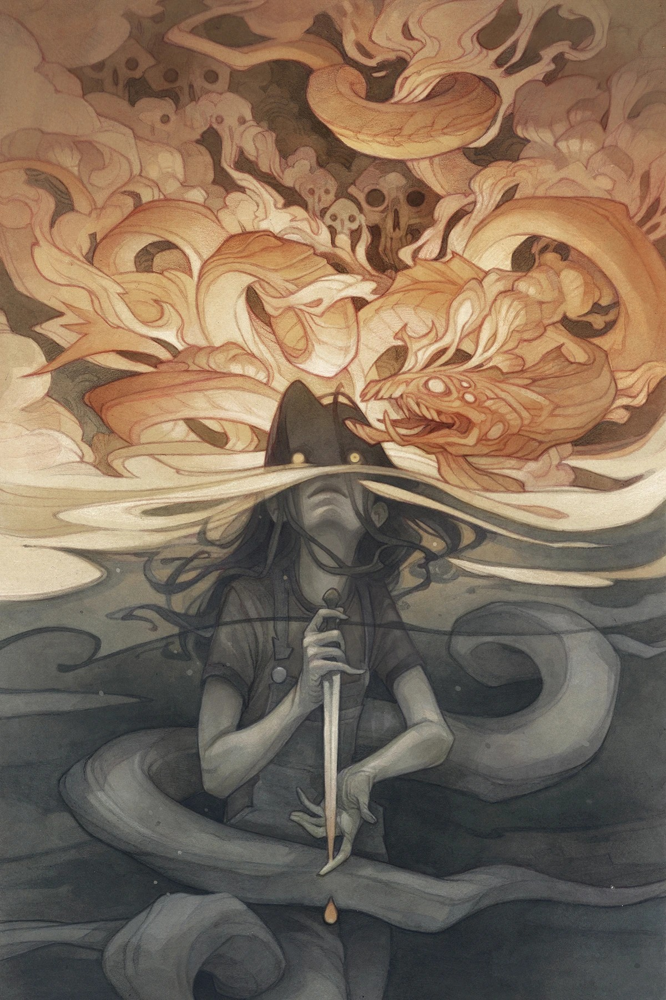
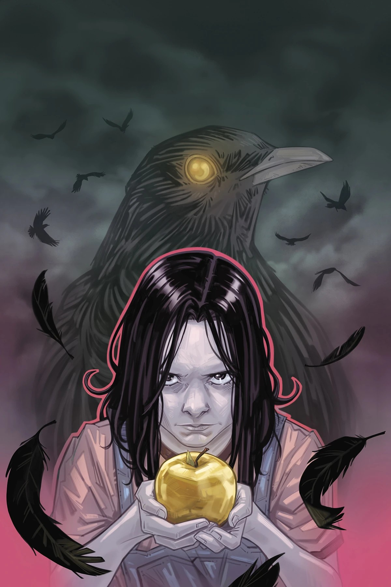
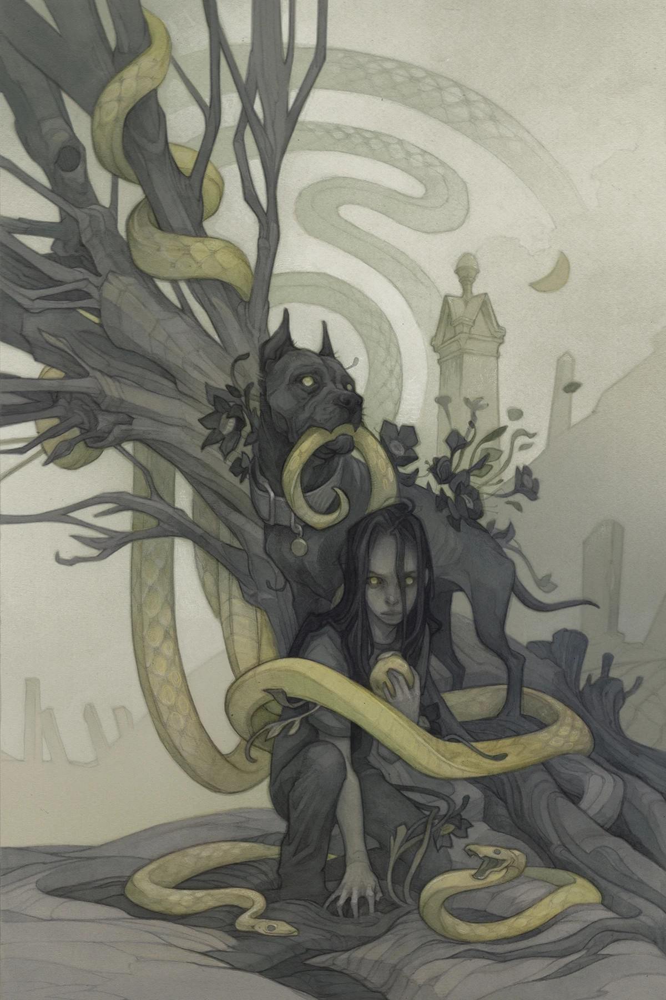
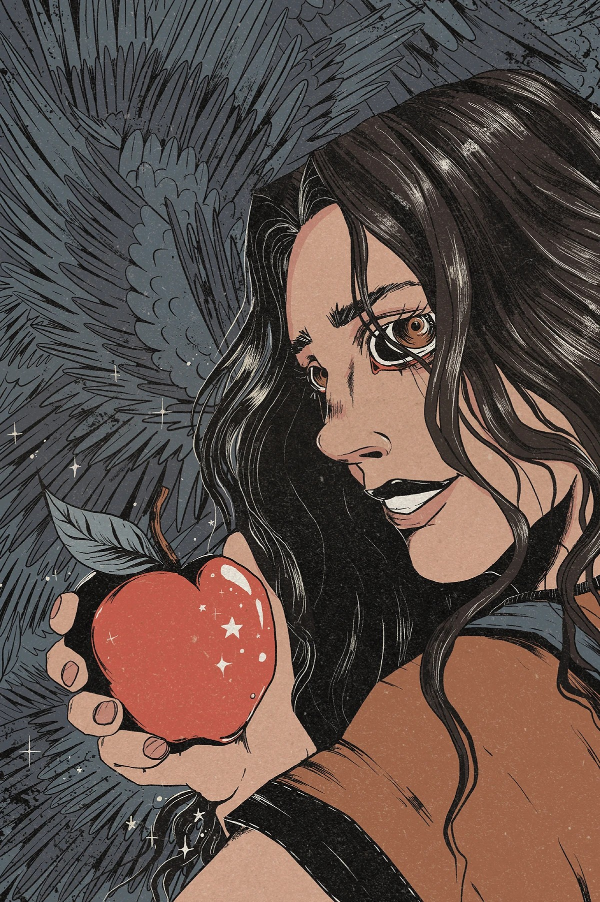
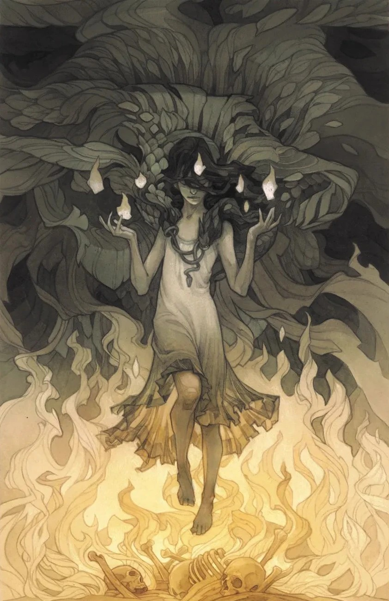
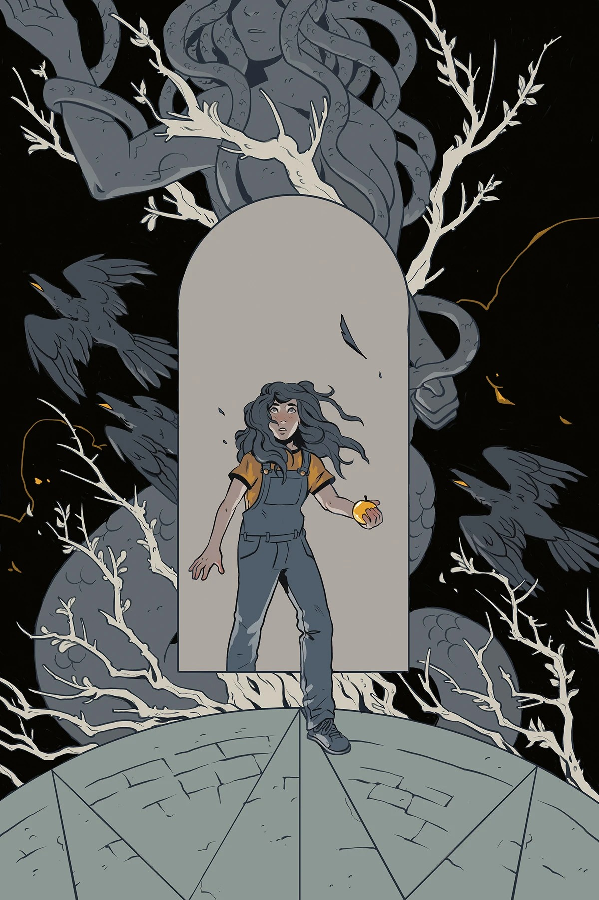

***《黑鸟城堡》*** 是一部四期限定迷你连载，由 [Angela Slatter](/entry/Angela_Slatter) 编剧、[Valeria Burzo](/entry/Valeria_Burzo) 作画。这是 Slatter 首次担任漫画编剧，也是 Slatter 与 Burzo 二人在地狱男爵宇宙中的首次亮相。故事讲述[萨拉·梅·布莱克本（Sara May Blackburn）](/entry/Sara_May_Blackburn)在 *[《地狱男爵与超自然调查防御署：艾菲·科尔布的归来》](/entry/The_Return_of_Effie_Kolb)* 事件之后，进入林顿女子学校（Linton School for Girls）后的经历。

## 出版历史

*《黑鸟城堡》* 于 2022 年 6 月公布。被问及为何邀请 Slatter 进入地狱男爵宇宙创作这个故事时，他说：“我确实知道，既然这是一部关于一个年轻女孩的作品，我就想要一个女性的视角。需要一个人能为 *《地狱男爵》* 的世界带来一些新东西，同时又能玩转我们为这个世界建立起来的历史与神话。”

## 剧情简介

### 第一部分

*《地狱男爵与超自然调查防御署：艾菲·科尔布的归来》* 事件之后，萨拉·梅·布莱克本动身前往纽约，心中只有一个目标：在林顿女子学校找到神秘的布鲁克斯小姐（Miss Brooks），问问她究竟对那些困扰了萨拉·梅一生的神秘力量了解多少。但这类事情往往如此，答案并没有那么简单。在林顿学校，等待萨拉的将不只是读、写、算术方面的教育。

### 第二部分

萨拉·梅·布莱克本在林顿女子学校开始跟随神秘的布鲁克斯女士接受特殊训练。随着她对自身特殊力量了解的加深，她面临着全新而危险的考验——但这些考验会不会只是一种障眼法，用来掩盖这所神秘学校里某种超越魔法教育的勾当？

### 第三部分

随着课程转向危险，萨拉·梅以更大胆、也更冒险的方式拓展着自己的魔法学业。而在暗处，阴谋开始成形。它们对这位年轻女巫又意味着什么？

### 第四部分

萨拉·梅在林顿女子学校的第一年即将结束之际，关于布鲁克斯小姐、校长以及同学失踪事件的真相，似乎比以往任何时候都更加神秘、更加可怖！然而，当萨拉·梅开始牵扯出新的线索、试图揭开真实内情时，整所学校的命运都可能悬于一线。

## 画廊

标准版封面作者：[Wylie Beckert](/entry/Wylie_Beckert)。

第 \#1 期

第 \#1 期变体封面  
作者：Vanesa Del Rey

第 \#2 期

第 \#2 期变体封面  
作者：Marianna Strychowska

第 \#3 期

第 \#3 期变体封面  
作者：Evangeline Gallagher

第 \#4 期

第 \#4 期变体封面  
作者：A.H. Szabla

|Issue #1 variant cover by Vanesa Del Rey

|第 #2 期

|Issue #2 variant cover by Marianna Strychowska

|第 #3 期

|Issue #3 variant cover by Evangeline Gallagher

|第 #4 期

|Issue #4 variant cover by A.H. Szabla
