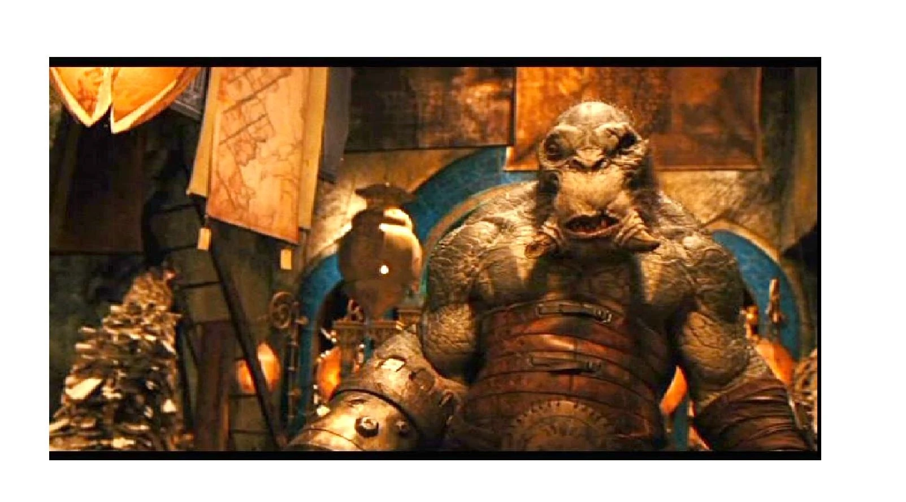

洞穴巨魔是强壮而愚笨的生物。努阿达王子 (Prince Nuada)在寻找黄金军团时，曾把温克 (Wink)当作帮手。不过洞穴巨魔在机械方面颇有头脑。

它们居住在洞穴中，那里遍布着各式机械与建筑。

它们在建造方面相当聪明，但在其他许多事情上就不那么灵光了。

它们力量强大，凌驾于科林斯 (Corinth)的各种生物（食人魔、巨魔、独眼巨人等）之上。

它们以多肉的生物为食，并且长有强壮的颚，以备遭遇危险时使用。
