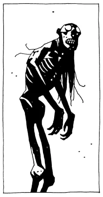

**卡伊波尔（Caypor）**是一种巴西恶魔，栖息在雨林的边缘地带，以把孩子们吓跑、使其远离林中危险的方式保护他们。它登场于小说*[《地狱男爵：巨人之骨》](/entry/Hellboy__The_Bones_of_Giants_(prose_novel))*。

## 描述

它外形高大，状似人形而枯瘦如尸，皮肤呈红色、如树皮一般，长发垂落。口中满是参差不齐、覆满苔藓的牙齿。手脚上的每根指（趾）头都生有利爪，坚固得甚至能划破地狱男爵的皮肤。它们体内没有血液，取而代之的是一种浓稠的树液。

## 能力

这种生物能够凭意志在人类眼前隐形，不过某些超自然存在（如地狱男爵）仍能察觉到它们。作为森林恶魔，它们对植物拥有一定程度的控制力。例如曾有一只卡伊波尔在短短数秒之内令多棵树木长至成材。卡伊波尔拥有一种植物般的快速再生能力，断肢须臾之间便能重新长出。然而它们对火与电格外脆弱。它还具备惊人的力量与敏捷，在施展复杂的杂技式攻击时可见一斑。它们也能说人类的语言，具体而言是葡萄牙语。

## 历史

[地狱男爵](/entry/Hellboy_(character))曾在弗吉尼亚州的一座游乐园里遭遇过一只这种生物。一群巴西母亲担心自己的孩子更偏爱美国文化而非本民族文化，便将它召唤到了那里。地狱男爵向它施以一连串看似致命的打击，随后才意识到它那惊人的再生能力使这些攻击全部失效。地狱男爵最终克服了这一点：他让它的身体充入大量电流，使它被灼烧而死。
