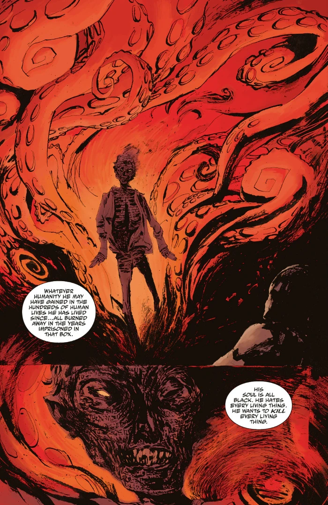

塞杜-巴拉（Cedu-Barra）是一位[海伯利亚人](/entry/Hyperboreans)巫师，也是秘火（Secret Fire）的祭司。

## 背景

塞杜-巴拉曾是海伯利亚的祭司，在海伯利亚毁灭时逃脱，向南流亡到[亚特兰蒂斯](/entry/Atlantis)。在那里，他凭借自己的法术，使自己成为地位仅次于国王的人物。然而亚特兰蒂斯最终也走到了末日，黑色女神的腐化给这座城市带来了毁灭。这位祭司不得不再次逃亡，而这一次他与一个被称为“六魔”（Six Devils）的群体同行。他们一同逃到[利莫里亚](/entry/Lemuria)，第二代人类便诞生在那里。他死在了那里，但他的造物对此早有准备，带走了他的灵魂，要在新人类种族中为它寻找一具新的躯体寄居。塞杜-巴拉和他的造物不断重复这一循环，将他的灵魂转入另一个宿主，并隐藏在人类众多有影响力的萨满、法老与国王的身份背后。

到了 18 世纪，他的恶魔们选中的下一任宿主是荷兰巫师 [Epke Vrooman](/entry/Epke_Vrooman)。然而 Vrooman 有一个敌人正紧追不舍。当恶魔们带着 Vrooman 乘船逃离伦敦时，[爱德华·格雷](/entry/Edward_Grey)追上了他们。在这位猎巫人打断他们之前，恶魔们成功将主人的灵魂转入了 Vroom 的体内，但当这位秘术师用一把附有古老魔法的魔法匕首刺中 Vrooman、将塞杜-巴拉封困在这具身体中时，他们便无法唤醒他了。这艘船最终在圣塞巴斯蒂安（Saint-Sebastian）海岸外沉没。

此后过了一段时间，装着 Vrooman 遗体的棺材被冲上岸边，被海巫发现。塞杜-巴拉虽然醒着，却像死人一样无力，他恳求女巫拔出匕首、放他自由。然而海巫认为，这个古老灵魂在他的生生世世中所行的善，都抵不过他作下的恶。她相信，是她的[父亲](/entry/Water_Spirit)把塞杜-巴拉送来，好让这个海伯利亚人被永远锁住。
