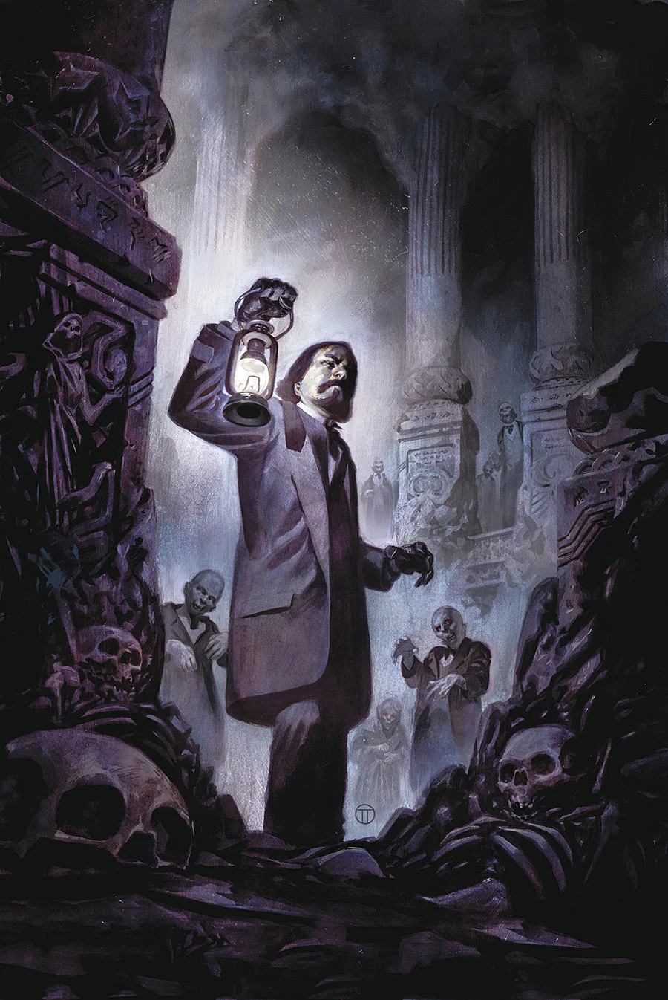
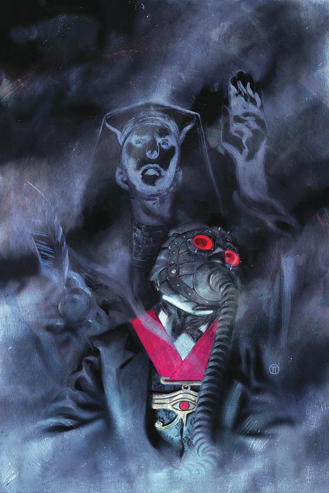
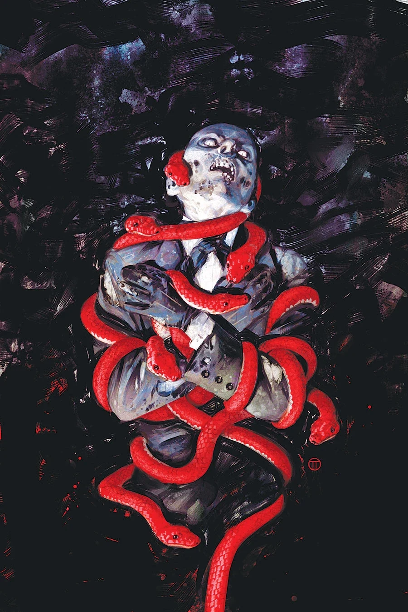
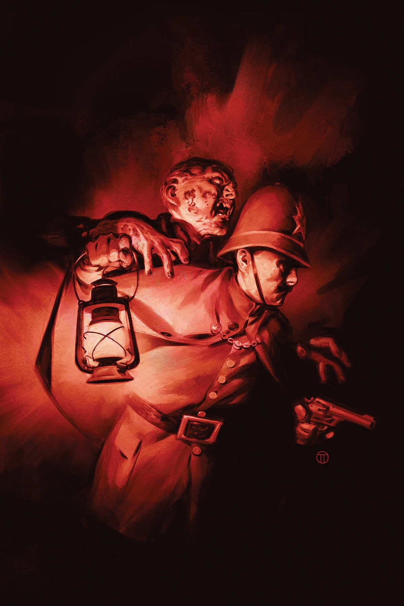

《**死亡之城**》（City of the Dead）是一部五期限定连载，由 [Mike Mignola](/entry/Mike_Mignola) 与 [Chris Roberson](/entry/Chris_Roberson) 编剧，[Ben Stenbeck](/entry/Ben_Stenbeck) 担任作画，[Julián Totino Tedesco](/entry/Juli%C3%A1n_Totino_Tedesco) 绘制封面。

## 剧情简介

### 第一部

女王的神秘学顾问 [爱德华·格雷爵士](/entry/Sir_Edward_Grey)直面噬食血肉的死尸，并在伦敦地下发现了一座神庙。最令他费解的谜团是：邪恶的[太阳神赫利奥皮克兄弟会](/entry/Heliopic_Brotherhood_of_Ra)想从这座神庙中得到什么——又想从他身上得到什么。

### 第二部

爱德华·格雷爵士在伦敦一座墓园中险之又险地从复活死尸的袭击下生还，随后循着唯一的线索追查，却走进了死胡同；但太阳神赫利奥皮克兄弟会或许能够揭示亡灵背后的真相。

### 第三部

爱德华·格雷爵士深入伦敦地下，来到一位宿敌的巢穴，而这位宿敌需要他的帮助，以对抗一个更加强大的威胁。

### 第四部

当一个老敌人现身、成为复活亡者的首领时，爱德华·格雷爵士转而求助于自己所信奉的更高力量，以进行反击。

### 第五部

猎巫人重返伦敦地下的秘密密室……

## 画廊

第 1 期

第 2 期

第 3 期

第 4 期

第 5 期
