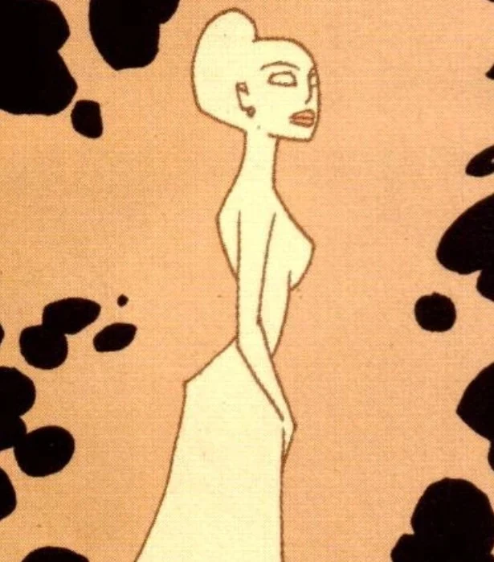

**克洛阿喀娜（Cloacina）**是罗马神话中的运河女神，也是威尼斯的守护神。

## 历史

克洛阿喀娜是威尼斯辉煌时期受人崇拜的女神，尽管对她的崇拜逐渐衰落，她仍继续维护着威尼斯的运河。她的灵魂被一位名叫[罗穆卢斯·迪乔瓦尼](/entry/Romulus_Diovanni)的年迈吸血鬼领主捕获。随着她的失踪，威尼斯的运河变得极度污浊。

[超自然调查防御署（B.P.R.D.）](/entry/Bureau_for_Paranormal_Research_and_Defense)特工[丽兹·舍曼](/entry/Elizabeth_Sherman)、[亚伯·塞皮恩](/entry/Abe_Sapien)、[罗杰](/entry/Roger)和[约翰·克劳斯](/entry/Johann_Kraus)前往威尼斯调查是否存在超自然原因。罗杰发现了一尊被冷落的她的雕像，并被她的形象迷住。四人查明此事与迪乔瓦尼有关，但他除罗杰之外把其余三人全部击昏，并召唤了恶魔领主[沙克斯](/entry/Shax)。吸血鬼提出献上克洛阿喀娜的灵魂以换取力量。他的提议遭到拒绝，恶魔要求被释放。罗杰成功打碎了囚禁女神的罐子，将她释放。吸血鬼和恶魔离开之后，有人最后看到克洛阿喀娜的灵魂对罗杰微微一笑。

此后威尼斯的运河恢复了正常，B.P.R.D. 小队其余成员短暂休假。有人看到罗杰在运河边与克洛阿喀娜的雕像分享一瓶葡萄酒。

克洛阿喀娜的灵魂似乎对罗杰产生了影响，在他自己的小小来世场景中设有一座供奉她的神龛。

## 能力

克洛阿喀娜是威尼斯之灵，与她的城市有着共生的联系。维护威尼斯的运河是她的职责，她的失踪险些酿成一场环境灾难。

## 画廊

Cloacnia2.jpeg Cloacina3.jpeg

|

|
