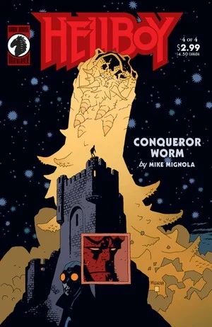

*本条目介绍的是[奥格德鲁·赫姆](/entry/Ogdru_Hem)。关于同名漫画迷你系列，见*[《征服之虫》（故事）](/entry/Conqueror_Worm_%28story%29)*。*

**征服之虫（Conqueror Worm）**是 369 只[奥格德鲁·赫姆](/entry/Ogdru_Hem)之一——它们是[奥古·桀哈](/entry/Ogdru_Jahad)的子嗣，也是[《地狱男爵：征服之虫》](/entry/Conqueror_Worm_%28story%29)中的主要反派。

## 历史

### 过去

征服之虫是三百六十九只[奥格德鲁·赫姆](/entry/Ogdru_Hem)之一，是古老的[奥古·桀哈](/entry/Ogdru_Jahad)的后裔。它被上帝的天使击败，但被摧毁的只是虫的躯体，它的灵魂被放逐到外太空。

1939 年，纳粹发现了这个灵魂，他们想与这个存在接触，利用它击败同盟国。纳粹送去新近去世的恩斯特·厄明博士的遗体，希望那灵魂把它当作容器。尸体随太空舱被送入太空，但计划被传奇义警大螯虾强生阻止。

1939 年，急于在第二次世界大战中对同盟国取得决定性优势的纳粹（正是这种急切促使他们资助了[诸神黄昏计划（Project Ragna Rok）](/entry/Project_Ragna_Rok)），不知怎的与太空中的邪恶实体取得了联系（[地狱男爵](/entry/Hellboy_%28character%29)半开玩笑地称之为"太空幽灵"），对方承诺：如果把一具尸体送入太空供其中一个实体附身，它将带着碾碎敌人的力量返回地球。

纳粹把新近遇刺身亡的 [恩斯特·厄明](/entry/Ernst_Oeming) 博士的尸体封进一件宇航服，用太空舱从奥地利的亨特城堡发射升空，但该计划被[大螯虾强生](/entry/Lobster_Johnson)阻止。

### 现在

六十一年后，[赫尔曼·冯·卡朗普特](/entry/Herman_von_Klempt)进入亨特城堡，重新启动旧设备，发出召回信号，把厄明博士的太空舱带回地球。太空舱着陆后，征服之虫从中现身。怪虫吐出一种气体，能把人瞬间变成[蛙怪](/entry/frog_monster)，随后它再吞噬这些蛙怪，让自己的体型和力量增长。

监视奥古·桀哈牢笼的外星种族派出一名代表警告地狱男爵和[罗杰](/entry/Roger)：如果不阻止它，它将强大到足以毁灭地球上的所有生命，然后把奥古·桀哈从牢笼中召唤出来。

怪虫最终被地狱男爵、罗杰和大螯虾的鬼魂击败，他们使用了外星人给地狱男爵的一块能量电池。

[格里高利·拉斯普廷](/entry/Grigori_Rasputin)曾把冯·卡朗普特引到亨特城堡，指望借此唤醒奥古·桀哈；怪虫的败北让他大为恼火。而[赫卡特](/entry/Hecate)——她寄居在那具曾处死 [伊尔莎·豪普斯坦](/entry/Ilsa_Haupstein) 的铁处女中——则嘲讽道：无论拉斯普廷怎么尝试，唯一能释放奥古·桀哈的力量是[毁灭右手](/entry/Right_Hand_of_Doom)，而这只手仍长在地狱男爵身上，地狱男爵也始终不受拉斯普廷控制。拉斯普廷勃然大怒，气得爆炸成一堆碎骨。

征服之虫的能力与 [萨杜-赫姆](/entry/Sadu-Hem)相似——后者曾出现在[卡文迪什庄园](/entry/Cavendish_Hall)，并在[蛙疫](/entry/Plague_of_Frogs)期间再度现身。

## 能力

- **生物操控**：它能在细胞和基因层面扭曲血肉，最显著的方式是它吐息，能把人类蜕变成畸形的蛙状生物。
- **超自然的耐久与恢复力**：众所周知，奥格德鲁·赫姆极难被常规武器摧毁，对伤害的抵抗力极强。
- **附身**（作为灵魂）：怪虫的灵魂可以附身于一具物质容器，正如它附在恩斯特·厄明博士的尸体上那样。

- **腐化吐息**：征服之虫最直接的武器是它的诱变吐息——一种能把人类瞬间变成它爪牙的气体。
- **巨大的体型与力量**：一旦开始吞食蛙怪爪牙，怪虫就会长到极为庞大的尺寸，把自己的肉身当作毁灭性的武器。

## 画廊

## 趣闻

征服之虫得名自埃德加·爱伦·坡的[同名诗作](/entry/wikipedia%3AThe_Conqueror_Worm)。这个名字也曾被用作英国恐怖片《驱魔降妖》（Witchfinder General，Vincent Price 主演）的美国片名（这部电影也是 [亨利·胡德](/entry/Henry_Hood) 这个角色的灵感来源之一）。
