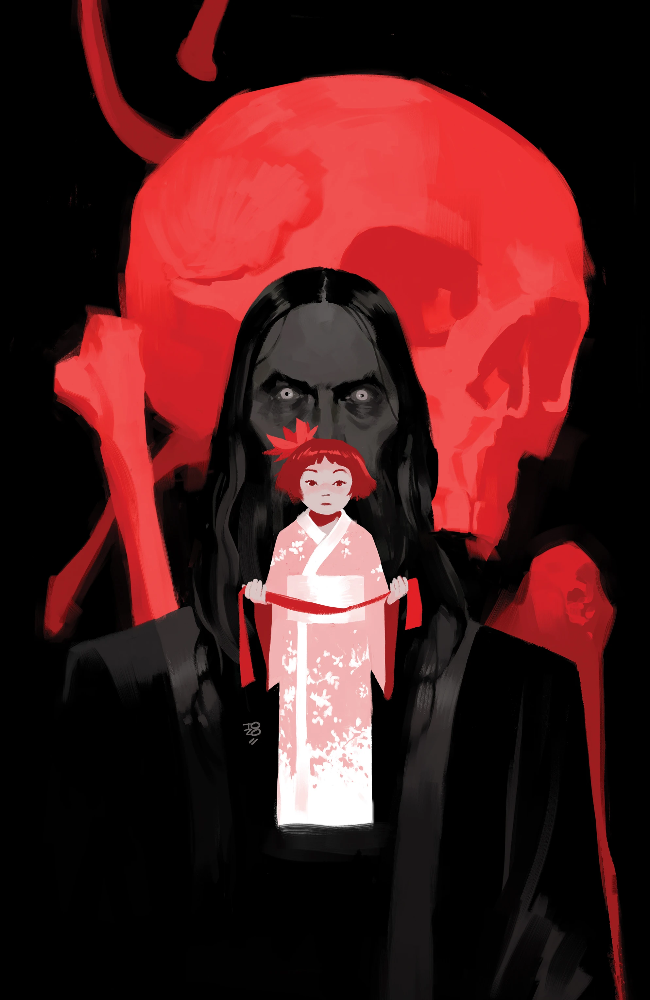
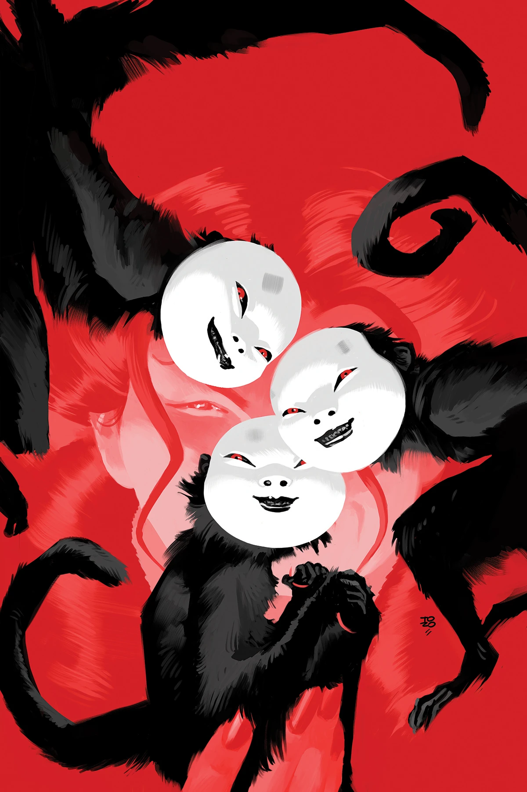
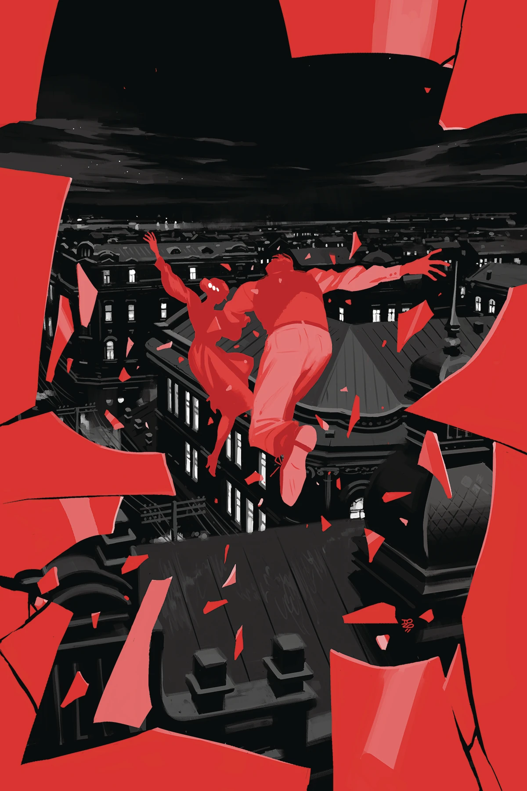
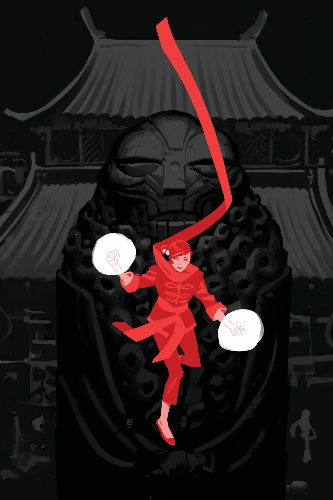

***《绯红莲花》*（Crimson Lotus）**是一部关于 [戴美子（Yumiko Daimio）](/entry/Yumiko_Daimio) 的五期限定迷你系列。这是 [明迪·李](/entry/Mindy_Lee) 在地狱男爵宇宙的处女作。

## 出版历史

*绯红莲花* 迷你系列于 2018 年圣迭戈国际动漫展期间揭晓，是地狱男爵 25 周年纪念发布内容的一部分。

## 剧情梗概

### 第一部分

在成为 [龙虾约翰逊](/entry/The_Lobster) 最大的对手之前，绯红莲花还只是个小女孩，她的家庭被卷入日俄战争。三十年后，莲花展开复仇，其影响在国际上掀起恐怖的波澜；两名间谍必须设法在中国追踪她，以免自己成为她蛛网上的苍蝇。

### 第二部分

秘密特工戴（Dai）和他所保护的男人在日占中国经历了一场动荡的火车之旅，结果却要面对新的盟友……和新的敌人。

### 第三部分

绯红莲花再次出击！一名特工死亡的消息令间谍胜利（Shengli）和戴大为震惊，当他们发现莲花比想象中离他们更近时，必须再次挡开她的攻势。两人能否避免被困在日军士兵和莲花本人之间？

### 第四部分

与绯红莲花的一次遭遇，让一名特工意识到自己一直被另一名特工蒙在鼓里；与此同时，莲花究竟在追寻什么，这一疑问比以往任何时候都更加凸显。

### 第五部分

夹在一连致命的日军士兵和更加致命的绯红莲花之间，戴和胜利必须在这个强大的女巫酿成一场世界性灾难之前阻止她。

## 画廊

封面由 [通奇·宗伊奇](/entry/Tonci_Zonjic) 绘制。

