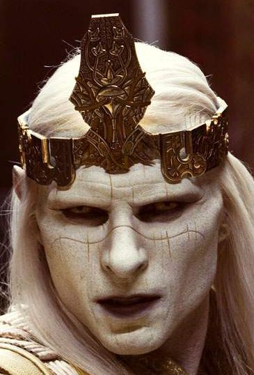

头戴王冠的[弩阿达](/entry/Nuada)王子

**贝斯莫拉王冠（Crown of Bethmora）**是 *[《地狱男爵2：黄金军团》](/entry/Hellboy_II%3A_The_Golden_Army)* 中登场的一件圣物。

## 背景

很久以前，当人类向魔法生物宣战时，贝斯莫拉的地精打造了这顶王冠，好让[巴洛尔国王](/entry/King_Balor)这样拥有古老血脉的人能够号令[黄金军团](/entry/The_Golden_Army)。战争结束后，巴洛尔促成了精灵一族与人类和平共处，并把王冠分成三片：三分之一交给人类，其余两片由他自己保管。只有巴洛尔的儿子[弩阿达](/entry/Nuada)认为这是个错误，随后他被迫踏上流亡之路。

## 历史

数千年后，弩阿达重新现身，因人类对大地、自然和各种魔法生灵犯下的罪行而向人类宣战。王子的征战第一步，便是集齐散落的王冠碎片，好让黄金军团将人类彻底抹去。第一片碎片在纽约市一家私人拍卖行被他夺回。随后他闯入父亲巴洛尔国王的宫廷，为夺取父亲手中的碎片而弑父。他的妹妹[弩阿拉公主](/entry/Nuala)持有最后一片王冠碎片，她逃出王宫，受到 B.P.R.D. 的保护。

弩阿达最终还是找到了她，轻而易举地攻入防御署总部，却没能取回碎片——弩阿拉已将它藏起，他被迫在防御署安全探员的围攻下撤退。

最后是亚伯·塞皮恩把最后一片王冠碎片带给弩阿达，以换取弩阿拉的平安，但这位精灵王子背信弃义，在贝斯莫拉废墟中启动了黄金军团。B.P.R.D. 探员们奋力抵抗，却无法真正摧毁黄金军团，因为它们会不断自我重组。地狱男爵眼见别无他法，便向弩阿达提出挑战——唯有王室血脉之人才能挑战佩戴王冠的权利。作为[堕落者](/entry/Azzael)——地狱的一位君王或王子——之子，地狱男爵凭借父系血脉有资格挑战弩阿达，并赢得了王冠。随后[丽兹·舍曼](/entry/Liz_Sherman)将王冠熔毁，使它的力量再也无法被用来唤醒黄金军团。

## 花絮

- 在《地狱男爵：黄金军团》的小说版中，拍卖师认定这件神器的年代可追溯至公元 1 世纪初。
