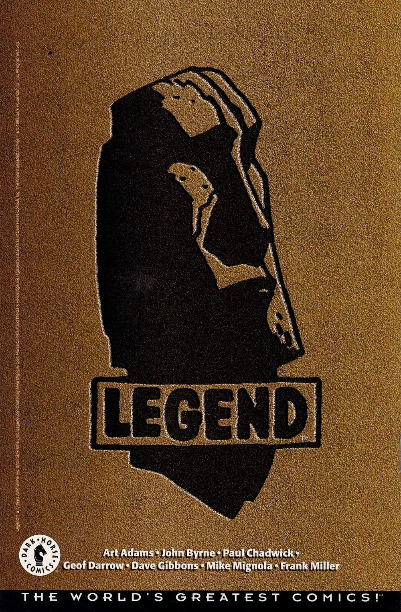

**黑马漫画（Dark Horse Comics）**是一家美国漫画出版公司，由迈克·理查森（Mike Richardson）于 1986 年创立。

自 1994 年起，黑马漫画开始出版 [迈克·米格诺拉](/entry/Mike_Mignola) 的 *[《地狱男爵》](/entry/Hellboy_(series))* 漫画。

## 历史

### Legend（传奇）

1994 年，黑马漫画推出了“Legend”出版厂牌。受 Malibu Comics 旗下 Image 的启发，Legend 专注于创作者自有版权的作品，推介一批知名漫画创作者的原创系列。米格诺拉的《地狱男爵》成为该厂牌最早的刊物之一。其他 Legend 创作者包括 [约翰·伯恩（John Byrne）](/entry/John_Byrne)、亚特·亚当斯（Art Adams）、弗兰克·米勒（Frank Miller）、戴夫·吉本斯（Dave Gibbons）和杰夫·达罗（Geof Darrow）。

> 
>
> **《Danger Unlimited》** 是我为新成立的 Legend 厂牌创作的第二部作品，也是本应成为“共享宇宙”一部分的那一部。*DU* 与 **《地狱男爵》**、**《Monkeyman and O'Brien》** 将处在同一个世界中［……］但 Legend 并不是一个“宇宙”。整体中只有小小的一角被设定为彼此连贯。而且如前所述，就连这一点关联也微乎其微。
>
> 
>
> ——[约翰·伯恩](/entry/John_Byrne)，《Danger Unlimited》平装合订本前言，2009 年 1 月

  
三位 Legend 创作者最初计划让他们的漫画共存于一个共享宇宙中——[约翰·伯恩](/entry/John_Byrne)的《Danger Unlimited》、亚特·亚当斯的《Monkeyman and O'Brien》，以及迈克·米格诺拉的《地狱男爵》——不过需要说明的是，Legend 产品线中有很大一部分是独立作品，其他创作者坚决要求自己的作品保持独立。这场三方合作的例子包括：

- [自由火炬（The Torch of Liberty）](/entry/The_Torch_of_Liberty)（出自伯恩的《Danger Unlimited》）出现在《地狱男爵：[毁灭之芽](/entry/Seed_of_Destruction)》中。
- [地狱男爵](/entry/Hellboy_(character))在《Danger Unlimited》第 \#4 期的一段闪回中登场，与[自由火炬](/entry/The_Torch_of_Liberty)及其他英雄并肩出现。
- 伯恩的 *[《Babe 2》](/entry/Babe_2)* 迷你系列（设定在《Danger Unlimited》的世界中）让 [亚伯·塞皮恩](/entry/Abraham_Sapien) 担任重要角色，他与 Babe 联手对抗 Shrewmanoid（出自亚当斯《Monkeyman and O'Brien》的反派）。地狱男爵也在故事最后一页客串登场。
- 罗伯特·卡森博士（Dr. Robert Carson，出自伯恩的《Danger Unlimited》）在 *[《锁链棺材》](/entry/The_Chained_Coffin)* 中被提及。

这些出版物之间还有一些非正典的联动：

- 《Monkeyman and O'Brien》作为后备短篇刊登在《地狱男爵：毁灭之芽》第 \#1–4 期中。实际故事内容并无重叠。
- 地狱男爵出现在约翰·伯恩的《Next Men》第 \#21 期中，在 *Next Men* 的宇宙里被描绘成一个虚构的漫画角色。

然而，米格诺拉和伯恩都回忆说，这个构想很快就出了问题——协调与组织上的困难迅速压过了任何收益，他们各自拥有自己的宇宙反而更好。因此，这些联动元素在《地狱男爵》的正典连续性中被弱化或删除（在《地狱男爵完全指南》（*[Hellboy: The Companion](/entry/Hellboy%3A_The_Companion)*）等补充资料中均未被提及）：

- 自由火炬自《毁灭之芽》之后再未正式登场。后来对“地狱男爵事件”的描绘往往弱化或完全略去他在该事件中的存在。
- 《毁灭之芽》的大多数再版本不仅没有收录《Monkeyman and O'Brien》后备短篇，还移除了期号封面上的宣传文字，并用[超自然调查防御署](/entry/Bureau_for_Paranormal_Research_and_Defense)的标志遮住亚当斯绘制的这对搭档的插图。
- 对罗伯特·卡森博士的提及在《锁链棺材》后来的版本中被删除。

*[《毁灭之芽》](/entry/Seed_of_Destruction)* 原版封面，宣传《Monkeyman and O'Brien》。

再版封面，去掉了《Monkeyman and O'Brien》。

与《毁灭之芽》第 \#1 期（1994 年）相比，*[《地狱男爵与超自然调查防御署》](/entry/Hellboy_and_the_B.P.R.D.): (/entry/1952)* 第 \#1 期（2014 年）弱化了火炬的存在感。

从 1998 年的再版开始，*[《锁链棺材》](/entry/The_Chained_Coffin)* 不再提及卡森博士。

到 1998 年，Legend 厂牌已被停用。

## 外部链接

- 黑马漫画
- 维基百科上的黑马漫画
- Dark Horse Database 维基
