**Dave Johnson** 是曾获 Eisner 奖的漫画画师（2002 年，凭借《100 Bullets》获奖）。2009 年 10 月至 2013 年 8 月间，他为[《亚伯·赛皮恩》（Abe Sapien）](/entry/Abe_Sapien_%28series%29)、[《Lobster Johnson》](/entry/Lobster_Johnson_%28series%29)和[《B.P.R.D.》](/entry/B.P.R.D._%28series%29)绘制封面，并在 2018 年 11 月至 2019 年 3 月间为[《地狱男爵与 B.P.R.D.》（Hellboy and the B.P.R.D.）](/entry/Hellboy_and_the_B.P.R.D.)绘制封面。

## 封面作画

### 《亚伯·赛皮恩》各期

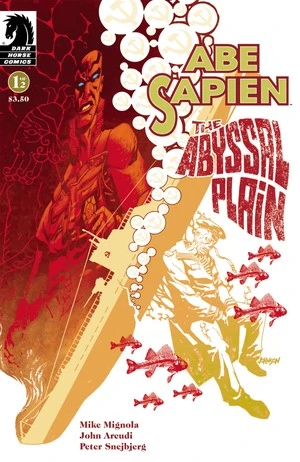

|《亚伯·赛皮恩：深渊平原》（Abe Sapien: The Abyssal Plain）第 1 期

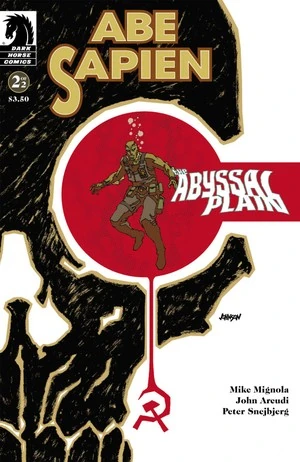

|《亚伯·赛皮恩：深渊平原》第 2 期

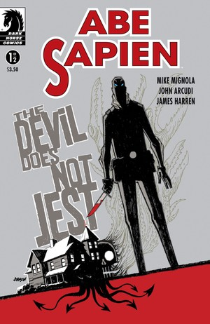

|《亚伯·赛皮恩：恶魔不开玩笑》（Abe Sapien: The Devil Does Not Jest）第 1 期

|《亚伯·赛皮恩：恶魔不开玩笑》第 2 期

### 《B.P.R.D.：人间地狱》各期

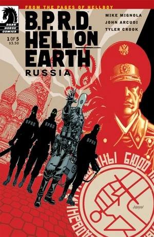

|《B.P.R.D. 人间地狱：俄罗斯》（B.P.R.D. Hell on Earth: Russia）第 1 期

|《B.P.R.D. 人间地狱：俄罗斯》第 2 期

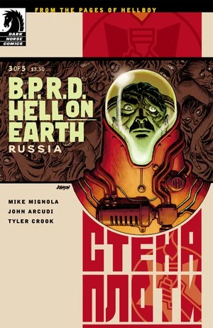

|《B.P.R.D. 人间地狱：俄罗斯》第 3 期

|《B.P.R.D. 人间地狱：俄罗斯》第 4 期

|《B.P.R.D. 人间地狱：俄罗斯》第 5 期

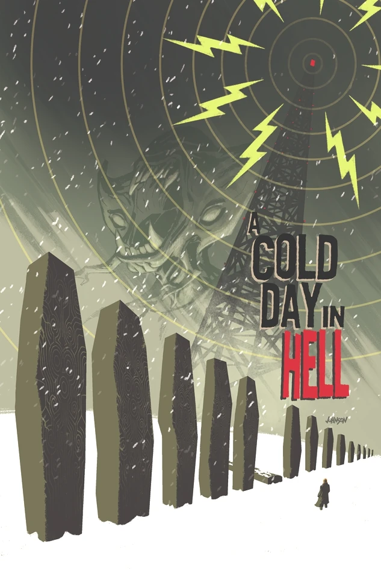

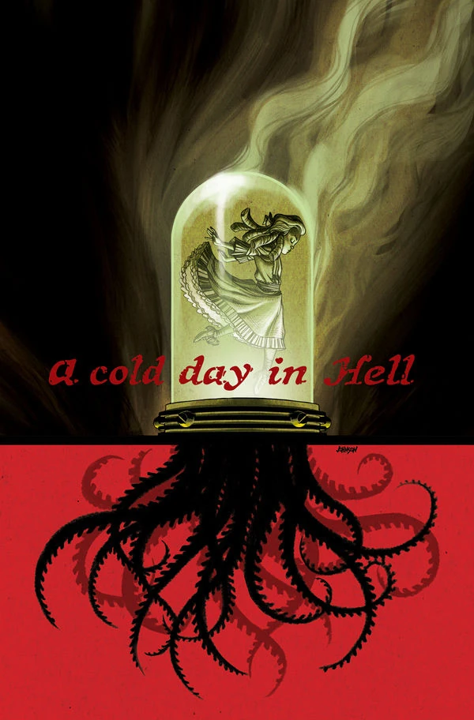

|《B.P.R.D. 人间地狱：地狱寒日》（B.P.R.D. Hell on Earth: A Cold Day in Hell）第 2 期

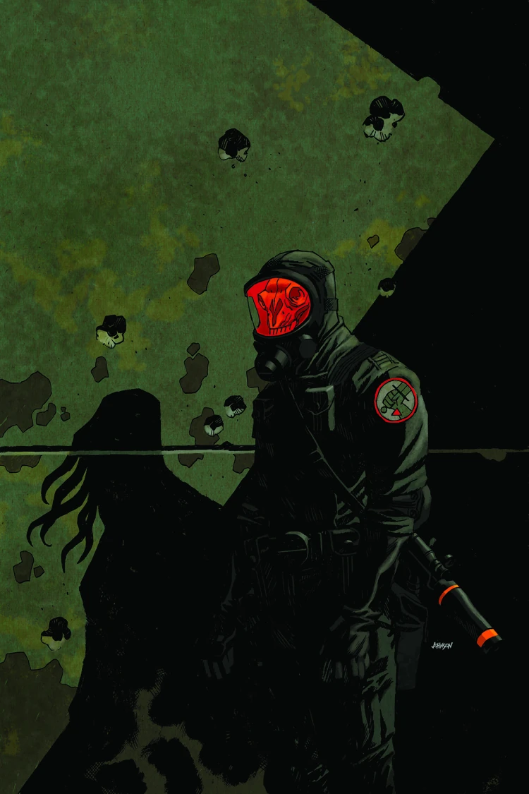

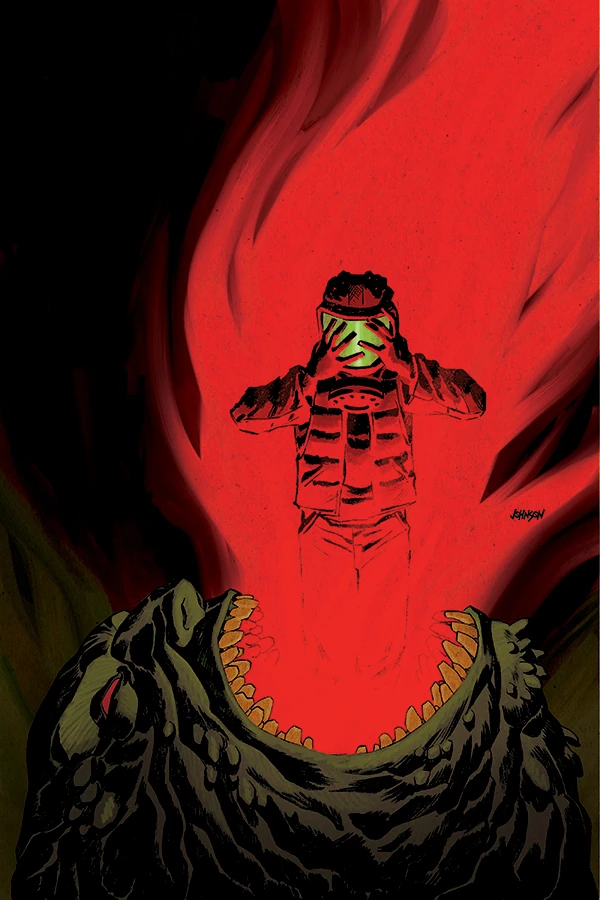

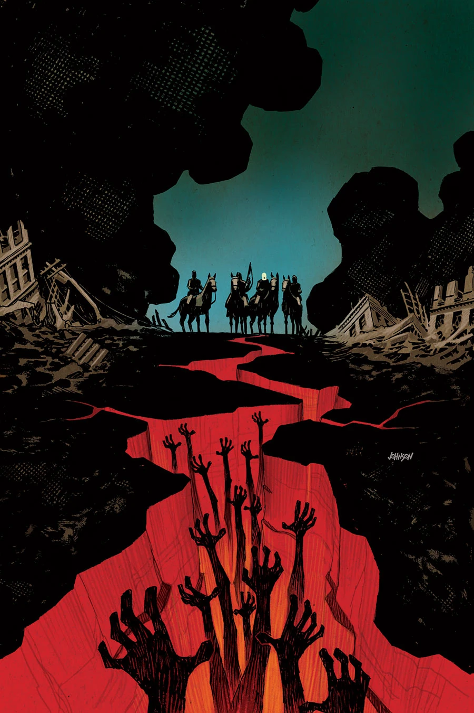

### [《Lobster Johnson：燃烧之手》（Lobster Johnson: The Burning Hand）](/entry/The_Burning_Hand)

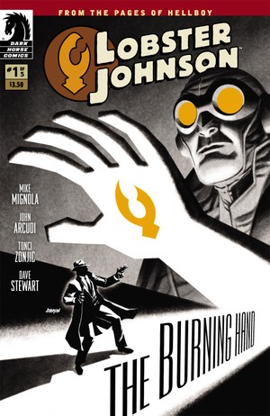

|《Lobster Johnson：燃烧之手》第 1 期

|《Lobster Johnson：燃烧之手》第 2 期

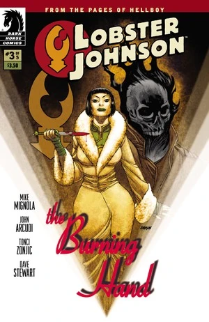

|《Lobster Johnson：燃烧之手》第 3 期

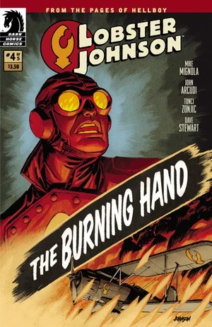

|《Lobster Johnson：燃烧之手》第 4 期

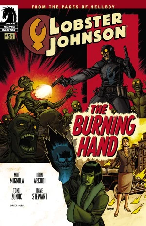

|《Lobster Johnson：燃烧之手》第 5 期

### [《B.P.R.D.：1948》](/entry/1948)

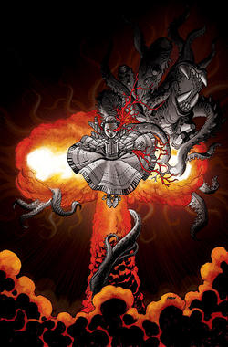

|《B.P.R.D.：1948》第 1 期

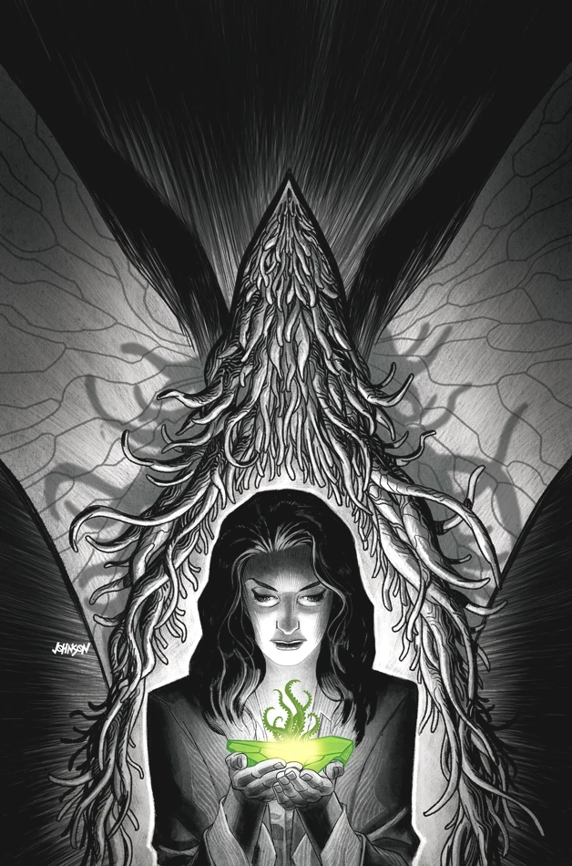

|《B.P.R.D.：1948》第 2 期

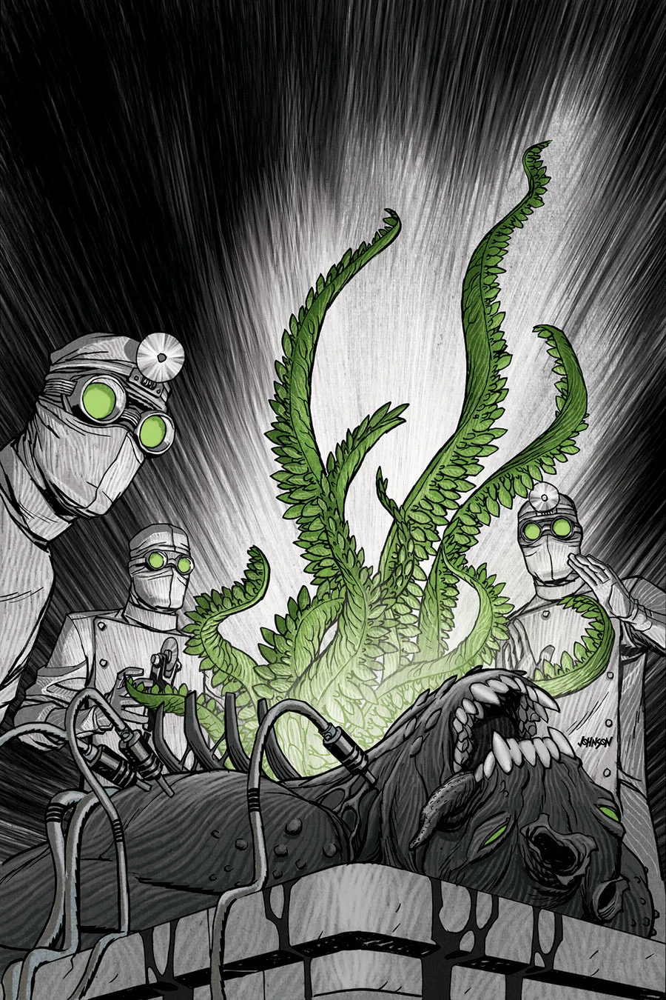

|《B.P.R.D.：1948》第 3 期

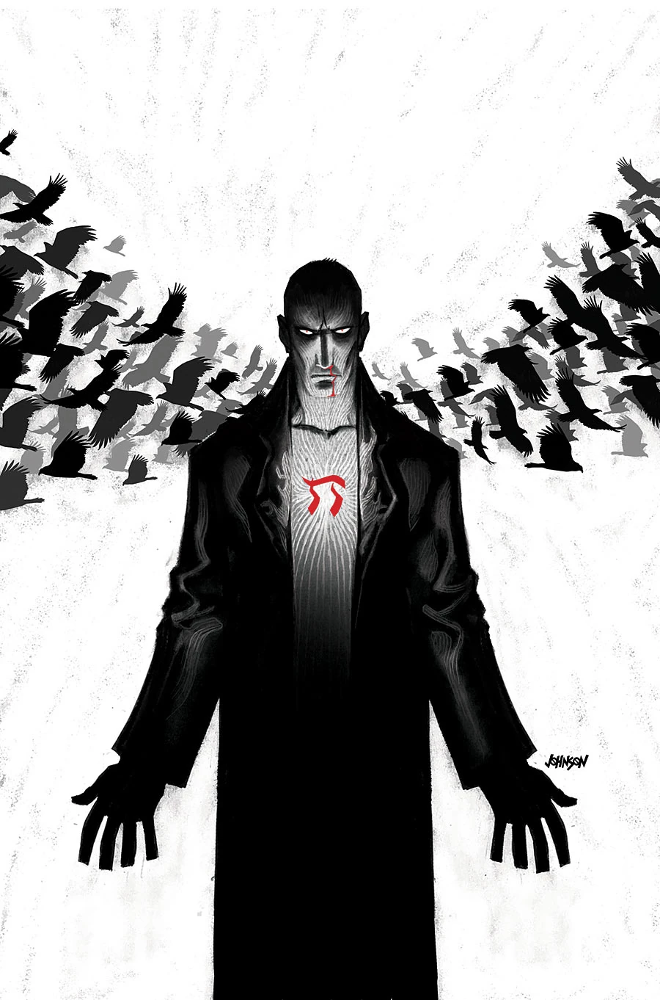

|《B.P.R.D.：1948》第 4 期

|《B.P.R.D.：1948》第 5 期

### [《地狱男爵与 B.P.R.D.：1956》](/entry/1956)

## 外部链接

- [**Comic Book DB：** Dave Johnson](http://www.comicbookdb.com/creator.php?ID=452)
