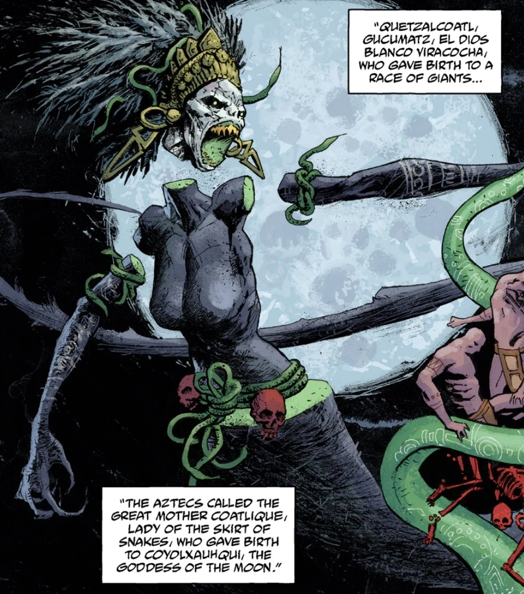
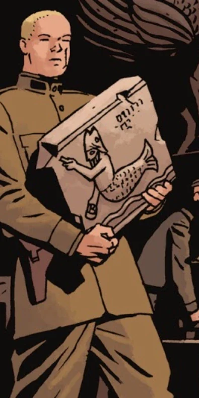
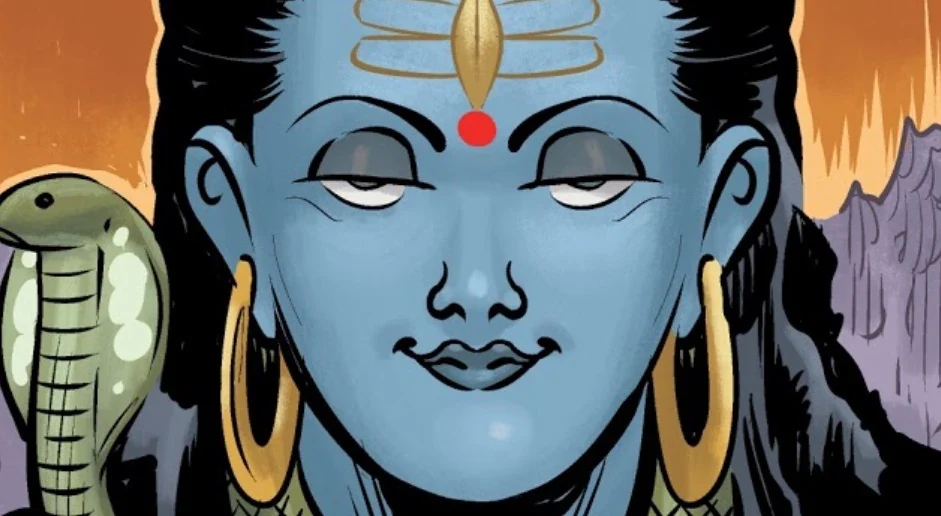
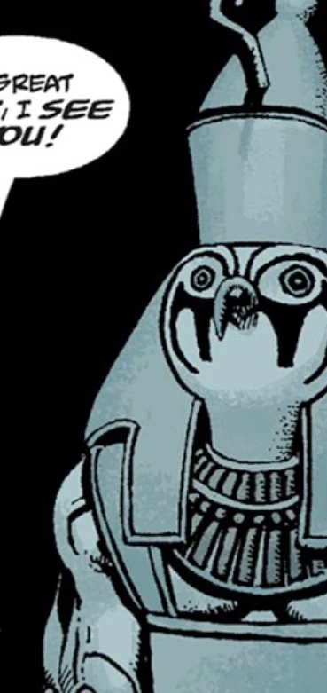
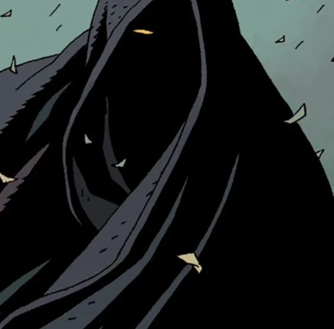
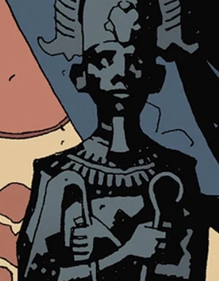

**神祇（Deities）**，又称**男神**或**女神**，是受[人类](/entry/Human)及其他低等存在崇拜的强大存在。

最强大、也是最初的神，是那位自我创生、全能的力量，人们只称之为[上帝](/entry/God)。其余的神通常被视为次等神、堕落的守望者、[恶魔](/entry/Demon)、[仙灵](/entry/Fairies)、[奥格德鲁·赫姆](/entry/Ogdru_Hem)、[异形](/entry/Aliens)，或是被夸大的人类。

## 地狱男爵宇宙神祇名录

### 亚伯拉罕诸教

[上帝](/entry/God)，宇宙及其中万物的创造者。

[耶稣基督](/entry/Jesus_Christ)

撒旦，众魔之首

### 阿坎族

[阿南西（Ananse）](/entry/Ananse)

### 阿兹特克

[西帕克特赫姆（Cipactlhem）](/entry/Cipactlhem)，实际上是一只[奥格德鲁·赫姆](/entry/Ogdru_Hem)

[魁札尔科亚特尔（Quetzalcoatl）](/entry/Quetzalcoatl)，实际上是一只[奥格德鲁·赫姆](/entry/Ogdru_Hem)

### 巴比伦

埃列什基伽勒（Ereshkigal），可能是上帝的对立面，也可能是赫卡特与奥古·桀哈的创造者

### 迦南

[摩洛（Moloch）](/entry/Moloch)，实际上是一个[恶魔](/entry/Demon)。

### 凯尔特

[达格达（Dagda）](/entry/Dagda)，实际上是[西迪仙族](/entry/Daoine_Sidhe)的一员

### 埃及

[努（Nu）](/entry/Nunn-Jahad)，实际上是[奥古·桀哈](/entry/Ogdru_Jahad)之一。

[索贝克（Sebek）](/entry/Sebek)

[托特（Thoth）](/entry/Thoth)，实际上是[海伯利亚人](/entry/Hyperboreans)的末代国王。

[阿努比斯（Anubis）](/entry/Anubis)，可能是埃及的冥界之神

### 希腊

[阿芙洛狄忒（Aphrodite）](/entry/Aphrodite)

[厄里倪厄斯（Erinyes）](/entry/Erinyes)，普路托的仆从

厄洛斯（Eros）

[赫卡特](/entry/Hecate)，可能是埃列什基伽勒的一个化身

### 玛雅

[乌库布·卡奎克斯（Vucub Caquix）](/entry/Vucub_Caquix)，实际上是一只[奥格德鲁·赫姆](/entry/Ogdru_Hem)

### 北欧

[托尔（Thor）](/entry/Thor)

### 斯拉夫

[多莫沃伊（Domovoi）](/entry/Domovoi)

[列希（Leshii）](/entry/Leshii)

[佩伦（Perun）](/entry/Perun)

### 罗马／希腊

[克洛阿西娜（Cloacina）](/entry/Cloacina)

[普路托（Pluto）](/entry/Pluto)，实际上是一名堕落的守望者。

希腊奥林匹斯众神

## 仅被提及，或通过画作、幻象出现者

### 科阿特利库埃

科阿特利库埃（Coatlicue）是一位阿兹特克神祇，被描述为伟大的母神、月亮的蛇女神。她只在[《亚伯·塞皮恩：未来之形》（Abe Sapien: The Shape of Things to Come）](/entry/The_Shape_of_Things_to_Come)中、于中美洲创世论与末世论的语境下被提及并在幻象中出现，因此她是否真实存在尚属未知。

她或许曾是一只奥格德鲁·赫姆，因为[乌库布·卡奎克斯](/entry/Vucub_Caquix)和[西帕克特赫姆](/entry/Cipactlhem)在同一个故事中被确认属于此类；不过她也可能与迦梨（Kali）类似，只是赫卡特的一个化身。

### 大衮

大衮（Dagon）是非利士人的丰饶之神，实际上是一个恶魔，在[《西班牙新娘》（The Spanish Bride）](/entry/The_Spanish_Bride)中被提及。他很可能是被贬为恶魔的，因为非利士人是古以色列人的敌人，这也可能是在向《失乐园》致敬。

[撒旦](/entry/Satan)和[阿斯塔罗斯](/entry/Astaroth)死后，奴隶恶魔们开始反叛其主人，杀死了许多恶魔领主。三名幸存的恶魔提到了大衮，与他并列的还有[鲁梅尔（Rumael）](/entry/Rumael)、[沙克斯（Shax）](/entry/Shax)、乌西尔（Usiel）、劳姆（Raum）、塞姆亚扎（Semyaza）、[摩洛](/entry/Moloch)和彼列（Belial）。

大衮常被描绘成鱼人形象（与[奥安尼斯（Oannes）](/entry/Atum)相似），不过这通常被视为一个翻译错误，后因约翰·弥尔顿的《失乐园》或 H.P. 洛夫克拉夫特的“克苏鲁神话”等虚构作品而广为流传。

### 杜尔迦

杜尔迦（Durga）是印度教中司掌母性、以及善战胜恶之胜利的女神。在[《神秘学情报》（Occult Intelligence）](/entry/Occult_Intelligence)的某一期中，她以其经典形象出现。

驱魔人也会呼号她的名号，例如[奥塔·本加（Ota Benga）](/entry/Ota_Benga)——他出现在[*《B.P.R.D.：1947》*](/entry/1947)的事件中；以及[阿什利·斯托德](/entry/Ashley_Strode)——她出现在[*《B.P.R.D.：魔鬼旧相识——万魔殿》（The Devil You Know—Pandemonium）*](/entry/Pandemonium_(story_arc))的事件中。她的名字与其他神祇和存在一同被提及，如上帝、耶稣基督、大天使米迦勒、因陀罗、阿耆尼、巴力-哈达、马尔杜克、埃阿、沙马什、乌图、阿努、宙斯和塔拉尼斯。奥塔·本加似乎认为，这些都不过是上帝的不同名号而已。

### 荷鲁斯

**荷鲁斯（Horus）**是埃及司掌王权与天空的神祇。他在《索贝克之屋》（The House of Sebek）这个故事中被着重提及，既被人提到，也以雕像的形象出现。

在故事中，一个疯癫的礼品店店员自称法老特什（Thesh），他向这位神祇的雕像祈祷时提到了荷鲁斯。此事发生在[索贝克](/entry/Sebek)的神庙中，触怒了另一位神，后者随即将他吞食。地狱男爵把荷鲁斯称作“那个长着鸟脑袋的”。

荷鲁斯是否以某种形式真实存在于米格诺拉宇宙中尚属未知，但可能性很大，因为疯癫店员的祈祷似乎触怒了真实存在的索贝克。[奥西里斯俱乐部](/entry/Osiris_Club)的成员在典礼和仪式中有时也会装扮成荷鲁斯的样子。

### 奥丁

奥丁是古老的北欧神祇之一，是[托尔](/entry/Thor)之父。

在[《狂猎》（The Wild Hunt）](/entry/The_Wild_Hunt)中，[阿斯塔罗斯](/entry/Astaroth)把他与沃尔德王（King Vold）、赫恩（Herne）并列提及，称他可能是[拉格纳·洛克](/entry/Ragna_Rok)期间狂猎的领袖。后来显示，率领狂猎奔驰在前的是沃尔德王。

在《狂怒》（The Fury）的事件中，当[地狱男爵](/entry/Hellboy_(character))走近妮缪时，在场的女巫们以为他是奥丁，因为他身披长袍、只剩一只眼睛，这正是那位古老神祇的特征。实际上，地狱男爵是把自己的一只眼睛给了[雅加婆婆](/entry/Baba_Yaga_(character))，好让他能不被察觉地潜过妮缪的军队。

地狱男爵身在[地狱](/entry/Hell)时，他的舅舅[阿斯塔罗斯](/entry/Astaroth)拿他失去的眼睛嘲弄他，说至少奥丁献出自己的一只眼睛后换来了智慧。

### 奥西里斯

奥西里斯（Osiris）是埃及的冥界、丰饶与王权之神，也是荷鲁斯之父。

奥西里斯俱乐部便以他命名，那是 1866 年 9 月 2 日从更大的[赫利奥皮克拉神兄弟会](/entry/Heliopic_Brotherhood_of_Ra)中分裂出来的一个组织。俱乐部总部里常能见到这位神的雕像，他还可能与神秘的[拉佐德（Larzod）](/entry/Larzod)之魂有关，后者与该组织的创立渊源颇深。

奥西里斯俱乐部的成员似乎一度像他们名号所源自的神那样获得了神格，主要是通过驾驭奥古·桀哈的力量，但这最终给他们带来了灭顶之灾。

### 拉

于是安努姆-拉（Anum-Ra）挖出自己的眼睛，把它送入努恩（Nun）之中去寻找他迷失的孩子们，那眼睛在那里把光芒照向一切隐秘之物……

拉（Ra）是埃及神话中一位重要的太阳神与创世神，受到赫利奥皮克拉神兄弟会的崇拜，他们以阿蒙-拉（Amun-Ra）或阿图姆-拉（Atum-Ra）之名呼求他。

在 2019 年的漫画改编电影中，特雷佛·布鲁姆与地狱男爵谈论奥西里斯俱乐部和赫利奥皮克拉神兄弟会时，这个恶魔声称他曾在冥界遇到过拉，并形容这位神说话时口水会流得相当多。
