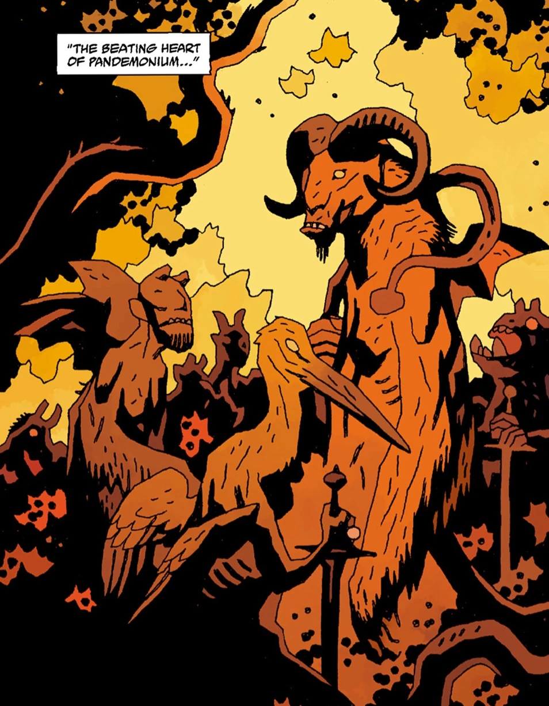

*关于在《不义联盟 2》中的客串登场，见[恶魔（不义联盟）](/entry/Demon_(Injustice))。*

路西法、阿斯塔罗斯、别西卜……现在都到我这里来吧，这样我便不再惧怕无底深坑……因为你们与我同在……莉莉丝，暗影之后，行走在我的右手边……彼列和他的军团在我身后……阿扎泽尔和他所有的军团在我面前……在伊甸园中诱惑夏娃的萨麦尔与我同在……在列国之间播撒纷争的莱拉耶与我同在……点燃男人心中欲火的萨罗斯与我同在……杀戮与屠杀的始作俑者拉伯拉斯与我同在……呼风唤雨、令人溺亡、令船只倾覆的佛卡洛，他和他所有的军团都与我同在……我将被高举，直到苍蝇之城万魔殿的高处……我也将在大地上被高举……因为你们与我同在。

**恶魔（Demons）**是一个以邪恶、暴力与混乱为乐的超自然种族。恶魔居于[地狱](/entry/Hell)，但可以往返于人间。他们经常这样做，以便对人类制造各式各样的恶作剧与恶行。

## 等级

恶魔之间有无数的位阶与头衔。位居首位的是[撒旦](/entry/Satan)，这位地狱之主曾反叛[上帝](/entry/God)，被投入深渊，注定永远在锁链与烈火中受困。然而撒旦拒绝屈从于自己的命运，他自立为王，建起了自己的万魔殿城。撒旦已有两千年沉睡在[万魔殿](/entry/Pandemonium_(location))下方自己的寝宫里，直到被[地狱男爵](/entry/Hellboy_(character))杀害。

撒旦之下，恶魔之间的等级据信如下：

- 大公爵
- 国王——统率 85 个以上军团
- 亲王——统率 60 个军团
- 公爵——统率 29 至 60 个军团
- 侯爵——统率 30 至 40 个军团
- 伯爵
- 骑士
- 下级恶魔——0 个军团

## 历史

### 起源

恶魔原本是天使，但当[上帝](/entry/God)要求他们向[人类](/entry/Human)跪拜时，他们反叛了。他们由撒旦率领，撒旦妄图成为新的上帝，但他们全部被打入地狱。

在地狱中，恶魔们与最初堕落的天使——守望者们——交战，将他们奴役，驱使他们修建了[万魔殿](/entry/Pandemonium_(location))城。

数百年来，恶魔一直设法引诱人类犯罪，或出卖灵魂、堕入地狱，而且屡屡得手。他们常充当女巫的主人，许诺赐予魔法力量和世俗礼物。

### 地狱男爵降临地狱

地狱男爵死后，他不可避免地降临地狱，在恶魔亲族中激起了混乱。万魔殿为之一空，贵族们四散奔逃以躲避他；奔逃之际，领主们让奴隶看到了他们的恐惧，奴隶恶魔们于是开始反叛主人。[沙克斯](/entry/Shax)、乌西尔、劳姆、塞姆亚扎、[摩洛](/entry/Moloch)、彼列和大衮等高级恶魔，全都被自己的仆从倒戈杀死。地狱男爵随后杀死了撒旦，之后又目睹[阿斯塔罗斯](/entry/Astaroth)和他自己的兄弟们被利维坦吞食。

撒旦已死、万魔殿陷入沉寂，恶魔约姆雅尔来到地狱，取走了地狱男爵行凶所用的匕首。她借助匕首上残余的力量，放出了地狱都城所矗立其上的那些守望者，驱使他们去对付新近降临地球的七位[奥古·桀哈](/entry/Ogdru_Jahad)之一。失去守望者后，万魔殿缓缓沉入火湖。尽管万魔殿看似残存下来供奴隶们占据，但好景不长：被复仇三女神惩罚的加莫莉沿着血河一路追溯到源头。撒旦被割开的喉咙令她失声尖叫，整座城市在奴隶们周围轰然倒塌。随着万魔殿沉入水中，地狱的心脏永远熄灭了。

以[别西卜](/entry/Beelzebub)为首的残余高级恶魔聚集在他的城堡中，策划反扑。地狱男爵以一个顶天立地的巨大恶魔之姿降临，身后跟着无数奴隶恶魔。地狱男爵消灭了[利维坦](/entry/Leviathan)和[贝希摩斯](/entry/Behemoth_(Demon))，而别西卜及其追随者则被复仇的奴隶们杀死。

### 万魔殿降临人间

最后三名高级恶魔——[约姆雅尔](/entry/Yomyael)、[巴拉姆](/entry/Balam)和[比弗隆斯](/entry/Bifrons)——设法束缚住奴隶恶魔，并把他们召唤到人间。他们企图在人间重建万魔殿、统治人类。然而这个计划落空了，三魔都被[超自然调查防御署](/entry/Bureau_for_Paranormal_Research_and_Defense)所杀，不过部分奴隶恶魔活了下来。

### 拉格纳·洛克

所有残余恶魔都落入[奥格德鲁·赫姆](/entry/Ogdru_Hem)的影响之下，变成了头颅燃烧的生物，类似卡塔-赫姆的子嗣。他们与锤头怪、蛙怪一道，开始追猎人类的残余势力，妄图将人类赶尽杀绝。

### 灭绝

当[奥古·桀哈](/entry/Ogdru_Jahad)被[奥西里斯俱乐部](/entry/Osiris_Club)杀死时，恶魔与所有由奥格德鲁·赫姆创造的怪物一同灭亡。

## 外貌

恶魔的外貌千差万别。虽然大多数似乎遵循某些基本特征，如发光的眼睛、犄角和翅膀，但这些都可能变化，因为恶魔是变形者，可以以人形、兽形或某种混合形态出现。

更下级的恶魔外貌则较为统一：他们是较小的生物，红皮肤、长角、有翼，脸如骷髅。

## 能力

- 魔法
- 不死或长寿
- 变形
- 飞行

## 已知恶魔

- [阿斯塔罗斯](/entry/Astaroth)——地狱大公爵（已故）
- [阿扎泽尔](/entry/Azzael)——冥府亲王（被永生永世活活囚禁）
- [加蒙](/entry/Gamon)——阿扎泽尔之子（已故）
- [鲁斯克](/entry/Lusk)——阿扎泽尔之子（已故）
- [加莫莉](/entry/Gamori)——阿扎泽尔之女
- [地狱男爵](/entry/Hellboy)——阿扎泽尔之子，半人类，启示录之兽
- [马尔科西亚斯](/entry/Marchosias)——地狱亲王
- [阿加雷斯](/entry/Agares)——地狱亲王（已故）
- 塞姆亚扎——地狱亲王（已故）
- 奥拉巴斯（Orabas）——地狱亲王（已故）
- 苏里埃尔（Suriel）——地狱亲王（已故）
- [贝雷斯](/entry/Beleth)——地狱亲王（已故）
- [伊布利菲卡](/entry/Iblifika)——马尔科西亚斯的王妃
- [阿姆杜西亚斯](/entry/Amdusias)——地狱公爵
- [沙克斯](/entry/Shax)——地狱侯爵
- [安德拉斯](/entry/Andras)——地狱侯爵（已故）
- [约姆雅尔](/entry/Yomyael)——地狱第七领主，曾为恶魔三位一体成员，曾任俄罗斯[特殊科学局](/entry/Special_Sciences_Service)局长（已故）
- [巴拉姆](/entry/Balam)——地狱之王
- [比弗隆斯](/entry/Bifrons)——地狱伯爵
- [贝里斯](/entry/Berith)
- [古辛](/entry/Gusion)
- [马尔巴斯](/entry/Marbas)
- [西特利](/entry/Sytry)
- [摩洛](/entry/Moloch)——“*亚扪子孙的可憎之物*”
- [阿斯蒙蒂斯](/entry/Asmodeus)——（已故）
- [西巴科](/entry/Sybacco)
- [利维坦](/entry/Leviathan)
- [玛门](/entry/Mammon)
- [哈博里姆](/entry/Haborym)
- [埃利戈斯](/entry/Eligos)——前地狱公爵、苍蝇骑士团骑士（被爱德华·格雷爵士囚禁）
- [乌阿拉克](/entry/Ualac)——下级恶魔，临时的启示录之兽（被阿斯塔罗斯囚禁）
- [杰里迈亚·威特金斯](/entry/Jeremiah_Witkins)（已故）

## 恶魔画廊

撒旦，众魔之首

阿斯塔罗斯，地狱公爵

阿扎泽尔，冥府亲王、地狱男爵之父

约姆雅尔，地狱第七领主

加莫莉，地狱男爵的姐妹

鲁斯克，地狱男爵的兄弟

加蒙，地狱男爵的兄弟

巴拉姆，地狱侯爵

比弗隆斯，地狱伯爵

马尔科西亚斯，地狱亲王

伊布利菲卡，地狱王妃

阿斯蒙蒂斯，众魔之王

乌阿拉克，下级恶魔

利维坦

别西卜，地狱亲王

沙克斯，地狱侯爵

安德拉斯，地狱侯爵
