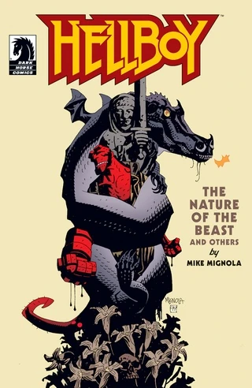
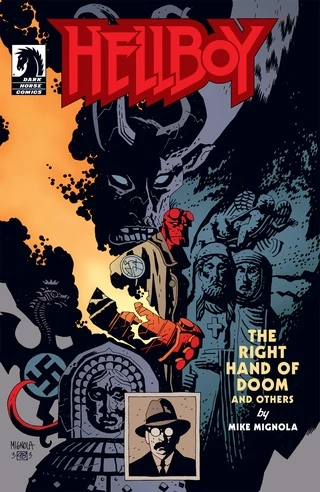
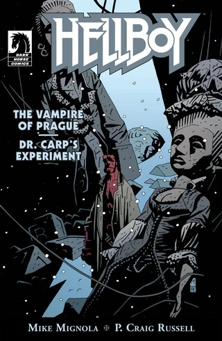
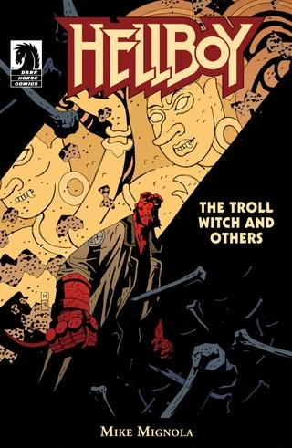
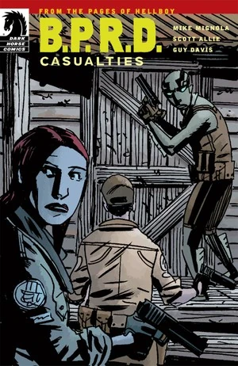
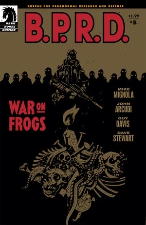

平装合集与[合订全集](/entry/Omnibus_Editions)的电子版与其纸质版内容完全相同，但电子单期则可能有所不同。较早的故事往往缺少后备故事或读者来信专栏（例如 *[《地狱男爵：毁灭之芽》](/entry/Seed_of_Destruction)*，其电子版就没有收录 Art Adams 创作的 *《猴子男与奥布赖恩》（Monkeyman and O'Brien）* 四回后备故事）。

## 纸质版与电子期刊对比

**注意：** *本部分内容非常不完整。欢迎提供任何帮助。若能告知各期是否含有读者来信专栏，将非常有帮助。*

期刊
纸质版中缺失的内容

&#10;
《地狱男爵：毁灭之芽》
#1

<li>猴子男与奥布赖恩是谁？（第 1 部分）</li>

#2

<li>猴子男与奥布赖恩是谁？（第 2 部分）</li>

#3

<li>猴子男与奥布赖恩是谁？（第 3 部分）</li>

#4

<li>猴子男与奥布赖恩是谁？（第 4 部分）</li>

《地狱男爵：狂猎》
#2

<li>科西切如何获得不死之身（第 1 部分）</li>

#3

<li>科西切如何获得不死之身（第 2 部分）</li>

#4

<li>雅加婆婆的盛宴</li>

#5

<li>怪物人：我们脚下的罪人啊！（第 1 部分）</li>

#6

<li>怪物人：我们脚下的罪人啊！（第 2 部分）</li>

#7

<li>凯瑟琳·贝克的葬礼</li>

## 电子版独占期刊

在 Dark Horse 将平装合集与合订全集搬上电子平台之前，他们主要依靠电子捆绑包来收录一部迷你连载或一个故事弧的各单期。然而，*《地狱男爵》* 系列中有许多短篇故事最初并非以单期形式发表。Dark Horse 的解决办法是把这些短篇故事组合在一起，做成篇幅大致相当于一期单期的合集。

封面
标题
发行日期
收录内容

&#10;

《地狱男爵：
锁链棺材／
雅加婆婆》
2011 年 4 月 4 日

<li>锁链棺材</li>
<li>雅加婆婆</li>

《地狱男爵：
野兽本性
及其他故事》
2011 年 4 月 26 日

<li>煎饼</li>
<li>野兽本性</li>
<li>沃尔德国王</li>
<li>人头</li>

《地狱男爵：
毁灭之手
及其他故事》
2011 年 4 月 26 日

<li>再见，托德先生</li>
<li>瓦尔科拉克（Vârcolac）</li>
<li>毁灭之手</li>

《地狱男爵：
布拉格吸血鬼／
卡普博士的实验》
2011 年 5 月 4 日

<li>布拉格吸血鬼</li>
<li>卡普博士的实验</li>

《地狱男爵：
巨怪女巫
及其他故事》
2011 年 5 月 4 日

<li>巨怪女巫</li>
<li>彭南古兰（Penanggalan）</li>
<li>九头蛇与狮子</li>

《超自然调查防御署：
伤亡》
2011 年 7 月（零售商独占版）
2012 年 3 月 1 日（DH Digital 版）

<li>伤亡</li>

《超自然调查防御署：
青蛙之战 #5》
2011 年 10 月 5 日

<li>复苏（扩充版）</li>
