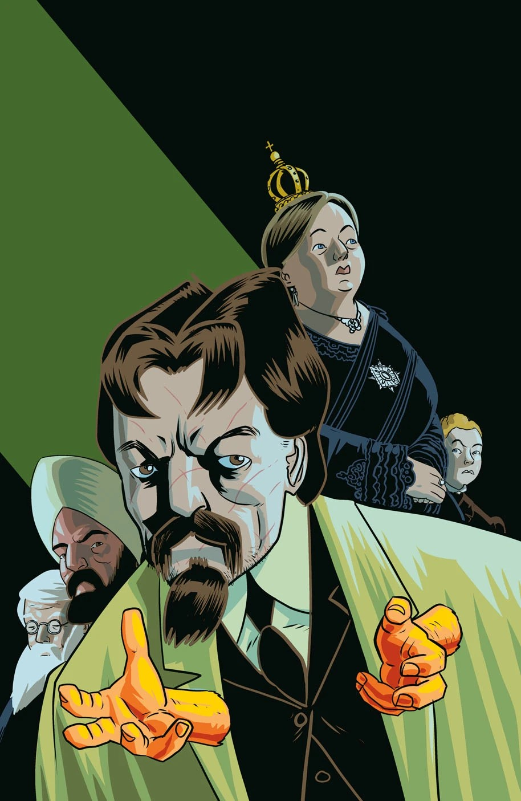
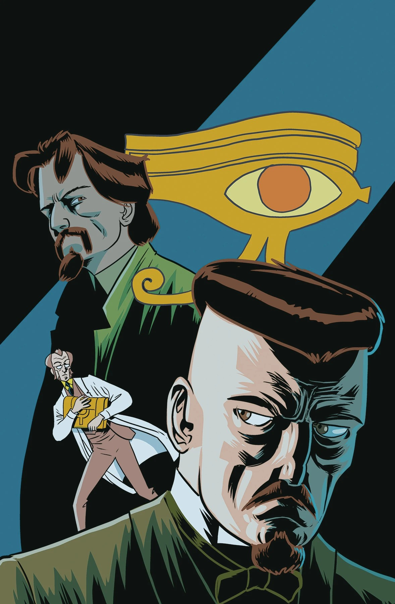
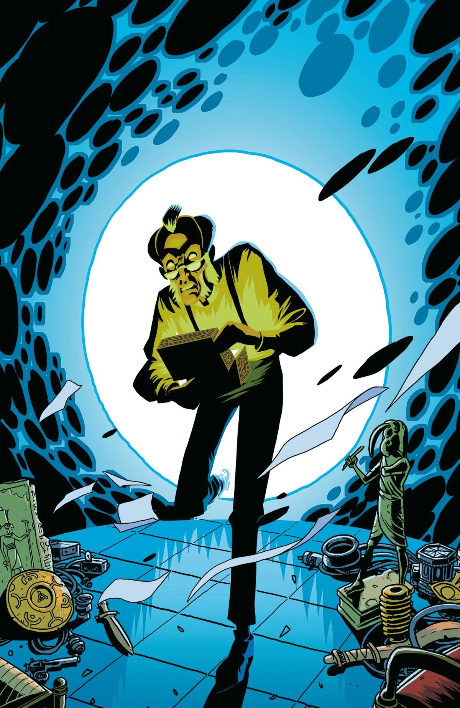
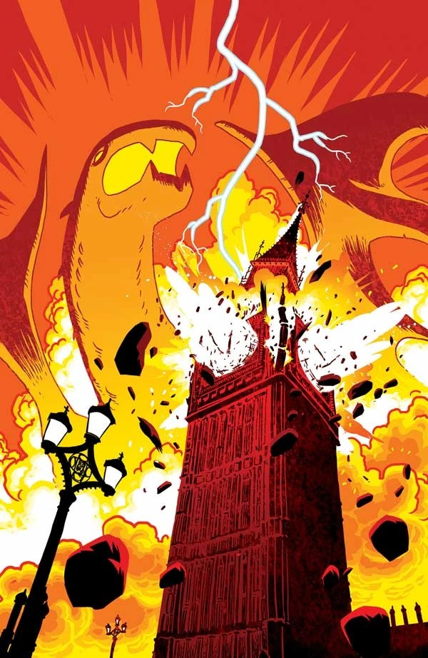
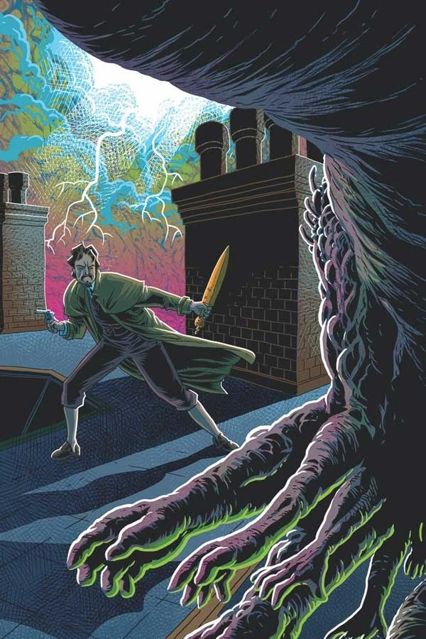

**Matt Brooker**，以笔名 **D'Israeli** 广为人知，是英国漫画画师、上色师、嵌字师兼编剧。

## 内页作画

- [《天堂之门》（The Gates of Heaven）](/entry/The_Gates_of_Heaven)

## 封面作画

## 外部链接

- **[Wikipedia](https://en.wikipedia.org/wiki/D%27Israeli_(cartoonist))**[：D'Israeli](https://en.wikipedia.org/wiki/D%27Israeli_(cartoonist))

## 画廊

|The Gates of Heaven #1

|The Gates of Heaven #2

|The Gates of Heaven #3

|The Gates of Heaven #4

|The Gates of Heaven #5
