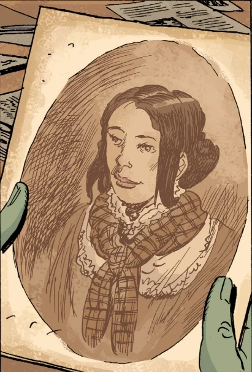
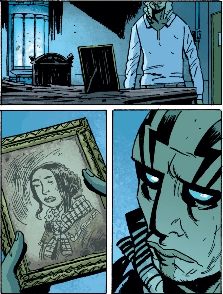

> "我的爱人。这个世界*确实*很美。很美……可对我来说，它*太*难熬了。"——伊迪丝·霍华德（Edith Howard）

**伊迪丝·霍华德（Edith Howard）** 是超自然调查防御署故事线中的一个小角色，是[兰登·埃弗里特·考尔（Langdon Everett Caul）](/entry/Abraham_Sapien)的妻子。她主要登场于[《亡者》](/entry/The_Dead)，故事中[亚伯·塞皮恩](/entry/Abraham_Sapien)前去探寻自己的过去。在其他各期中也有对她的画面呈现或顺带提及。伊迪丝于 1861 年嫁给兰登，1865 年去世。

## 历史

兰登·埃弗里特·考尔不再为[伊莱休·卡文迪什（Elihu Cavendish）](/entry/Elihu_Cavendish)出海航行之后，在罗得岛州的利特尔波特（Littleport）定居下来，并建造了一座宅邸。他花了大约八年时间才完工（1853—1861 年）。宅邸建成后，兰登娶了当地姑娘伊迪丝。1865 年 2 月 22 日，兰登被报失踪。伊迪丝无法接受这个打击，据说在丈夫未能归家一个月后发了疯，投海自尽。她的遗体始终没有被找到。

多年以后，亚伯在一次濒死经历后想起自己曾是兰登·埃弗里特·考尔，于是开始探寻自己的过去。他和凯特前往利特尔波特，图书馆里的一位女士向他们讲述了兰登及其妻子的详细情况，还给了亚伯一张伊迪丝本人的照片。

亚伯回到考尔宅邸，伊迪丝的鬼魂试图劝他留下来陪她。亚伯陷入幻象，重温自己身为兰登时的旧日生活：在他亲手建造的房子里，伊迪丝依偎着他，屋外风暴肆虐——眼看就要把考尔宅邸掀入大海。最终，亚伯迫使她揭开一面镜子，直面真相。幻象消散，阳光重新洒落，伊迪丝的灵魂也随之逝去。

文中从未提及伊迪丝离开过利特尔波特，她在那里长大、成婚并离世。

亚伯把她的一张照片放在超自然调查防御署总部自己房间的床头柜上。

## 性格

据描述，伊迪丝即使在状态最好的时候情绪也不稳定。她认定这个世界太过艰难、太过残酷，无法忍受失去丈夫的生活。她深爱自己的丈夫，希望永远和他厮守，并为此不遗余力地试图说服他留下。

1.  [↑](#cite_ref-1) [《亡者》](/entry/The_Dead)
2.  [↑](#cite_ref-2) [《黑焰》（故事）](/entry/The_Black_Flame_(story))
