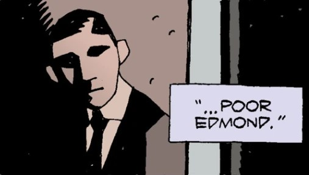

**埃德蒙·艾克曼（Edmond Aickman）**是一位丹麦民俗学教授。

## 历史

埃德蒙·艾克曼在哥本哈根工作，在那里他成了[特雷佛·布鲁姆](/entry/Trevor_Bruttenholm)的密友兼同事。

### *[《沃尔德王》（King Vold）](/entry/King_Vold_%28Story%29)*

1956 年，他请求[地狱男爵](/entry/Hellboy_%28character%29)提供协助，布鲁姆很乐意成全。在哥本哈根，艾克曼设计骗地狱男爵召唤出[沃尔德王](/entry/King_Vold_%28character%29)；按照神话，任何人只要能躲过或制服他的猎犬，沃尔德王就会赐予巨额财富。地狱男爵费了一番力气做到了，却被撞昏过去。艾克曼声称胜利是自己的功劳，并索取奖赏。沃尔德王看穿了谎言，洒下一阵金币，但艾克曼接住的一枚金币径直烧穿了他的手，留下一个洞。金币一落地就立刻变成了一块块煤。

人们最后一次见到艾克曼时，他正在哥本哈根的街头乞讨，手上的洞缠着绷带。布鲁姆哀叹自己的老朋友竟沦为贪欲的俘虏。

### *[《巨人之骨》（The Bones of Giants）](/entry/The_Bones_of_Giants_%28comic_miniseries%29)*

1988 年 2 月，地狱男爵和[亚伯·塞皮恩](/entry/Abraham_Sapien)重返斯堪的纳维亚：此前一场地震使一具握着[Mjollnir](/entry/Mjollnir)——即[托尔](/entry/Thor)之锤——的巨型骨架重见天日。出乎意料的是，地狱男爵一拿起锤子，它便与他的[石手](/entry/The_Right_Hand_of_Doom)融为一体。地狱男爵和亚伯找到最近的北欧神话权威——已迁居斯德哥尔摩的艾克曼教授。起初会面并不顺利。艾克曼的女儿[Pernilla](/entry/Pernilla_Aickman)从父亲那里听说过沃尔德王事件，以为地狱男爵仍因被骗而记恨她父亲。地狱男爵向艾克曼父女保证并无此事（还冷峻地指出，埃德蒙在那桩交易里吃的亏更大）。

Aickmann 把地狱男爵和亚伯迎进家中，却在夜里失踪，留下两人遭到[Svartalves](/entry/Svartalves)（黑暗精灵）攻击。他们追踪 Aickmann 来到[Djurgården](https://en.wikipedia.org/wiki/Djurg%C3%A5rden)——瑞典王室昔日的皇家御花园，在那里看到他用"斯里姆酒樽"（Tankard of Thrym）举行仪式，传说这只酒杯蕴含冰霜巨人之王的力量。后来证明这是一个误译：Aickmann 用酒樽饮下自己鲜血的举动使[Thrym](/entry/Thrym)复活，从花园下方的坟墓中升起。巨人抓起 Aickmann，吸干了他的生命，随后把他扔在地上。

Pernilla 抱着父亲的尸体回想，父亲给她留下了许多快乐回忆，是他把对民俗与神话的热爱同样注入了她的心中。但她一直知道，他骨子里潜藏着一股隐秘的贪欲——无论贪图财富还是权力——而这股贪欲总是把他引向自我毁灭。埃德蒙的葬礼之后，Pernilla 与地狱男爵、亚伯一起追踪 Thrym，深入群山中它的巢穴。

## 画廊

|A photo of an young Edmond Aikman.
## 趣闻

- 年轻艾克曼的照片似乎是在致敬已故的[H.P.洛夫克拉夫特](https://en.wikipedia.org/wiki/H._P._Lovecraft)——这位 20 世纪恐怖小说作家的作品影响了《地狱男爵》与 B.P.R.D. 漫画。
