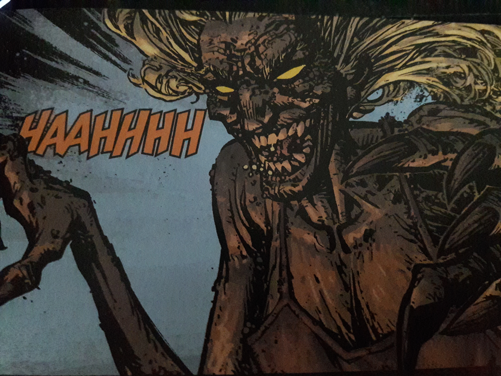
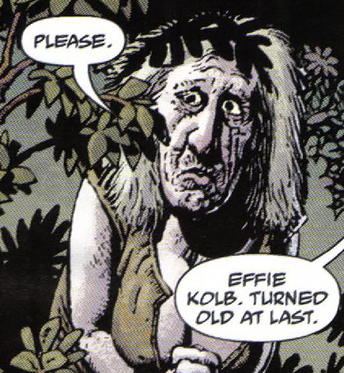

**埃菲·科尔布（Effie Kolb）** 是他手下主要的[女巫](/entry/Witches)，也是 [杰里迈亚·威特金斯](/entry/Jeremiah_Witkins) 的左膀右臂、头号支持者。

## 故事

埃菲是 [汤姆·费雷尔](/entry/Tom_Ferrell) 遇到的第一个女巫：她既让汤姆尝到了女色的甜头，又骗他与自己的主人威特金斯立下契约；威特金斯的巫术维系着她年轻的容貌。1958 年汤姆回到弗吉尼亚时，埃菲嘲讽他，并透露自己用一副魔法辔头把他年迈的父亲变成了一匹马，然后骑着他直到他力竭而死。在《飓风》中威特金斯与汤姆在旧教堂对峙时，埃菲在威特金斯的爪牙之间风情万种地跳舞，引诱汤姆再次拥抱黑暗、拥抱她。

威特金斯最终被消灭后，汤姆和地狱男爵发现埃菲鬼鬼祟祟地躲在宅邸外，她的身体此刻显露出真实的年纪。她虚弱无助、苦苦求饶，却几乎没从汤姆那里讨到怜悯：汤姆把魔法辔头塞进她嘴里，把她变成了一匹驽马。更羞辱的是，[地狱男爵](/entry/Hellboy_%28character%29)还在埃菲身侧写上警示，让旁人远离她，这样就能确保辔头永远不会被取下，她将以驽马之身度过余生。

### [《埃菲·科尔布归来》（The Return of Effie Kolb）](/entry/The_Return_of_Effie_Kolb)

到 1967 年，埃菲又回来了——她通过不明方法取下了辔头；地狱男爵当初离开后，汤姆·费雷尔和 [Watts 牧师](/entry/Reverend_Watts)对女巫展开了清洗，她因此元气大伤。她开始纠缠、恐吓年迈的汤姆。

## 能力

多年来，埃菲·科尔布一直充当"歪人"（Crooked Man）的招募者，引诱许多女人投身巫术，把她们的灵魂献给主人。除了拥有渊博的巫术知识，她还表现出违背马匹（实际上是变成马的汤姆之父）意志骑乘它的能力，能从马背上高高跃起，并躲过地狱男爵的枪击。

丑陋的真相。

她最突出的能力是保有青春：她看上去只有十几岁，但故事结尾揭示她实际上要年长得多。[魔法马嚼子](/entry/Magic_horse%27s_bit)可能是她打造的——无论有没有歪人的帮助。

### 性格

埃菲看上去像个乡下俏姑娘，性格却相当恶毒。她觉得把汤姆的父亲骑到死、拿汤姆的困境和他人的不幸取乐是件趣事。但一旦失去青春和力量，她就没什么胆量了，只会一头扑到敌人脚下乞求怜悯。

## 其他媒体

埃菲·科尔布出现在电影[《地狱男爵：歪人》](/entry/Hellboy__The_Crooked_Man_%28film%29)中，由 [Leah McNamara](/entry/Leah_McNamara) 饰演。

## 趣闻

- Watts 牧师在她真的年轻时就认识她，那时她也不是什么好东西。
- 一些鬼怪和女巫故事里有个叫科尔布的农夫。谁知道呢。
- 读者几乎看不到她施展什么法术，但其他女巫都对她敬畏三分。
