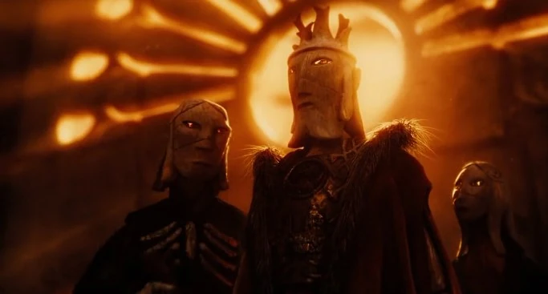
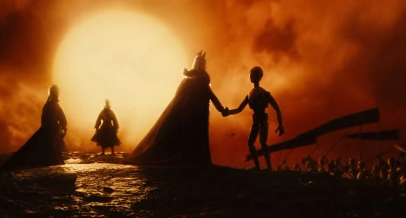
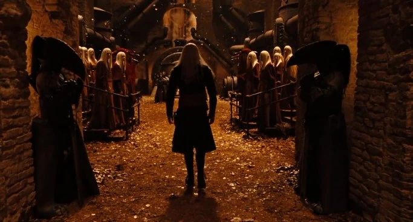
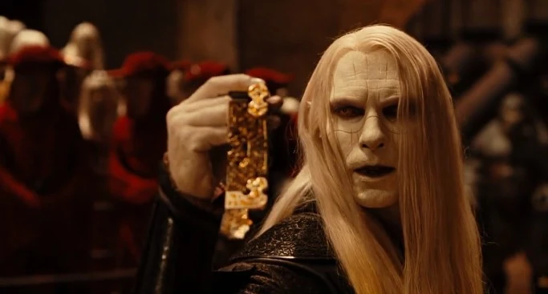
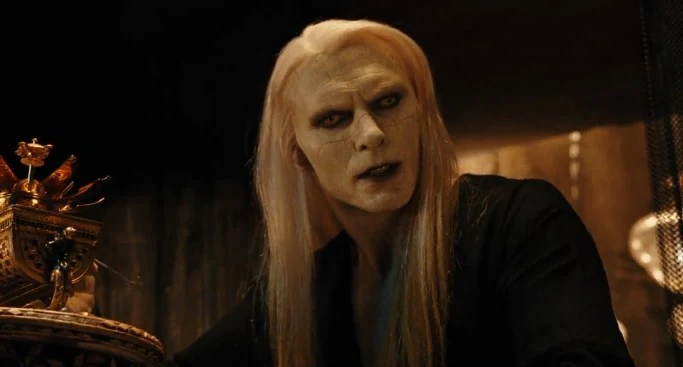
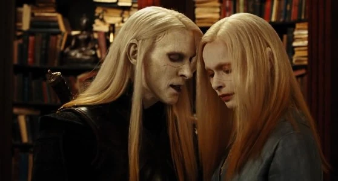
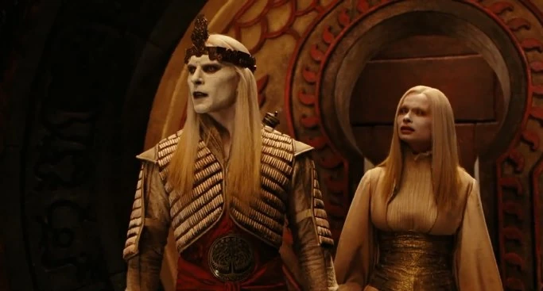
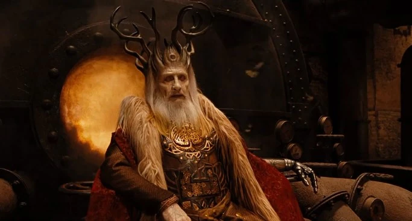
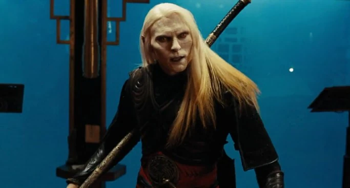
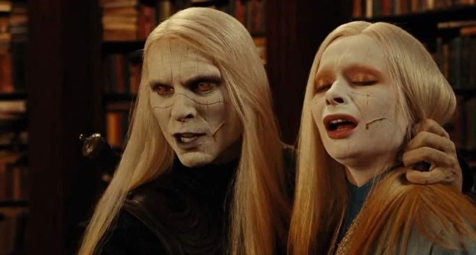

**精灵（Elves）**是*[《地狱男爵 2：黄金军团》](/entry/Hellboy_II%3A_The_Golden_Army)*中登场的一类魔法生物，其原型是地狱男爵漫画中的[西迪仙族](/entry/Daoine_Sidhe)。他们的外貌差异很大：有的俊美非凡、与人类极为相似，有的则有着醒目而异于常人的容貌。

## 历史

### 远古时代

众所周知，精灵早在古埃及时代便已存在，一直与[人类](/entry/Human)共同生活。后来人类被贪婪吞噬，引发了一场战争，魔法生物被进一步驱赶进自己的领地，面临存亡之危。精灵的统治者——[巴洛尔](/entry/Balor)国王——为拯救族人想尽办法，已然绝望。就在一切看似无望之际，一个地精铁匠向国王提议，为他打造一支[由无坚不摧的机械战士组成的军队](/entry/The_Golden_Army)。王子努阿达说服父亲接受了这个提议。不久，黄金军团建成，[贝斯莫拉王冠](/entry/Crown_of_Bethmora)使巴洛尔得以号令这支军队。然而，巴洛尔发现黄金军团远比预想中危险——他亲眼目睹它们毫无怜悯地屠戮人类军队。

这促使巴洛尔与人类缔结休战协定：城市归人类掌控，仙灵诸族则退守森林与荒野。为巩固协定，黄金军团被封印在[贝斯莫拉](/entry/Bethmora)地下；王冠的三分之一交给人类，其余两份由巴洛尔国王和他的女儿[努阿拉](/entry/Nuala)保管。精灵们遵守着休战条款，唯有努阿达相信人类终将背弃誓约，于是自我流放，打算在族人最需要他的时候归来。

### 现代

数千年后，巴洛尔和他的宫廷栖居于纽约市地下。这位君王仍恪守人类与精灵之间的休战协定，尽管他承认人类的所作所为不过是其本性——他的大片领土已被人类夺走。然而，巴洛尔得知努阿达在一家拍卖行杀害了多名人类，贝斯莫拉王冠的其中一块碎片当时正保管在那里。

努阿达来到父亲的宫廷，想取得剩余的两块王冠碎片，同时试图号召族人加入他的行列。巴洛尔最后一次试图与儿子讲理，最终别无选择，只得判处努阿达死刑。尽管努阿拉因兄妹间的羁绊而甘愿接受自己的死亡，并对哥哥所作所为的后果表示悔恨，努阿达却拒绝接受命运：他杀出屠夫卫队的重围，杀死巴洛尔，夺走了父亲持有的那块王冠碎片。那时，努阿拉已经逃走，前往巨魔市场寻找通往贝斯莫拉的地图。

在巨魔市场，努阿拉与正在调查拍卖行事件线索的[超自然调查防御署](/entry/Bureau_for_Paranormal_Research_and_Defense)一行人狭路相逢。地狱男爵与巨魔[温克先生](/entry/Mr._Wink)对峙并杀死了他；努阿达得知朋友的死讯后，放出了最后的森林元素去杀地狱男爵。虽然这一刺杀行动失败，努阿达却成功把一个念头植入地狱男爵心中：人类永远不会接纳他。

之后，努阿达利用与努阿拉的感应找到总部，几乎毫无阻碍地潜入其中，并得知妹妹藏起了最后一块王冠碎片。他还没来得及找到，努阿拉便触发了警报；努阿达在重创地狱男爵之后，把妹妹神不知鬼不觉地带往贝斯莫拉，并告诉亚伯，如果想再见到努阿拉，就把王冠碎片带来。

在贝斯莫拉，亚伯带着最后一块王冠碎片一到，努阿达便唤醒黄金军团，要消灭超自然调查防御署探员们；这时地狱男爵当众宣布，要为争夺王冠的所有权与他决斗。由于地狱男爵是[堕落者](/entry/Azzael)之子，努阿达被迫接受挑战，结果落败。努阿达一边喝令地狱男爵杀了他，一边试图从背后偷袭这个恶魔，努阿拉却刺向自己的心脏，以自己的性命为代价终结了兄长的生命。随着王室最后成员的死去，精灵一族的命运不得而知。

## 描述

精灵的灵感似乎来自盖尔神话中的 aos sí 与日耳曼神话中的精灵：他们是拥有魔力的半神性种族，会运用其力量既造福、也加害于人类，而非流行文化中那种矮小顽皮的小东西。

### 外貌

在电影中，精灵与[人类](/entry/Human)十分相似，但他们拥有幽灵般苍白、质感如同木头或大理石的皮肤。他们的脸上蚀刻着奇异的纹路。他们还留着银白长发，发梢呈金色，瞳色从琥珀色到赭色不等。耳朵呈树叶状，尖端上翘。精灵生于大地，死后会化为石头，重归大地。

### 能力

精灵究竟拥有哪些技能，乃至他们是否普遍具备任何特殊技能，都无法确定。

#### 悠长寿命

精灵似乎具有一定程度的不死性。在电影中，据说国王和他的孩子们自大地诞生之初便已存活，这意味着他们极为长寿。与托尔金笔下的精灵不同，他们确实会衰老，不会永远年轻美丽——巴洛尔国王的外貌便证明了这一点。但他们并非不死之身，也可以被常规手段杀死。

#### 身体素质

《地狱男爵 2》中的[努阿达王子](/entry/Nuada)拥有远超凡人的速度、敏捷与格斗技巧，某些方面甚至超过地狱男爵。这一点在片中多次展现，例如他几乎不费吹灰之力便潜入了拍卖行和[超自然调查防御署](/entry/Bureau_for_Paranormal_Research_and_Defense)总部。影片开头，他在几分钟内解决掉父亲的屠夫卫队，随后杀死父亲。第一次交手时他轻松刺伤地狱男爵，第二次交手时仍能保持同样的水准。努阿拉也展现出仅凭双手探知他人情况的能力。

#### 魔法

作为一个种族，精灵似乎还拥有强大的[魔法](/entry/Magic)，以及创造伟大工艺与附魔之物的能力，例如武器和[贝斯莫拉大城](/entry/Bethmora)。作为最先诞生的种族，他们还表现出对元素与自然力量的影响力，例如努阿达召唤森林元素，以及他直接从火中取出一个金属地图筒时，手部毫发无伤。

努阿达王子与他的孪生妹妹努阿拉之间存在一种羁绊，将二人在精神、心灵与肉体层面联结在一起。两人能够感知彼此的距离远近，其中一人受伤时，另一人也会承受相同的伤。

## 趣闻

- 精灵一族走向衰落、其中一些人试图从人类手中夺回世界的故事，与[棕精灵](/entry/Gruagach)及与他志同道合的西迪仙族如出一辙——后者曾试图以犯下滔天罪行的方式拯救自己的族人。
- 精灵（或称“大地之子”）使用的古老语言是盖尔语，即爱尔兰语。
