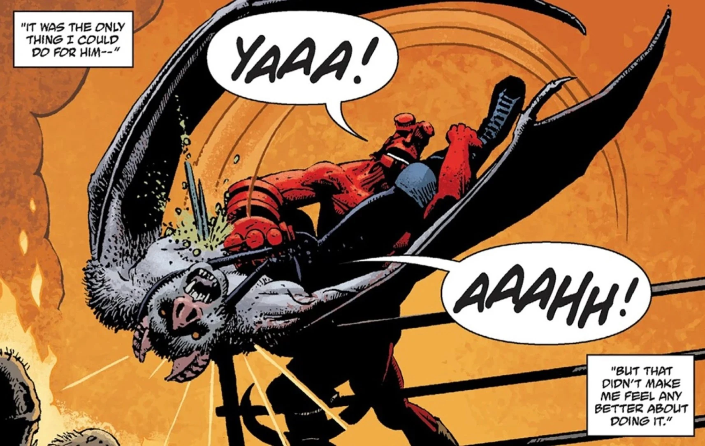

埃斯特万（Esteban）原本是一名墨西哥*自由式摔跤（Lucha libre）*选手，后来转行成为怪物猎人；他最终变成了[吸血鬼](/entry/Vampire_(creature))，并与[地狱男爵](/entry/Hellboy_(character))交手。

## 生平

1956 年，埃斯特万是三兄弟*摔跤手（luchador）*之一。他们在得到圣母马利亚显灵、警示大祸将至之后，便退出摔跤界，转而与怪物作战。幻象应验了：大批怪物在当地现身，屠戮了许多人。地狱男爵赶来处理这一威胁后，三兄弟与他联手。这段时间里，四位战友白天整日搏杀怪物，夜晚通宵狂欢。地狱男爵与埃斯特万的关系尤其亲密。

一天夜里，在一场狂饮中，埃斯特万独自走散，被吸血鬼掳走。众人搜寻数日一无所获，只好重新投入猎杀怪物的行动，一边审问、拷打猎物，打探他的下落。最终，他们发现了一张*自由式摔跤*风格的海报，上面是一位名叫[卡马佐茨](/entry/Camazotz)的摔跤手，还有吸血鬼留下的口信，要地狱男爵独自前往一座古老的玛雅神庙与他对决。

地狱男爵赶到后，发现神庙内部被布置成了一座*自由式摔跤*擂台，四周环绕着亡灵与其他怪物，戴面具的卡马佐茨正在台上等他。地狱男爵很快认出，那就是埃斯特万。

比赛中，埃斯特万摘下面具，露出自己已被变成吸血鬼的真相。他把这一切归咎于地狱男爵——他曾信任自己的朋友会在身边，可对方却不在。地狱男爵承认了这一点，但他现在来了，而他能为朋友做的只有一件事。他把埃斯特万刺穿在擂台削尖的立柱上，既赢得了比赛，也让对方恢复了人形。在生命最后的时刻，埃斯特万向他道了谢。

地狱男爵帮剩下的两兄弟安葬了他，随后开始了长达数月的狂饮，直到被人找到并送回[调查防御署](/entry/Bureau_for_Paranormal_Research_and_Defense)。

酗酒期间，吸血鬼不断用幻象折磨地狱男爵，让他看到那些自己在墨西哥未能救下的人——其中就包括埃斯特万；它们许诺能让他比酒精更彻底地忘却。然而，在劳尔（Raul）消灭了那些吸血鬼之后，地狱男爵看到了埃斯特万的幻象：他告诉地狱男爵，自己知道对方曾试图救他，另一位受害者也知道。

1982 年重返该地区后，地狱男爵把埃斯特万的故事讲给了[亚伯·塞皮恩](/entry/Abe_Sapien)听，只是因为酒精，许多细节已经模糊不清。

## 画廊

埃斯特万显露自己的变身

埃斯特万／卡马佐茨死于地狱男爵之手

|Esteban/Camazotz is killed by Hellboy
## 登场

- [《地狱男爵在墨西哥》](/entry/Hellboy_in_Mexico_(story))
- [《活死人之屋》](/entry/House_of_the_Living_Dead)（幻象／已故）
