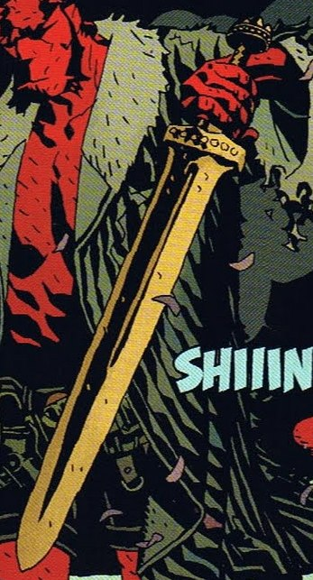

Excalibur2.jpg

**王者之剑（Excalibur）**是[亚瑟王](/entry/King_Arthur)所持的传说之剑。亚瑟死后，这把剑在数百年后重见天日。亚瑟的后裔、不列颠名正言顺的国王——[地狱男爵](/entry/Hellboy_%28character%29)——将它从石头中拔了出来。

地狱男爵持有王者之剑的时间不长，其中最著名的一战是用这把剑斩杀了[妮缪](/entry/Nimue)的勇士。然而，当地狱男爵决定独自面对妮缪后，他把剑交给[爱丽丝·莫娜汉](/entry/Alice_Monaghan)保管。爱丽丝后来把剑呈给[乔治·沃什布鲁克](/entry/George_Washbrook)，后者用王者之剑率领不列颠高贵的亡者投入战斗，对抗妮缪的大军。战斗结束后，据说王者之剑又回到了传说之境。
